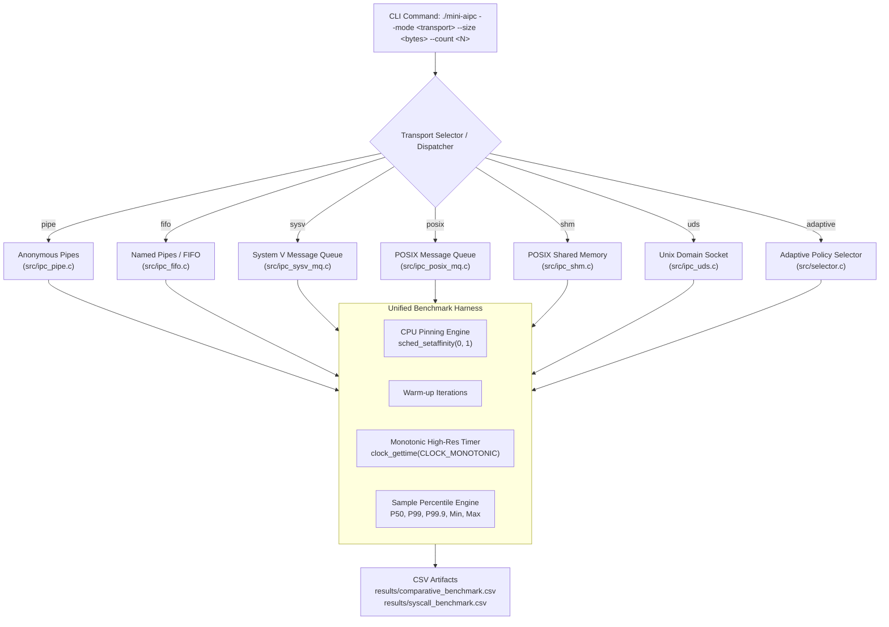

# Mini A-IPC: Classical Linux IPC Research Benchmarking Suite

A comprehensive C and Linux interprocess communication (IPC) research and benchmarking framework developed for Ubuntu Linux on WSL2.

Mini A-IPC implements, tests, and evaluates all **six classical Linux IPC mechanisms** analyzed in high-performance computing (HPC) research:

1. **Anonymous Pipes** (`--mode pipe`)
2. **Named Pipes / FIFOs** (`--mode fifo` and standalone utility `bin/ipc_fifo`)
3. **System V Message Queues** (`--mode sysv`)
4. **POSIX Message Queues** (`--mode posix`)
5. **POSIX Shared Memory with Semaphores** (`--mode shm`)
6. **Unix Domain Stream Sockets** (`--mode uds`)

Additionally, it preserves the **adaptive payload-size selector** (`--mode adaptive`) and the custom **Linux kernel character-device mailbox module** (`/dev/aipc`).

---

## 1. Research Grounding

This benchmark framework implements the experimental requirements established in:

> Danyliuk, I. M., *"Classical Interprocess Communication Mechanisms in Linux OS: Review and Latency Analysis for HPC Scenarios"*, SWorldJournal, Issue 37 / Part 2 (2026), DOI: [10.30888/2663-5712.2026-37-02-028](https://doi.org/10.30888/2663-5712.2026-37-02-028).

Key research requirements:
- **Consistent Request-Response Workload**: Parent producer sends a message of size `S`, child consumer receives and echoes the message back, and parent validates byte-level integrity.
- **Payload Sweep**: Benchmarks across small HPC message payloads: `64, 128, 256, 512, 1024` bytes.
- **Fine-Grained Latency Distributions**: Captures empirical per-exchange latency samples to compute **Median (P50)**, **P99**, **P99.9**, **Minimum**, and **Maximum** latencies alongside throughput.
- **CPU Affinity Pinning**: Uses `sched_setaffinity()` to bind producer (CPU 0) and consumer (CPU 1), eliminating process migration noise.
- **Cache Warm-up**: Pre-warms CPU caches and branch predictors before timing.
- **System-Call Profiling**: Uses `strace -f -c` to quantify communication-path system calls vs. process lifecycle calls.

---

## 2. Architecture



---

## 3. Overview of the Six IPC Mechanisms

| Mechanism | Source File | Key System Calls | Synchronization | Data Transfer Overhead |
|---|---|---|---|---|
| **Anonymous Pipe** | [`src/ipc_pipe.c`](src/ipc_pipe.c) | `pipe()`, `read()`, `write()`, `close()` | Implicit blocking stream I/O | 2 copies: User $\rightarrow$ Kernel buffer $\rightarrow$ User |
| **Named Pipe (FIFO)** | [`src/ipc_fifo.c`](src/ipc_fifo.c) | `mkfifo()`, `open()`, `read()`, `write()`, `unlink()` | Rendezvous on blocking `open()` | 2 copies: User $\rightarrow$ Kernel buffer $\rightarrow$ User |
| **System V MQ** | [`src/ipc_sysv_mq.c`](src/ipc_sysv_mq.c) | `msgget()`, `msgsnd()`, `msgrcv()`, `msgctl()` | Discrete message types (`mtype`) | 2 copies: Message queue struct copy |
| **POSIX MQ** | [`src/ipc_posix_mq.c`](src/ipc_posix_mq.c) | `mq_open()`, `mq_send()`, `mq_receive()`, `mq_unlink()` | Message priorities + queue limits | 2 copies: Virtual filesystem buffer copy |
| **Shared Memory** | [`src/ipc_shm.c`](src/ipc_shm.c) | `shm_open()`, `mmap()`, `sem_wait()`, `sem_post()` | 4 POSIX process-shared semaphores | **Zero kernel copy** (direct memory copy) |
| **Unix Domain Socket** | [`src/ipc_uds.c`](src/ipc_uds.c) | `socket()`, `bind()`, `listen()`, `connect()`, `accept()`, `send()`, `recv()` | Full-duplex connection handshake | 2 copies: Socket stream buffer copy |

---

## 4. Build Instructions

The project uses standard Linux C11 with POSIX 2008 and GNU extensions (`gcc`, `-pthread`, `-lrt`). No third-party frameworks or external dependencies are required.

```bash
# Build all executables: mini-aipc, mini-aipc-mixed, aipc-client, bin/ipc_fifo
make clean
make
```

---

## 5. Execution Commands

### A. Unified Multi-Mode CLI (`./mini-aipc`)

```bash
# 1. Anonymous Pipes
./mini-aipc --mode pipe --size 64 --count 10000

# 2. Named Pipes (FIFO)
./mini-aipc --mode fifo --size 64 --count 10000

# 3. System V Message Queues
./mini-aipc --mode sysv --size 64 --count 10000

# 4. POSIX Message Queues
./mini-aipc --mode posix --size 64 --count 10000

# 5. POSIX Shared Memory
./mini-aipc --mode shm --size 64 --count 10000

# 6. Unix Domain Stream Sockets
./mini-aipc --mode uds --size 64 --count 10000

# 7. Adaptive Transport Selector (selects shm for <=1024 B, pipe for >1024 B)
./mini-aipc --mode adaptive --size 16384 --count 10000
```

### Advanced Benchmark Options
```bash
# Pin producer to CPU 0, consumer to CPU 1, with 500 untimed warm-up exchanges
./mini-aipc --mode uds --size 256 --count 10000 --warmup 500 --cpu-producer 0 --cpu-consumer 1

# Output result directly as a CSV line:
./mini-aipc --mode shm --size 64 --count 10000 --csv --trial 1
```

### B. Standalone FIFO Executable
```bash
./bin/ipc_fifo
./bin/ipc_fifo --size 128 --count 5000
```

---

## 6. Automated Testing

Mini A-IPC includes an extensive automated verification test suite checking communication correctness, multi-size payload integrity, argument validation, child exit fault recovery, and filesystem/kernel resource cleanup:

```bash
# Run CLI correctness and fault injection tests
make test

# Run regression test suite (verifies script syntax, bracket balance, and safety checks)
python tests/final_verification_test.py
```

---

## 7. Comparative Research Benchmarking

Run the complete comparative experiment across all six IPC mechanisms and all five payload sizes:

```bash
# Run with default settings (10,000 exchanges, 5 trials, 500 warm-up exchanges)
bash ./bench/run_comparative.sh

# Or customize execution parameters:
COUNT=5000 TRIALS=3 WARMUP=100 CPU_PRODUCER=0 CPU_CONSUMER=1 bash ./bench/run_comparative.sh
```

### Benchmark Outputs:
1. `results/comparative_benchmark.csv`:
   Empirical RTT latency measurements, including:
   - `avg_rtt_us`: Arithmetic mean round-trip time in microseconds.
   - `p50_rtt_us`: Median latency (P50).
   - `p99_rtt_us`: 99th percentile tail latency.
   - `p999_rtt_us`: 99.9th percentile tail latency.
   - `min_rtt_us`: Minimum observed round-trip latency.
   - `max_rtt_us`: Maximum observed round-trip latency.
   - `throughput_msg_sec`: Message exchanges per second.
2. `results/syscall_benchmark.csv`:
   Kernel system-call counts profiled via `strace -f -c`, separating communication data-path system calls from process setup and cleanup.
3. `results/environment.txt`:
   Full record of CPU model, Linux kernel, WSL version, compiler version, and build flags.

---

## 8. Viva Voce & Defense Guide (For B.Tech CSE Students)

### Q1: Why does Shared Memory outperform all other IPC mechanisms in latency?
**Answer**: Shared memory maps physical memory pages into both processes' virtual address spaces (`mmap(MAP_SHARED)`). Once mapped, writing and reading data occurs directly in RAM at memory bus speeds with **zero kernel copies**. In contrast, pipes, message queues, and sockets require two kernel copies (user buffer $\rightarrow$ kernel space $\rightarrow$ peer user buffer) and two system calls per message transfer.

### Q2: What is the difference between System V and POSIX Message Queues?
**Answer**:
- **System V (`msgget`, `msgsnd`, `msgrcv`)**: Uses integer keys (`IPC_PRIVATE`) and identifiers (`msqid`). Messages carry an integer type field (`mtype`), allowing processes to filter and selectively dequeue messages out of order.
- **POSIX (`mq_open`, `mq_send`, `mq_receive`)**: Uses filesystem-style names (e.g. `/mini_aipc_req`), returns standard file descriptor-like handles (`mqd_t`), supports message priority (higher priorities dequeued first), and exposes virtual filesystem inspection via `/dev/mqueue`.

### Q3: What is the difference between an Anonymous Pipe and a Named Pipe (FIFO)?
**Answer**:
- **Anonymous Pipe (`pipe()`)**: Unnamed kernel buffer that exists only in memory while its file descriptors remain open. It can only connect processes with common ancestry (parent/child created via `fork()`).
- **FIFO (`mkfifo()`)**: Exists as an explicit directory entry in the filesystem (`S_IFIFO`). Unrelated processes can open it by pathname. It persists until explicitly removed via `unlink()`.

### Q4: Why are latency percentiles (P50, P99, P99.9) more important than the average in HPC?
**Answer**: In distributed and high-performance computing, the overall completion time of parallel tasks (e.g. MPI barriers, map-reduce) is dictated by the **slowest process (straggler effect)**. The arithmetic average conceals tail latency spikes caused by CPU scheduler preemption, TLB shootdowns, and hardware interrupts. The 99th and 99.9th percentiles reveal how the IPC mechanism behaves under worst-case contention.

### Q5: How many system calls are executed per round-trip exchange?
**Answer**:
- For **Pipes, FIFOs, System V MQ, POSIX MQ, and Unix Domain Sockets**: Exactly **4 system calls per round-trip exchange** (2 for request: producer write/send + consumer read/recv; 2 for response: consumer write/send + producer read/recv). This equals 2 system calls per one-way message.
- For **Shared Memory**: Synchronization uses semaphores implemented with Linux `futex`. In the fast path, atomic assembly instructions (`lock cmpxchg`) operate entirely in user space. The `futex` system call is invoked **only when a thread must sleep or wake due to contention**, resulting in far lower system-call overhead.
