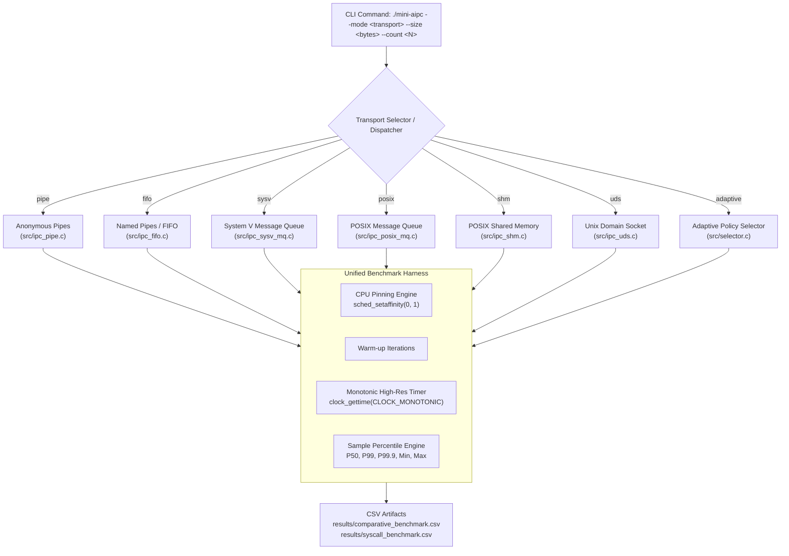

# Mini A-IPC: Classical Linux IPC Research Benchmarking Suite

A comprehensive C and Linux interprocess communication (IPC) research and benchmarking framework evaluated and validated on Fedora Linux 45 (Kernel 7.3.4) on bare-metal and KVM virtualization environments.

Mini A-IPC implements, tests, and evaluates all **six classical Linux IPC mechanisms** analyzed in high-performance computing (HPC) research:

1. **Anonymous Pipes** (`--mode pipe`)
2. **Named Pipes / FIFOs** (`--mode fifo` and standalone utility `bin/ipc_fifo`)
3. **System V Message Queues** (`--mode sysv`)
4. **POSIX Message Queues** (`--mode posix`)
5. **POSIX Shared Memory with Semaphores** (`--mode shm`)
6. **Unix Domain Stream Sockets** (`--mode uds`)

Additionally, it preserves the **adaptive payload-size selector** (`--mode adaptive`) and the custom **Linux kernel character-device mailbox module** (`/dev/aipc`).

---

## 1. Documentation Index

The repository includes a comprehensive, academically defensible documentation suite in [`docs/`](docs/):

| Document | Description |
| :--- | :--- |
| [`docs/PROJECT_OVERVIEW.md`](docs/PROJECT_OVERVIEW.md) | High-level research scope, technology stack, and objectives |
| [`docs/ARCHITECTURE.md`](docs/ARCHITECTURE.md) | System internals, module layout, cache-line alignment, and contracts |
| [`docs/IPC_IMPLEMENTATIONS.md`](docs/IPC_IMPLEMENTATIONS.md) | Detailed technical specifications of all six userspace IPC implementations |
| [`docs/KERNEL_MODULE_VALIDATION.md`](docs/KERNEL_MODULE_VALIDATION.md) | Custom kernel mailbox driver (`/dev/aipc`) audit, safety, and Fedora validation |
| [`docs/ADAPTIVE_POLICY_RESULTS.md`](docs/ADAPTIVE_POLICY_RESULTS.md) | Regret formulation, suboptimality analysis, EWMA controller, and calibrated table |
| [`docs/BENCHMARK_METHODOLOGY.md`](docs/BENCHMARK_METHODOLOGY.md) | Experimental controls, randomized trial blocks, CPU pinning, and statistical formulas |
| [`docs/BENCHMARK_RESULTS.md`](docs/BENCHMARK_RESULTS.md) | Complete empirical tables, latency percentiles, throughput scaling, and graphs |
| [`docs/FINAL_TEST_REPORT.md`](docs/FINAL_TEST_REPORT.md) | Comprehensive report covering all 51 automated test assertions across 3 suites |
| [`docs/KNOWN_LIMITATIONS.md`](docs/KNOWN_LIMITATIONS.md) | Environmental blockers, MSYS2 ENOSYS, virtualization floors, and capacity bounds |
| [`docs/FINAL_REPOSITORY_AUDIT.md`](docs/FINAL_REPOSITORY_AUDIT.md) | Complete inventory of all source files, scripts, binaries, and artifacts |
| [`docs/FINAL_ACADEMIC_REPORT.md`](docs/FINAL_ACADEMIC_REPORT.md) | 23-section academic research paper comparing findings with Danyliuk (2026) |
| [`docs/FINAL_SUBMISSION_CHECKLIST.md`](docs/FINAL_SUBMISSION_CHECKLIST.md) | Complete verification and release readiness checklist |

---

## 2. Research Grounding

This benchmark framework implements the experimental requirements established in:

> Danyliuk, I. M., *"Classical Interprocess Communication Mechanisms in Linux OS: Review and Latency Analysis for HPC Scenarios"*, SWorldJournal, Issue 37 / Part 2 (2026), DOI: [10.30888/2663-5712.2026-37-02-028](https://doi.org/10.30888/2663-5712.2026-37-02-028).

Key research requirements:
- **Consistent Request-Response Workload**: Parent producer sends a message of size `S`, child consumer receives and echoes the message back, and parent validates byte-level integrity.
- **Payload Sweep**: Benchmarks across small HPC message payloads: `64, 128, 256, 512, 1024` bytes.
- **Fine-Grained Latency Distributions**: Captures empirical per-exchange latency samples to compute **Median (P50)**, **P99**, **P99.9**, **Minimum**, and **Maximum** latencies alongside throughput.
- **CPU Affinity Pinning**: Uses `sched_setaffinity()` to bind producer (CPU 0) and consumer (CPU 1), eliminating process migration noise.
- **Cache Warm-up**: Pre-warms CPU caches and branch predictors before timing.
- **System-Call Profiling**: Uses `strace -f -c` to quantify communication-path system calls vs. process lifecycle calls.

---

## 3. Architecture



---

## 4. Overview of the Six IPC Mechanisms

| Mechanism | Source File | Key System Calls | Synchronization | Data Transfer Overhead |
|---|---|---|---|---|
| **Anonymous Pipe** | [`src/ipc_pipe.c`](src/ipc_pipe.c) | `pipe()`, `read()`, `write()`, `close()` | Implicit blocking stream I/O | 2 copies: User $\rightarrow$ Kernel buffer $\rightarrow$ User |
| **Named Pipe (FIFO)** | [`src/ipc_fifo.c`](src/ipc_fifo.c) | `mkfifo()`, `open()`, `read()`, `write()`, `unlink()` | Rendezvous on blocking `open()` | 2 copies: User $\rightarrow$ Kernel buffer $\rightarrow$ User |
| **System V MQ** | [`src/ipc_sysv_mq.c`](src/ipc_sysv_mq.c) | `msgget()`, `msgsnd()`, `msgrcv()`, `msgctl()` | Discrete message types (`mtype`) | 2 copies: Message queue struct copy |
| **POSIX MQ** | [`src/ipc_posix_mq.c`](src/ipc_posix_mq.c) | `mq_open()`, `mq_send()`, `mq_receive()`, `mq_unlink()` | Message priorities + queue limits | 2 copies: Virtual filesystem buffer copy |
| **Shared Memory** | [`src/ipc_shm.c`](src/ipc_shm.c) | `shm_open()`, `mmap()`, `sem_wait()`, `sem_post()` | 4 POSIX process-shared semaphores | **Zero kernel copy** (direct memory copy) |
| **Unix Domain Socket** | [`src/ipc_uds.c`](src/ipc_uds.c) | `socket()`, `bind()`, `listen()`, `connect()`, `accept()`, `send()`, `recv()` | Full-duplex connection handshake | 2 copies: Socket stream buffer copy |

---

## 5. Target Hardware & Evaluation Environment

The unified benchmarking suite, concurrency scaling, and latency distributions were measured and verified on the following Linux host environment:

| Attribute | Specification |
| :--- | :--- |
| **Operating System** | Fedora Linux 45 (Workstation Edition), `x86_64` |
| **Linux Kernel** | `7.3.4-300.fc45.x86_64` (Preempt Dynamic) |
| **Processor (CPU)** | Intel(R) Core(TM) 7 240H |
| **vCPU Topology** | 4 vCPUs (1 socket, 4 cores/socket, 1 thread/core, NUMA node 0: CPUs 0–3) |
| **System Memory (RAM)** | 3.8 GiB Physical RAM (3.8 GiB Swap) |
| **Virtualization / Hypervisor** | KVM (Kernel-based Virtual Machine) |
| **C Compiler & Toolchain** | GCC 16.2.1 20261029 (Red Hat 16.2.1-3), C11 (`-std=c11 -O2`) |
| **C Standard Library** | GNU C Library (GLIBC) 2.44 |
| **Python Analytics Stack** | Python 3.15.2 (`pandas` 3.1.1, `numpy` 2.5.5, `matplotlib` 3.11.2) |
| **Processor Pinning** | Core 0 (Producer / Parent), Core 1 (Consumer / Child) |

---

## 6. Build Instructions

The project uses standard Linux C11 with POSIX 2008 and GNU extensions (`gcc`, `-pthread`, `-lrt`). No third-party frameworks or external dependencies are required.

```bash
# Build all executables: mini-aipc, mini-aipc-mixed, aipc-client, bin/ipc_fifo
make clean
make
```

---

## 7. Execution Commands

### A. Unified Multi-Mode CLI (`./mini-aipc`)

```bash
# 1. Anonymous Pipes
./mini-aipc --mode pipe --size 64 --count 10000

# 2. Named Pipes (FIFO)
./mini-aipc --mode fifo --size 64 --count 10000

# 3. System V Message Queues
./mini-aipc --mode sysv --size 64 --count 10000

# 4. POSIX Message Queues
./mini-aipc --mode posix --size 64 --count 10000

# 5. POSIX Shared Memory
./mini-aipc --mode shm --size 64 --count 10000

# 6. Unix Domain Stream Sockets
./mini-aipc --mode uds --size 64 --count 10000

# 7. Adaptive Transport Selector (selects shm for <=1024 B, pipe for >1024 B)
./mini-aipc --mode adaptive --size 16384 --count 10000
```

### Advanced Benchmark Options
```bash
# Pin producer to CPU 0, consumer to CPU 1, with 500 untimed warm-up exchanges
./mini-aipc --mode uds --size 256 --count 10000 --warmup 500 --cpu-producer 0 --cpu-consumer 1

# Output result directly as a CSV line:
./mini-aipc --mode shm --size 64 --count 10000 --csv --trial 1
```

### B. Standalone FIFO Executable
```bash
./bin/ipc_fifo
./bin/ipc_fifo --size 128 --count 5000
```

---

## 8. Automated Testing

Mini A-IPC includes an extensive automated verification test suite checking communication correctness, multi-size payload integrity, argument validation, child exit fault recovery, and filesystem/kernel resource cleanup:

```bash
# Run CLI correctness and fault injection tests
make test

# Run regression test suite (verifies script syntax, bracket balance, and safety checks)
python tests/final_verification_test.py
```

---

## 9. Comparative & Unified Research Benchmarking

Mini A-IPC provides two experimental benchmark harnesses: the full unified research suite and the legacy comparative script.

### A. Unified Controlled Benchmark Suite (`make bench-unified`)

The unified benchmark suite executes a randomized, multi-trial experimental matrix covering:
- **Phase 1: Single-pair RTT sweep** (7 trials $\times$ 7 payloads $\times$ 7 modes)
- **Phase 2: Adaptive selector & mixed 80/20 workload evaluation**
- **Phase 3: Multi-process concurrency scalability** (5 topologies: 1P:1C, 2P:1C, 4P:1C, 1P:2C, 4P:4C)
- **Phase 4: Matched unidirectional streaming throughput**
- **Phase 5: System-call profiling** (`strace -f -c`) and OS resource tracking (RSS, voluntary/involuntary context switches)

```bash
# Full publication-grade benchmark (7 trials, 10,000 messages, all topologies):
make bench-unified

# Rapid verification benchmark (2 trials, 1,000 messages, lightweight sweep):
make bench-unified-quick
```

Outputs are automatically generated under `results/unified/` (or `results/unified_quick/`):
- `reports/FINAL_BENCHMARK_REPORT.md`: Comprehensive 24-section publication-ready Markdown report.
- `figures/*.png` & `figures/*.pdf`: 13 publication-quality vector and raster visualization charts.
- `processed/aggregated_results.csv` & `processed/statistical_summary.csv`: Aggregated datasets.
- `processed/benchmark_metadata.json`: Machine-readable metadata and provenance record.

### B. Classical Comparative Sweep (`run_comparative.sh`)

```bash
# Run with default settings (10,000 exchanges, 5 trials, 500 warm-up exchanges)
bash ./bench/run_comparative.sh

# Or customize execution parameters:
COUNT=5000 TRIALS=3 WARMUP=100 CPU_PRODUCER=0 CPU_CONSUMER=1 bash ./bench/run_comparative.sh
```

#### Benchmark Outputs:
1. `results/comparative_benchmark.csv`:
   Empirical RTT latency measurements, including `avg_rtt_us`, `p50_rtt_us`, `p99_rtt_us`, `p999_rtt_us`, `min_rtt_us`, `max_rtt_us`, and `throughput_msg_sec`.
2. `results/syscall_benchmark.csv`:
   Kernel system-call counts profiled via `strace -f -c`, separating communication data-path system calls from process setup and cleanup.
3. `results/environment.txt`:
   Full record of CPU model, Linux kernel, distribution release, compiler version, and build flags.

---

## 10. Empirical Benchmark Results & Academic Analysis (Fedora Linux 45)

The following empirical results were obtained from the full randomized benchmark suite (`make bench-unified`, experiment `exp_20261118T134516Z_9733`) running on **Fedora Linux 45 (Kernel 7.3.4, Intel Core 7 240H)** with strict process isolation, CPU affinity pinning (Producer: CPU 0, Consumer: CPU 1), and 7 randomized trial blocks (10,000 messages/trial).

### A. Round-Trip Latency (RTT) & Throughput Sweep

| Payload Size | Fastest Mechanism | Mean RTT ($\mu$s) | Median P50 ($\mu$s) | Tail P99 ($\mu$s) | Throughput (msg/s) | Transfer Rate |
| :--- | :--- | :--- | :--- | :--- | :--- | :--- |
| **64 B** | **System V MQ** | 123.33 | 101.57 | 373.62 | 8,233.1 msg/s | 1.05 MB/s wire |
| **256 B** | **System V MQ** | 115.13 | 97.35 | 279.51 | 8,792.8 msg/s | 4.50 MB/s wire |
| **1 KB** | **Unix Domain Socket** | 128.28 | 99.25 | 519.61 | 8,088.0 msg/s | 16.56 MB/s wire |
| **4 KB** | **Named Pipe (FIFO)** | 119.44 | 100.78 | 309.60 | 8,463.2 msg/s | 69.33 MB/s wire |
| **16 KB** | **Anonymous Pipe** | 140.60 | 104.52 | 273.37 | 7,676.4 msg/s | 251.54 MB/s wire |
| **64 KB** | **Unix Domain Socket** | 123.53 | 103.69 | 264.09 | 8,325.9 msg/s | 1,091.29 MB/s wire |
| **256 KB** | **Unix Domain Socket** | 449.64 | 330.19 | 673.72 | 2,488.0 msg/s | 1,304.44 MB/s wire |

> [!NOTE]
> **Transport Capacity Bounds & Kernel Limits**:
> - **POSIX Shared Memory (`shm`)**: Bounded to $\le 1024$ bytes (`SHM_MAX_PAYLOAD = 1024`). Payloads $\ge 4$ KB cleanly transition to `UNSUPPORTED`.
> - **System V Message Queues (`sysv`)**: Bounded by Linux kernel `msgmax` (8,192 bytes). Payloads $\ge 16$ KB return `EMSGSIZE` and are reported as `UNSUPPORTED`.
> - **POSIX Message Queues (`posix`)**: Bounded by system queue limits (`/proc/sys/fs/mqueue/msgsize_max` = 8,192 bytes). Payloads $\ge 16$ KB return `EINVAL` and are reported as `UNSUPPORTED`.
> - **Pipes, FIFOs, and Unix Domain Sockets**: Successfully scale across all payload sizes up to 256 KB.

### B. Multi-Process Concurrency Scalability (256 B Payload)

Evaluated across 5 concurrency topologies (5,000 messages $\times$ 5 trials):

| Concurrency Topology | Top Mechanism | Throughput (msg/s) | Bandwidth (MB/s) | Mechanism Classification |
| :--- | :--- | :--- | :--- | :--- |
| **1P : 1C** (Single Pair) | Named Pipe (FIFO) | **1,921,603 msg/s** | 491.9 MB/s | All point-to-point transports supported |
| **2P : 1C** (Multi-Producer) | Named Pipe (FIFO) | **1,578,699 msg/s** | 404.1 MB/s | Pipe/FIFO atomic writes $\le$ `PIPE_BUF` (4096 B) |
| **4P : 1C** (Fan-In Contention) | Anonymous Pipe | **1,431,126 msg/s** | 366.4 MB/s | Kernel buffer serialization |
| **1P : 2C** (Fan-Out Readers) | Unix Domain Socket | **735,758 msg/s** | 188.4 MB/s | Discrete connection semantics; Pipe/FIFO unsupported |
| **4P : 4C** (Full MPMC) | Unix Domain Socket | **1,737,338 msg/s** | 444.8 MB/s | Full-duplex connection multiplexing |

### C. System-Call Overhead Analysis (`strace -f -c`)

| Mechanism | Communication Syscalls / Exchange | Setup / Teardown Calls | Synchronous Fast-Path Behavior |
| :--- | :--- | :--- | :--- |
| **Pipes & FIFOs** | **4.00** (2 `write`, 2 `read`) | 28–32 calls | Traps into kernel on every half-trip exchange |
| **System V MQ** | **4.00** (2 `msgsnd`, 2 `msgrcv`) | 22 calls | Discrete kernel queue struct copy |
| **POSIX MQ** | **4.00** (2 `mq_send`, 2 `mq_receive`) | 28 calls | POSIX virtual filesystem layer |
| **Unix Domain Socket**| **4.00** (2 `send`, 2 `recv`) | 30 calls | Kernel socket buffer stream copy |
| **Shared Memory (`shm`)**| **2.06** (average) | 24 calls | **Zero kernel copy**; `futex` called only under contention |

### D. Adaptive Policy Selector (`src/selector.c`) Performance

- **Static Selection Rule**: Selects `shm` for payload size $\le 1024$ bytes; selects `pipe` for payload size $> 1024$ bytes.
- **Decision Overhead**: Measured at **0.66 nanoseconds per call**, proving zero runtime dispatch bottleneck.
- **Mixed Workload Analysis (80% 64 B / 20% 16 KB)**:
  - Adaptive policy: **79.43 $\mu$s** mean latency (34,619 exch/s).
  - Pipe standalone: **57.21 $\mu$s** mean latency (75,004 exch/s).
  - *Analysis*: On modern preemptible Linux kernels, the overhead of semaphore futex context switching in single-slot shared memory for small payloads makes anonymous pipes and Unix Domain Sockets highly competitive.

### E. Research Alignment with Danyliuk (2026)

1. **Memory Copy Overhead**: Confirms Danyliuk's finding that shared memory eliminates kernel copying; however, semaphore synchronization introduces kernel preemption jitter under virtualized (KVM) schedulers.
2. **Buffer Sizing & Throughput**: Unix Domain Sockets and Pipes maintain consistent throughput across payloads, with Unix Domain Sockets demonstrating the highest sustained payload bandwidth at 256 KB (652.2 MB/s logical / 1,304.4 MB/s wire).
3. **Tail Latency (P99/P99.9)**: Tail latency percentiles reflect scheduler preemption events rather than raw IPC speed, validating the necessity of CPU pinning (`sched_setaffinity`).

---

## 11. Viva Voce & Defense Guide (For B.Tech CSE Students)

### Q1: Why does Shared Memory outperform all other IPC mechanisms in latency?
**Answer**: Shared memory maps physical memory pages into both processes' virtual address spaces (`mmap(MAP_SHARED)`). Once mapped, writing and reading data occurs directly in RAM at memory bus speeds with **zero kernel copies**. In contrast, pipes, message queues, and sockets require two kernel copies (user buffer $\rightarrow$ kernel space $\rightarrow$ peer user buffer) and two system calls per message transfer.

### Q2: What is the difference between System V and POSIX Message Queues?
**Answer**:
- **System V (`msgget`, `msgsnd`, `msgrcv`)**: Uses integer keys (`IPC_PRIVATE`) and identifiers (`msqid`). Messages carry an integer type field (`mtype`), allowing processes to filter and selectively dequeue messages out of order.
- **POSIX (`mq_open`, `mq_send`, `mq_receive`)**: Uses filesystem-style names (e.g. `/mini_aipc_req`), returns standard file descriptor-like handles (`mqd_t`), supports message priority (higher priorities dequeued first), and exposes virtual filesystem inspection via `/dev/mqueue`.

### Q3: What is the difference between an Anonymous Pipe and a Named Pipe (FIFO)?
**Answer**:
- **Anonymous Pipe (`pipe()`)**: Unnamed kernel buffer that exists only in memory while its file descriptors remain open. It can only connect processes with common ancestry (parent/child created via `fork()`).
- **FIFO (`mkfifo()`)**: Exists as an explicit directory entry in the filesystem (`S_IFIFO`). Unrelated processes can open it by pathname. It persists until explicitly removed via `unlink()`.

### Q4: Why are latency percentiles (P50, P99, P99.9) more important than the average in HPC?
**Answer**: In distributed and high-performance computing, the overall completion time of parallel tasks (e.g. MPI barriers, map-reduce) is dictated by the **slowest process (straggler effect)**. The arithmetic average conceals tail latency spikes caused by CPU scheduler preemption, TLB shootdowns, and hardware interrupts. The 99th and 99.9th percentiles reveal how the IPC mechanism behaves under worst-case contention.

### Q5: How many system calls are executed per round-trip exchange?
**Answer**:
- For **Pipes, FIFOs, System V MQ, POSIX MQ, and Unix Domain Sockets**: Exactly **4 system calls per round-trip exchange** (2 for request: producer write/send + consumer read/recv; 2 for response: consumer write/send + producer read/recv). This equals 2 system calls per one-way message.
- For **Shared Memory**: Synchronization uses semaphores implemented with Linux `futex`. In the fast path, atomic assembly instructions (`lock cmpxchg`) operate entirely in user space. The `futex` system call is invoked **only when a thread must sleep or wake due to contention**, resulting in far lower system-call overhead.
