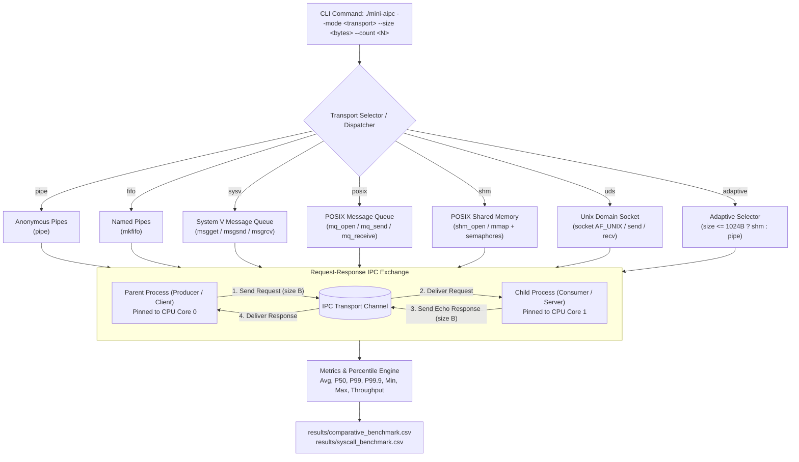

# Mini A-IPC: Architecture and Design

## 1. Overview and Process Model

Mini A-IPC evaluates and compares six classical Linux Interprocess Communication (IPC) mechanisms alongside an adaptive payload-size selector and a custom kernel mailbox character device.

The benchmark executes an identical request-response (round-trip ping-pong) communication pattern across all transports:
1. **Parent Process (Producer / Client)**: Prepares a request buffer with a deterministic pseudo-random byte pattern, writes the message across the IPC channel to the child, and waits for a response.
2. **Child Process (Consumer / Server)**: Waits for the incoming message on the IPC channel, verifies or echoes the payload, and writes the response back to the parent.
3. **Data Integrity & Timing**: The parent receives the response, compares every byte against the expected pattern, and accumulates high-resolution round-trip latency using `clock_gettime(CLOCK_MONOTONIC)`.

By maintaining a single parent-child process pair across all message exchanges within a trial, process creation (`fork()`) and channel initialization overhead are excluded from the steady-state per-message latency and throughput measurements.

---

## 2. Architecture Diagram



---

## 3. The Six IPC Mechanisms: Implementation Details

### A. Anonymous Pipes (`src/ipc_pipe.c`)
- **System Calls**: `pipe()`, `read()`, `write()`, `close()`.
- **Channel Topology**: Unidirectional kernel ring buffer (default 64 KiB capacity in Linux).
- **Bidirectional Setup**: Requires two pipes:
  - `request_pipe[2]`: Parent writes requests (`request_pipe[1]`); Child reads requests (`request_pipe[0]`).
  - `response_pipe[2]`: Child writes responses (`response_pipe[1]`); Parent reads responses (`response_pipe[0]`).
- **Synchronization**: Implicitly synchronized by blocking stream I/O.
- **Robustness**: Parent and child close unused descriptor ends immediately after `fork()`. `SIGPIPE` is ignored with `sigaction(SIGPIPE, SIG_IGN)` to prevent process termination on broken pipes; read/write loops handle `EINTR` and partial transfers via `read_all()` and `write_all()`.

### B. Named Pipes / FIFOs (`src/ipc_fifo.c`)
- **System Calls**: `mkfifo()`, `open()`, `read()`, `write()`, `close()`, `unlink()`.
- **Channel Topology**: Filesystem directory node (`S_IFIFO`) pointing to a kernel-managed FIFO buffer in memory.
- **Bidirectional Setup**: Requires two unique filesystem paths in `/tmp` created with permission `0600` (user read/write only):
  - `/tmp/mini_aipc_req_<pid>.fifo`: Parent WRONLY, Child RDONLY.
  - `/tmp/mini_aipc_resp_<pid>.fifo`: Child WRONLY, Parent RDONLY.
- **Deadlock Prevention**: Rendezvous order is strictly synchronized:
  - Child opens `req_fifo` (RDONLY), then `resp_fifo` (WRONLY).
  - Parent opens `req_fifo` (WRONLY), then `resp_fifo` (RDONLY).
- **Resource Cleanup**: Both FIFO nodes are unlinked on normal exit or failure, ensuring zero persistent filesystem leaks. A standalone executable (`bin/ipc_fifo`) provides independent testing and demonstration.

### C. System V Message Queues (`src/ipc_sysv_mq.c`)
- **System Calls**: `msgget()`, `msgsnd()`, `msgrcv()`, `msgctl()`.
- **Channel Topology**: Kernel-resident linked list of typed message packets identified by an integer queue ID (`msqid`).
- **Queue Creation**: Created using `IPC_PRIVATE` with flags `IPC_CREAT | IPC_EXCL | 0600`, ensuring an isolated, private queue accessible only by the creating process and its children.
- **Bidirectional Protocol**:
  - Request messages: tagged with `mtype = MSG_TYPE_REQ` (1).
  - Response messages: tagged with `mtype = MSG_TYPE_RESP` (2).
  - Child receives only type 1 messages; Parent receives only type 2 messages.
- **Failure Recovery**: A `SIGCHLD` handler installed without `SA_RESTART` ensures that if the child terminates prematurely, the parent's blocking `msgrcv()` returns immediately with `EINTR`, preventing hangs. The queue is explicitly removed on exit via `msgctl(msqid, IPC_RMID, NULL)`.

### D. POSIX Message Queues (`src/ipc_posix_mq.c`)
- **System Calls**: `mq_open()`, `mq_send()`, `mq_receive()`, `mq_close()`, `mq_unlink()`.
- **Channel Topology**: Kernel-resident message queues accessible via names in the POSIX IPC namespace (virtual filesystem mounted at `/dev/mqueue`).
- **Queue Configuration**:
  - `mq_maxmsg = 10`: Standard Linux unprivileged message queue depth ceiling (`/proc/sys/fs/mqueue/msg_max`).
  - `mq_msgsize = payload_size`: Explicitly sized to the message payload. POSIX mandates that receive buffers passed to `mq_receive()` must be at least `mq_msgsize`, otherwise failing with `EMSGSIZE`.
- **Bidirectional Setup**: Requires two queue descriptors:
  - `/mini_aipc_req_<pid>`: Parent sends requests; child receives requests.
  - `/mini_aipc_resp_<pid>`: Child sends responses; parent receives responses.
- **Cleanup**: Unlinked immediately via `mq_unlink()` upon teardown so that memory resources are freed when descriptors close.

### E. POSIX Shared Memory with Semaphores (`src/ipc_shm.c`)
- **System Calls**: `shm_open()`, `ftruncate()`, `mmap()`, `munmap()`, `close()`, `shm_unlink()`, `sem_init()`, `sem_wait()`, `sem_post()`, `sem_destroy()`.
- **Channel Topology**: Shared physical memory pages mapped into both parent and child address spaces. Data transfer is true zero-copy in user memory (no kernel buffer copy required).
- **Mailbox Structure**:
  ```c
  typedef struct {
      sem_t request_empty;   /* Initialized to 1 */
      sem_t request_full;    /* Initialized to 0 */
      sem_t response_empty;  /* Initialized to 1 */
      sem_t response_full;   /* Initialized to 0 */
      size_t request_length;
      size_t response_length;
      unsigned char request[1024];
      unsigned char response[1024];
  } shared_mailbox_t;
  ```
- **Synchronization**: Four process-shared POSIX semaphores (`pshared = 1`).
  - Sequence: Wait `request_empty` -> Write request -> Post `request_full` -> Wait `response_full` -> Read response -> Post `response_empty`.
- **Child Monitoring**: The parent uses `sem_timedwait()` with 100 ms polling intervals checking `waitpid(child, WNOHANG)` to avoid deadlocks if the child crashes while holding or waiting for a semaphore.

### F. Unix Domain Stream Sockets (`src/ipc_uds.c`)
- **System Calls**: `socket(AF_UNIX, SOCK_STREAM, 0)`, `bind()`, `listen()`, `accept()`, `connect()`, `send()`, `recv()`, `close()`, `unlink()`.
- **Channel Topology**: Local bidirectional byte-stream socket operating entirely within the Linux kernel networking subsystem without network interface or protocol overhead.
- **Rendezvous Sequence**:
  - The parent creates the server socket, binds to `/tmp/mini_aipc_uds_<pid>.sock`, and initiates `listen(1)` before calling `fork()`. This guarantees the listening socket is active before the client connects.
  - After `fork()`, the child acts as server, calling `accept()` to obtain the connected socket.
  - The parent acts as client, creates a client socket, and calls `connect()`.
- **Stream I/O**: `send_all()` and `recv_all()` handle stream boundaries, partial packets, and `EINTR`. If the child exits, the connection closes, causing parent `recv()` to return 0 (EOF) immediately.

---

## 4. CPU Affinity Pinning (`sched_setaffinity`)

Modern multicore systems experience significant cache bouncing and cross-core synchronization latency when producer and consumer processes migrate between CPU cores during high-frequency IPC.

Mini A-IPC implements CPU pinning using the Linux `sched_setaffinity()` system call:
```c
int set_cpu_affinity(int cpu)
{
    if (cpu < 0) return 0;
    cpu_set_t cpuset;
    CPU_ZERO(&cpuset);
    CPU_SET(cpu, &cpuset);
    return sched_setaffinity(0, sizeof(cpu_set_t), &cpuset);
}
```
- In comparative benchmarking, the parent (producer) is pinned to CPU Core 0, and the child (consumer) is pinned to CPU Core 1.
- Pinning ensures stable cache locality and repeatable timing across trials.
- If CPU affinity is not supported in a constrained environment (e.g. single-core virtual machine), execution continues with an explanatory warning.

---

## 5. Summary Metrics and Percentile Calculation

For every trial of `N` exchanges, Mini A-IPC measures each individual exchange round-trip latency (`\Delta t_i = t_{end,i} - t_{start,i}`) and records it into a dedicated sample array.

After `N` iterations:
- **Average Round-Trip Latency**: `\text{avg} = \frac{\sum \Delta t_i}{N}`
- **Throughput**: `\text{throughput} = \frac{N}{\text{Total Elapsed Time}}`
- **Percentiles**: The sample array is sorted using `qsort()`. Exact percentiles are derived using standard statistical conventions with zero-based array indexing:
  - **P50 (Conventional Median)**:
    - Odd `N`: middle sample at index `N / 2`.
    - Even `N`: average of two middle samples: `\frac{\text{samples}[N / 2 - 1] + \text{samples}[N / 2]}{2.0}`.
  - **Nearest-Rank Percentiles (P99, P99.9)**:
    - Standard nearest-rank formula: 1-based rank `k = \lceil \frac{P}{100} \times N \rceil`, zero-based index `\text{index} = k - 1`.
    - Calculated via overflow-safe integer arithmetic without multiplication:
      - **P99**: `k = \text{count} - \lfloor \text{count} / 100 \rfloor`, zero-based index `\text{index} = k - 1`. For `N = 100`, index is `98` (99th sample).
      - **P99.9**: `k = \text{count} - \lfloor \text{count} / 1000 \rfloor`, zero-based index `\text{index} = k - 1`.
    - Avoiding multiplication (e.g. `count * 99`) guarantees that calculations will not overflow integer limits, even for the maximum possible valid count `SIZE_MAX / sizeof(uint64_t)`.
    - **Small-Sample P99.9 Behavior**: For sample sizes `N < 1000`, `\lfloor \text{count} / 1000 \rfloor = 0`, so `k = N` and index evaluates to `N - 1` (the maximum observed sample), which is mathematically exact since a 99.9th percentile cannot be separated from the maximum without at least 1,000 observations.
  - **Min**: `\text{samples}[0]`
  - **Max**: `\text{samples}[N - 1]`

This eliminates the statistical error of taking "averages of trial averages" and captures the true tail latency caused by kernel context switches and scheduler preemption.
