# Mini A-IPC: Unified IPC Experimental Benchmark Report

- **Experiment ID**: `exp_20261111T154018Z_2004`
- **Generated At (UTC)**: `2026-11-11T15:45:25.780095+00:00`
- **Overall Evaluation Status**: **PARTIAL**
- **Host Environment**: `MSYS2` | Kernel `MSYS_NT-10.0-26200 RamSai 3.5.7-2644508f.x86_64 2025-02-06 19:32 UTC x86_64 Msys` | Arch `AMD64`

## 1. Executive Summary

> [!IMPORTANT]
> Overall benchmark status is **PARTIAL**. Components not fully executed in this environment: `sysv, kernel_aipc`. Because the kernel module and/or blocked transports could not execute on this host, the cross-8-component comparison is explicitly incomplete and missing measurements are reported as `BLOCKED`/`N/A` rather than fabricated.

- **Fastest eligible transport at 64 B**: `pipe` (mean RTT **15.73 us**, P50 **13.10 us**, throughput **63,949.1 msg/s**).
- **Fastest eligible transport at 1 KB**: `pipe` (mean RTT **15.98 us**, P50 **14.35 us**, throughput **62,676.6 msg/s**).
- **Fastest eligible transport at 16 KB**: `pipe` (mean RTT **24.49 us**, P50 **23.20 us**, throughput **40,886.8 msg/s**).
- **Fastest eligible transport at 256 KB**: `posix` (mean RTT **108.09 us**, P50 **96.10 us**, throughput **9,314.0 msg/s**).
- **Adaptive Policy Selector (`src/selector.c`)**: Selection accuracy **28.57%** (vs empirical best mean RTT), mean latency regret **51.83%**, decision overhead **2.36 ns/call**.

## 2. Project Architecture

Mini A-IPC separates transport implementations (`src/ipc_*.c`), adaptive selection policy (`src/selector.c`), kernel mailbox (`kernel/aipc_module.c`), and the unified controlled benchmarking harness (`bench/unified_bench.c` + `bench/run_unified_benchmark.sh`). Primary latency measurements run directly in compiled C using `CLOCK_MONOTONIC` with process-isolated setup/teardown and zero strace/polling overhead inside the timed loop.

## 3. All Eight Components

| ID | Component | Implementation | Status | Status Rationale | Mechanism Semantics |
| --- | --- | --- | --- | --- | --- |
| 1 | Anonymous Pipes | `src/ipc_pipe.c` | **PASS** | All payload sizes and trials passed | Kernel unidirectional ring buffer pair (`pipe()` / `read()` / `write()`). |
| 2 | Named Pipes / FIFO | `src/ipc_fifo.c` | **PASS** | All payload sizes and trials passed | Filesystem-backed kernel FIFO rendezvous (`mkfifo()` / `open()` / `read()` / `write()`). |
| 3 | System V Message Queue | `src/ipc_sysv_mq.c` | **BLOCKED** | sysv unsupported/not implemented in host runtime (ENOSYS) | Kernel discrete typed message queue (`msgget()` / `msgsnd()` / `msgrcv()`). |
| 4 | POSIX Message Queue | `src/ipc_posix_mq.c` | **PASS** | All payload sizes and trials passed | POSIX priority message queues (`mq_open()` / `mq_send()` / `mq_receive()`). |
| 5 | POSIX Shared Memory | `src/ipc_shm.c` | **PASS** | All supported payloads (<= 1024 B) passed; >1024 B cleanly marked UNSUPPORTED (SHM_MAX_PAYLOAD=1024) | Shared memory mapping (`shm_open()` / `mmap()`) + 4 POSIX process-shared semaphores (`<= 1024 B`). |
| 6 | Unix Domain Socket | `src/ipc_uds.c` | **PASS** | All payload sizes and trials passed | Connection-oriented local stream socket (`AF_UNIX`, `SOCK_STREAM`). |
| 7 | Kernel AIPC Module | `kernel/aipc_module.c` | **BLOCKED** | Host OS is MSYS_NT-10.0-26200; Linux kernel build tree unavailable; Host OS is MSYS_NT-10.0-26200; Linux kernel module build and insmod require a Linux kernel | Loadable Linux kernel character device (`/dev/aipc`) ring buffer with mutex & wait queues. |
| 8 | Adaptive Policy Selector | `src/selector.c` | **PASS** | All payload sizes and trials passed | User-space policy selecting `shm` for payloads `<= min(threshold, 1024)` and `pipe` otherwise. |

## 4. Experimental Environment

```text
Mini A-IPC Unified Benchmark Environment
Experiment ID: exp_20261111T154018Z_2004
Environment ID: MSYS_NT-10.0-26200_x86_64_RamSai
Captured at (UTC): 2026-11-11T15:40:18Z

[OS / Kernel]
MSYS_NT-10.0-26200 RamSai 3.5.7-2644508f.x86_64 2025-02-06 19:32 UTC x86_64 Msys
NAME=MSYS2
ID=msys2
PRETTY_NAME="MSYS2"
ID_LIKE="cygwin arch"
HOME_URL="https://www.msys2.org"
BUG_REPORT_URL="https://github.com/msys2/MSYS2-packages/issues"

[CPU]
model name	: AMD Ryzen 7 8845HS w/ Radeon 780M Graphics

[Memory]
MemTotal:       15973576 kB
MemFree:         2754724 kB
HighTotal:             0 kB
HighFree:              0 kB
LowTotal:       15973576 kB
LowFree:         2754724 kB
SwapTotal:      19031700 kB
SwapFree:       17526588 kB

[Compiler & Flags]
gcc (GCC) 13.3.0
CFLAGS := -std=c11 -D_POSIX_C_SOURCE=200809L -D_GNU_SOURCE -Wall -Wextra -Wpedantic -O2 -Iinclude
LDFLAGS := -pthread -lrt -lm

[Python & Libraries]
python: 3.14.3 pandas: 3.0.1 numpy: 2.4.3 matplotlib: 3.10.8

[Instrumentation & Kernel Availability]
CPU affinity status: SUPPORTED and ACTIVE (sched_setaffinity: producer=0, consumer=1)
Kernel headers: UNAVAILABLE (non-Linux host MSYS_NT-10.0-26200)
Linux strace: UNAVAILABLE (host strace is Cygwin/MSYS or absent)
GNU time: /usr/bin/time
Pre-existing aipc_module loaded: NO

[Experiment Parameters]
MESSAGES=1000 WARMUP=100 TRIALS=7 SEED=20261111
PAYLOADS=64,256,1024,4096,16384,65536,262144
CONCURRENCY_MATRIX=1:1,2:1,4:1,1:2,4:4 CONCURRENCY_PAYLOAD=256
THRESHOLD=1024
```

## 5. Hardware and Software Configuration

| Parameter | Observed Value |
| --- | --- |
| Host OS / Subsystem | `MSYS2` (`Windows-11-10.0.26200-SP0`) |
| Kernel Release | `MSYS_NT-10.0-26200 RamSai 3.5.7-2644508f.x86_64 2025-02-06 19:32 UTC x86_64 Msys` |
| CPU Model | `AMD Ryzen 7 8845HS w/ Radeon 780M Graphics` |
| Logical CPUs | `16` |
| Compiler | `gcc (GCC) 13.3.0` |
| Optimization & Flags | `CFLAGS := -std=c11 -D_POSIX_C_SOURCE=200809L -D_GNU_SOURCE -Wall -Wextra -Wpedantic -O2 -Iinclude` |
| Python Runtime | `3.14.3` (`scipy=False`) |
| CPU Affinity Policy | Producer core `0`, Consumer core `1` (`sched_setaffinity`) |

## 6. Benchmark Methodology

- **Sequential execution**: One benchmark configuration runs at a time to eliminate cross-experiment contention.
- **Trial-block randomization**: Within each trial block `1..T`, mechanism execution order is shuffled using deterministic PRNG seed `20261111` (recorded in `benchmark_metadata.json`).
- **Process isolation & cleanup**: Each trial executes in a fresh process invocation, unlinking FIFOs, POSIX MQs, SysV queues, shared memory segments, and UDS sockets before and after each trial.
- **Instrumentation separation**: Primary trials record latency, throughput, and `getrusage()` around the run; per-process RSS sampling, context-switch polling, and syscall tracing execute in a separate profiling pass (`bench/profile_resources.py`).

## 7. Workload Definitions

1. **`single_pair_rtt` (1P/1C Round-Trip Request-Response)**: Parent producer writes payload of size $S$, child consumer validates/echoes $S$ back, parent verifies byte-for-byte identity (`memcmp == 0`). **Latency represents full round-trip time (RTT)**.
2. **`concurrency_pipeline` (M-Producer / N-Consumer One-Way Validated Pipeline)**: $M$ producer processes send `24`-byte header + deterministic payload with FNV-1a checksum (`M:N` across `1P/1C`, `2P/1C`, `4P/1C`, `1P/2C`, `4P/4C`); $N$ consumers validate every byte and report counts back to coordinator. Classified strictly separately from RTT.
3. **`unidirectional_stream` & `kernel_unidirectional_mailbox`**: 1P->1C unidirectional transfer matching `/dev/aipc` ring-buffer semantics.
4. **`mixed_80_20` (`mini-aipc-mixed`)**: Deterministic shuffled sequence of 80% 64 B and 20% 16 KB messages comparing `pipe` vs `adaptive`.
5. **`selector_overhead`**: Tight loop calling `select_transport()` to isolate decision latency in nanoseconds.

## 8. Measurement Methodology

- **Clocks**: `clock_gettime(CLOCK_MONOTONIC)` with nanosecond resolution.
- **Percentiles**: Exact nearest-rank indexing ($k = N - \lfloor N / D \rfloor$, index $k - 1$) on sorted per-exchange sample arrays (`P50` conventional median, `P90`, `P95`, `P99`, `P99.9`), plus sample standard deviation ($s$, $N-1$ denominator).
- **Throughput**: Calculated strictly from validated completed messages (`validation_errors == 0`). `MB/s` uses SI $10^6$ bytes/sec; both logical payload bandwidth and bidirectional RTT wire bandwidth are preserved in CSVs.
- **CPU & Memory**: `getrusage(RUSAGE_SELF)` + `getrusage(RUSAGE_CHILDREN)` outside the timed loop for CPU user/system times and peak RSS, plus separate 2 ms process-tree polling (`Win32 NtQuerySystemInformation` / Linux `/proc/<pid>/status`) for average RSS and context switches.

## 9. Raw Experiment Configuration

| Configuration Key | Value |
| --- | --- |
| messages | `1000` |
| warmup | `100` |
| trials | `7` |
| payloads | `64,256,1024,4096,16384,65536,262144` |
| producers | `1` |
| consumers | `1` |
| concurrency_matrix | `1:1,2:1,4:1,1:2,4:4` |
| concurrency_payload | `256` |
| concurrency_messages | `2000` |
| concurrency_trials | `5` |
| unidirectional_messages | `500` |
| unidirectional_trials | `3` |
| threshold | `1024` |
| cpu_producer | `0` |
| cpu_consumer | `1` |
| seed | `20261111` |

## 10. Latency Comparison

| Payload | Mechanism | Status | Avg Mean (us) | Trial SD (us) | P50 (us) | P90 (us) | P95 (us) | P99 (us) | Min (us) | Max (us) |
| --- | --- | --- | --- | --- | --- | --- | --- | --- | --- | --- |
| 64 B | adaptive | PASS | 25.63 | 1.32 | 24.50 | 27.50 | 28.50 | 31.90 | 13.50 | 1,077.20 |
| 64 B | fifo | PASS | 38.76 | 11.36 | 43.00 | 45.30 | 47.50 | 58.70 | 11.30 | 373.90 |
| 64 B | pipe | PASS | 15.73 | 1.42 | 13.10 | 18.60 | 19.50 | 28.50 | 11.30 | 331.40 |
| 64 B | posix | PASS | 25.46 | 0.69 | 25.70 | 27.30 | 28.20 | 31.00 | 19.00 | 96.50 |
| 64 B | shm | PASS | 25.52 | 1.41 | 24.20 | 26.70 | 27.30 | 34.50 | 7.20 | 974.30 |
| 64 B | sysv | BLOCKED | N/A | N/A | N/A | N/A | N/A | N/A | N/A | N/A |
| 64 B | uds | PASS | 54.63 | 2.01 | 52.20 | 56.80 | 61.30 | 86.00 | 42.80 | 506.20 |
| 256 B | adaptive | PASS | 25.09 | 0.62 | 24.50 | 25.60 | 26.40 | 30.70 | 13.80 | 617.60 |
| 256 B | fifo | PASS | 34.56 | 15.59 | 43.30 | 45.30 | 47.00 | 55.10 | 11.40 | 1,781.50 |
| 256 B | pipe | PASS | 15.84 | 0.69 | 13.50 | 18.80 | 19.80 | 32.20 | 11.30 | 221.00 |
| 256 B | posix | PASS | 25.86 | 0.65 | 25.50 | 27.90 | 28.60 | 31.30 | 17.30 | 112.50 |
| 256 B | shm | PASS | 25.37 | 0.46 | 25.00 | 27.10 | 27.90 | 32.70 | 15.50 | 138.10 |
| 256 B | sysv | BLOCKED | N/A | N/A | N/A | N/A | N/A | N/A | N/A | N/A |
| 256 B | uds | PASS | 54.63 | 2.00 | 52.40 | 56.60 | 61.10 | 68.90 | 46.50 | 818.60 |
| 1 KB | adaptive | PASS | 26.31 | 3.55 | 23.90 | 25.20 | 26.40 | 34.00 | 13.70 | 2,002.20 |
| 1 KB | fifo | PASS | 35.40 | 14.69 | 43.30 | 45.50 | 47.40 | 55.40 | 11.50 | 195.90 |
| 1 KB | pipe | PASS | 15.98 | 0.67 | 14.35 | 18.70 | 19.40 | 28.10 | 11.40 | 347.30 |
| 1 KB | posix | PASS | 27.88 | 5.39 | 25.40 | 26.90 | 28.40 | 31.10 | 9.40 | 7,635.90 |
| 1 KB | shm | PASS | 26.07 | 3.60 | 25.00 | 27.40 | 28.00 | 31.00 | 17.80 | 2,866.30 |
| 1 KB | sysv | BLOCKED | N/A | N/A | N/A | N/A | N/A | N/A | N/A | N/A |
| 1 KB | uds | PASS | 53.63 | 0.34 | 52.70 | 56.20 | 60.20 | 69.00 | 45.70 | 114.80 |
| 4 KB | adaptive | PASS | 21.45 | 0.77 | 20.40 | 21.30 | 23.60 | 34.60 | 14.90 | 699.40 |
| 4 KB | fifo | PASS | 42.03 | 11.49 | 46.00 | 48.60 | 50.50 | 59.30 | 14.80 | 920.10 |
| 4 KB | pipe | PASS | 21.23 | 0.31 | 20.50 | 21.50 | 22.70 | 34.40 | 15.00 | 453.50 |
| 4 KB | posix | PASS | 29.20 | 4.37 | 26.90 | 29.00 | 30.00 | 36.40 | 20.10 | 1,455.70 |
| 4 KB | shm | UNSUPPORTED | N/A | N/A | N/A | N/A | N/A | N/A | N/A | N/A |
| 4 KB | sysv | BLOCKED | N/A | N/A | N/A | N/A | N/A | N/A | N/A | N/A |
| 4 KB | uds | PASS | 58.76 | 1.44 | 56.50 | 61.90 | 66.10 | 75.60 | 52.30 | 910.20 |
| 16 KB | adaptive | PASS | 24.56 | 0.73 | 23.30 | 24.70 | 26.70 | 47.70 | 18.40 | 450.70 |
| 16 KB | fifo | PASS | 47.02 | 9.45 | 49.35 | 52.70 | 55.40 | 65.10 | 18.70 | 1,404.50 |
| 16 KB | pipe | PASS | 24.49 | 1.04 | 23.20 | 24.50 | 27.00 | 39.70 | 18.60 | 1,157.60 |
| 16 KB | posix | PASS | 30.50 | 2.14 | 29.70 | 31.40 | 31.70 | 37.90 | 23.40 | 849.70 |
| 16 KB | shm | UNSUPPORTED | N/A | N/A | N/A | N/A | N/A | N/A | N/A | N/A |
| 16 KB | sysv | BLOCKED | N/A | N/A | N/A | N/A | N/A | N/A | N/A | N/A |
| 16 KB | uds | PASS | 67.97 | 7.52 | 62.20 | 67.60 | 74.90 | 85.10 | 55.60 | 1,862.90 |
| 64 KB | adaptive | PASS | 68.07 | 2.94 | 66.20 | 72.60 | 79.50 | 104.60 | 35.50 | 728.20 |
| 64 KB | fifo | PASS | 66.41 | 4.50 | 62.20 | 68.30 | 75.00 | 85.60 | 36.80 | 1,225.60 |
| 64 KB | pipe | PASS | 68.15 | 3.37 | 66.75 | 75.30 | 81.30 | 113.00 | 35.30 | 591.70 |
| 64 KB | posix | PASS | 41.52 | 2.73 | 39.40 | 42.30 | 45.80 | 54.40 | 35.50 | 1,553.40 |
| 64 KB | shm | UNSUPPORTED | N/A | N/A | N/A | N/A | N/A | N/A | N/A | N/A |
| 64 KB | sysv | BLOCKED | N/A | N/A | N/A | N/A | N/A | N/A | N/A | N/A |
| 64 KB | uds | PASS | 92.98 | 5.95 | 87.20 | 97.30 | 105.80 | 126.00 | 80.50 | 2,921.00 |
| 256 KB | adaptive | PASS | 228.64 | 88.00 | 148.00 | 223.60 | 268.40 | 370.40 | 119.80 | 24,764.10 |
| 256 KB | fifo | PASS | 23,127.34 | 17,801.93 | 150.65 | 62,036.80 | 62,684.50 | 63,488.00 | 113.20 | 64,350.50 |
| 256 KB | pipe | PASS | 175.34 | 13.20 | 154.90 | 218.80 | 256.10 | 362.50 | 122.30 | 15,286.00 |
| 256 KB | posix | PASS | 108.09 | 9.58 | 96.10 | 128.80 | 158.30 | 207.30 | 82.90 | 3,941.60 |
| 256 KB | shm | UNSUPPORTED | N/A | N/A | N/A | N/A | N/A | N/A | N/A | N/A |
| 256 KB | sysv | BLOCKED | N/A | N/A | N/A | N/A | N/A | N/A | N/A | N/A |
| 256 KB | uds | PASS | 258.26 | 9.10 | 255.20 | 296.00 | 331.30 | 405.70 | 205.80 | 1,669.40 |

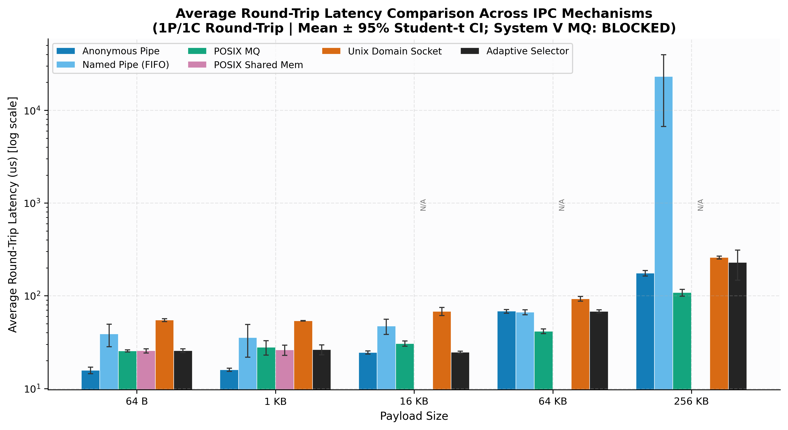

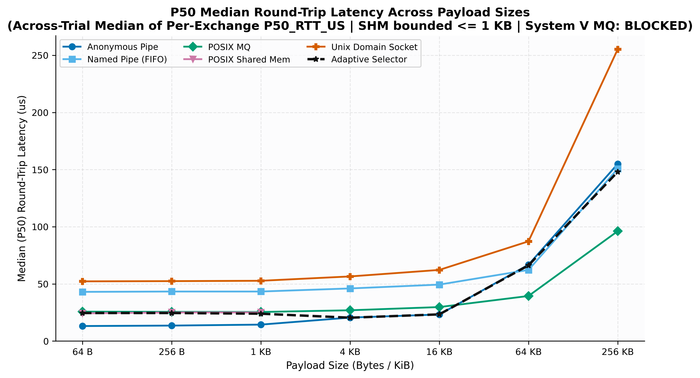

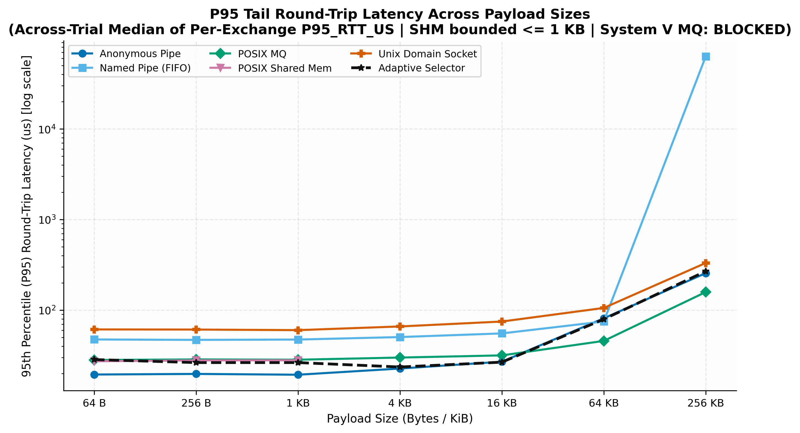

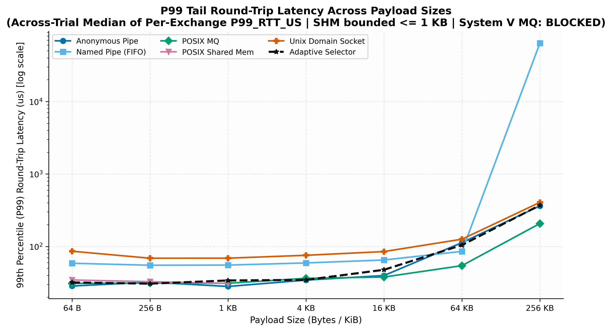

## 11. Throughput Comparison

| Payload | Mechanism | Msg/s (Mean) | Bytes/s (Mean) | Payload MB/s | RTT Wire MB/s |
| --- | --- | --- | --- | --- | --- |
| 64 B | adaptive | 39,108.0 | 2,502,912 | 2.503 | 5.006 |
| 64 B | fifo | 30,606.3 | 1,958,802 | 1.959 | 3.918 |
| 64 B | pipe | 63,949.1 | 4,092,742 | 4.093 | 8.185 |
| 64 B | posix | 39,300.7 | 2,515,246 | 2.515 | 5.030 |
| 64 B | shm | 39,277.1 | 2,513,732 | 2.514 | 5.027 |
| 64 B | uds | 18,324.3 | 1,172,756 | 1.173 | 2.346 |
| 256 B | adaptive | 39,880.8 | 10,209,480 | 10.209 | 20.419 |
| 256 B | fifo | 37,457.7 | 9,589,169 | 9.589 | 19.178 |
| 256 B | pipe | 63,240.9 | 16,189,665 | 16.190 | 32.379 |
| 256 B | posix | 38,689.9 | 9,904,603 | 9.905 | 19.809 |
| 256 B | shm | 39,422.5 | 10,092,155 | 10.092 | 20.184 |
| 256 B | uds | 18,324.5 | 4,691,062 | 4.691 | 9.382 |
| 1 KB | adaptive | 38,496.6 | 39,420,542 | 39.421 | 78.841 |
| 1 KB | fifo | 36,789.7 | 37,672,673 | 37.673 | 75.345 |
| 1 KB | pipe | 62,676.6 | 64,180,831 | 64.181 | 128.362 |
| 1 KB | posix | 36,738.7 | 37,620,387 | 37.620 | 75.241 |
| 1 KB | shm | 38,879.8 | 39,812,920 | 39.813 | 79.626 |
| 1 KB | uds | 18,646.8 | 19,094,323 | 19.094 | 38.189 |
| 4 KB | adaptive | 46,677.0 | 191,189,061 | 191.189 | 382.378 |
| 4 KB | fifo | 26,833.9 | 109,911,719 | 109.912 | 219.823 |
| 4 KB | pipe | 47,118.4 | 192,997,155 | 192.997 | 385.994 |
| 4 KB | posix | 34,847.5 | 142,735,468 | 142.735 | 285.471 |
| 4 KB | uds | 17,025.8 | 69,737,723 | 69.738 | 139.475 |
| 16 KB | adaptive | 40,752.0 | 667,681,401 | 667.681 | 1,335.363 |
| 16 KB | fifo | 22,483.7 | 368,373,712 | 368.374 | 736.747 |
| 16 KB | pipe | 40,886.8 | 669,889,792 | 669.890 | 1,339.780 |
| 16 KB | posix | 32,917.8 | 539,325,791 | 539.326 | 1,078.652 |
| 16 KB | uds | 14,855.0 | 243,384,608 | 243.385 | 486.769 |
| 64 KB | adaptive | 14,716.1 | 964,433,935 | 964.434 | 1,928.868 |
| 64 KB | fifo | 15,113.7 | 990,491,832 | 990.492 | 1,980.984 |
| 64 KB | pipe | 14,706.2 | 963,786,974 | 963.787 | 1,927.574 |
| 64 KB | posix | 24,169.1 | 1,583,947,997 | 1,583.948 | 3,167.896 |
| 64 KB | uds | 10,790.0 | 707,132,560 | 707.133 | 1,414.265 |
| 256 KB | adaptive | 4,905.2 | 1,285,881,584 | 1,285.882 | 2,571.763 |
| 256 KB | fifo | 168.5 | 44,181,802 | 44.182 | 88.364 |
| 256 KB | pipe | 5,730.6 | 1,502,236,341 | 1,502.236 | 3,004.473 |
| 256 KB | posix | 9,314.0 | 2,441,598,476 | 2,441.598 | 4,883.197 |
| 256 KB | uds | 3,876.1 | 1,016,090,556 | 1,016.091 | 2,032.181 |

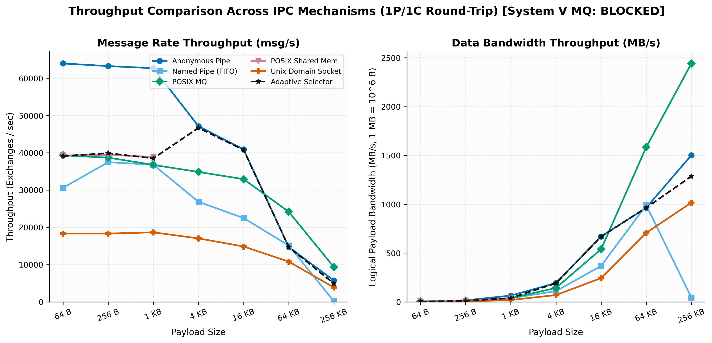

## 12. CPU Comparison

| Payload | Mechanism | User CPU (s) | Sys CPU (s) | Total CPU (s) | CPU Util (%) | CPU us/msg |
| --- | --- | --- | --- | --- | --- | --- |
| 64 B | adaptive | 0.0109 | 0.0197 | 0.0306 | 61.6 | 27.79 |
| 64 B | fifo | 0.0261 | 0.0527 | 0.0789 | 109.4 | 71.69 |
| 64 B | pipe | 0.0174 | 0.0307 | 0.0481 | 129.2 | 43.77 |
| 64 B | posix | 0.0263 | 0.0129 | 0.0391 | 76.8 | 35.58 |
| 64 B | shm | 0.0177 | 0.0260 | 0.0437 | 84.3 | 39.74 |
| 64 B | uds | 0.0309 | 0.0551 | 0.0860 | 98.3 | 78.18 |
| 256 B | adaptive | 0.0110 | 0.0176 | 0.0286 | 55.8 | 25.97 |
| 256 B | fifo | 0.0286 | 0.0461 | 0.0747 | 110.6 | 67.92 |
| 256 B | pipe | 0.0133 | 0.0237 | 0.0370 | 99.2 | 33.64 |
| 256 B | posix | 0.0264 | 0.0197 | 0.0461 | 92.2 | 41.95 |
| 256 B | shm | 0.0176 | 0.0199 | 0.0374 | 72.6 | 34.03 |
| 256 B | uds | 0.0434 | 0.0463 | 0.0897 | 103.3 | 81.56 |
| 1 KB | adaptive | 0.0131 | 0.0286 | 0.0417 | 82.2 | 37.92 |
| 1 KB | fifo | 0.0331 | 0.0306 | 0.0637 | 90.9 | 57.92 |
| 1 KB | pipe | 0.0134 | 0.0353 | 0.0487 | 133.2 | 44.29 |
| 1 KB | posix | 0.0173 | 0.0217 | 0.0390 | 71.8 | 35.45 |
| 1 KB | shm | 0.0133 | 0.0197 | 0.0330 | 63.6 | 30.00 |
| 1 KB | uds | 0.0414 | 0.0551 | 0.0966 | 110.6 | 87.79 |
| 4 KB | adaptive | 0.0264 | 0.0329 | 0.0593 | 139.7 | 53.90 |
| 4 KB | fifo | 0.0420 | 0.0351 | 0.0771 | 104.7 | 70.13 |
| 4 KB | pipe | 0.0264 | 0.0331 | 0.0596 | 134.4 | 54.16 |
| 4 KB | posix | 0.0219 | 0.0174 | 0.0393 | 72.9 | 35.71 |
| 4 KB | uds | 0.0394 | 0.0486 | 0.0880 | 97.0 | 80.00 |
| 16 KB | adaptive | 0.0220 | 0.0373 | 0.0593 | 127.2 | 53.90 |
| 16 KB | fifo | 0.0420 | 0.0484 | 0.0904 | 107.4 | 82.21 |
| 16 KB | pipe | 0.0243 | 0.0463 | 0.0706 | 149.9 | 64.16 |
| 16 KB | posix | 0.0219 | 0.0151 | 0.0370 | 65.7 | 33.64 |
| 16 KB | uds | 0.0527 | 0.0530 | 0.1057 | 103.7 | 96.10 |
| 64 KB | adaptive | 0.0617 | 0.0506 | 0.1123 | 121.7 | 102.08 |
| 64 KB | fifo | 0.0486 | 0.0573 | 0.1059 | 94.0 | 96.23 |
| 64 KB | pipe | 0.0554 | 0.0641 | 0.1196 | 127.9 | 108.70 |
| 64 KB | posix | 0.0351 | 0.0221 | 0.0573 | 85.4 | 52.08 |
| 64 KB | uds | 0.0550 | 0.0751 | 0.1301 | 100.1 | 118.31 |
| 256 KB | adaptive | 0.1513 | 0.2273 | 0.3786 | 123.5 | 344.16 |
| 256 KB | fifo | 0.3341 | 0.5083 | 0.8424 | 4.0 | 765.84 |
| 256 KB | pipe | 0.1399 | 0.2271 | 0.3670 | 162.7 | 333.64 |
| 256 KB | posix | 0.0483 | 0.0794 | 0.1277 | 90.9 | 116.10 |
| 256 KB | uds | 0.1599 | 0.2540 | 0.4139 | 131.8 | 376.23 |

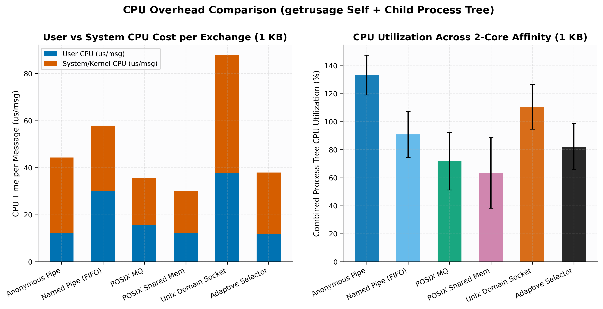

## 13. Memory Comparison

| Payload | Mechanism | Prod Avg RSS (KB) | Cons Avg RSS (KB) | Total Avg RSS (KB) | Total Peak RSS (KB) | Kernel Slab (KB) |
| --- | --- | --- | --- | --- | --- | --- |
| 64 B | adaptive | 7,511 | 3,728 | 9,996 | 13,696 | N/A |
| 64 B | fifo | 7,785 | 6,780 | 11,175 | 15,460 | N/A |
| 64 B | pipe | 6,251 | 3,702 | 8,102 | 13,544 | N/A |
| 64 B | posix | 7,469 | 5,416 | 9,275 | 13,620 | N/A |
| 64 B | shm | 7,476 | 3,730 | 9,963 | 13,712 | N/A |
| 64 B | uds | 7,765 | 4,885 | 11,429 | 14,748 | N/A |
| 256 B | adaptive | 7,512 | 3,726 | 9,996 | 13,700 | N/A |
| 256 B | fifo | 7,173 | 6,128 | 9,624 | 15,576 | N/A |
| 256 B | pipe | 7,449 | 3,710 | 9,923 | 13,556 | N/A |
| 256 B | posix | 7,299 | 5,416 | 9,104 | 13,612 | N/A |
| 256 B | shm | 7,541 | 3,730 | 10,028 | 13,700 | N/A |
| 256 B | uds | 7,768 | 4,821 | 11,384 | 14,736 | N/A |
| 1 KB | adaptive | 7,477 | 3,728 | 9,963 | 13,696 | N/A |
| 1 KB | fifo | 7,789 | 5,333 | 11,789 | 15,472 | N/A |
| 1 KB | pipe | 7,427 | 3,702 | 9,895 | 13,528 | N/A |
| 1 KB | posix | 7,483 | 5,420 | 9,289 | 13,640 | N/A |
| 1 KB | shm | 7,491 | 3,732 | 9,979 | 13,712 | N/A |
| 1 KB | uds | 7,783 | 4,880 | 11,443 | 14,732 | N/A |
| 4 KB | adaptive | 7,396 | 3,708 | 9,868 | 13,532 | N/A |
| 4 KB | fifo | 7,621 | 6,788 | 11,015 | 15,464 | N/A |
| 4 KB | pipe | 7,385 | 3,702 | 9,853 | 13,532 | N/A |
| 4 KB | posix | 7,561 | 3,692 | 10,023 | 13,704 | N/A |
| 4 KB | uds | 7,945 | 6,252 | 10,446 | 14,876 | N/A |
| 16 KB | adaptive | 7,284 | 3,702 | 9,752 | 13,520 | N/A |
| 16 KB | fifo | 7,784 | 5,253 | 11,724 | 15,536 | N/A |
| 16 KB | pipe | 7,415 | 3,702 | 9,883 | 13,532 | N/A |
| 16 KB | posix | 7,552 | 3,704 | 10,021 | 13,752 | N/A |
| 16 KB | uds | 7,952 | 4,650 | 11,672 | 14,860 | N/A |
| 64 KB | adaptive | 7,734 | 4,387 | 11,024 | 13,832 | N/A |
| 64 KB | fifo | 7,824 | 6,636 | 11,806 | 15,720 | N/A |
| 64 KB | pipe | 7,749 | 4,560 | 11,169 | 13,824 | N/A |
| 64 KB | posix | 7,701 | 3,832 | 10,256 | 14,224 | N/A |
| 64 KB | uds | 8,093 | 5,595 | 12,756 | 15,036 | N/A |
| 256 KB | adaptive | 8,387 | 5,752 | 13,420 | 15,164 | N/A |
| 256 KB | fifo | 9,031 | 7,716 | 16,626 | 17,056 | N/A |
| 256 KB | pipe | 8,330 | 5,118 | 12,808 | 15,164 | N/A |
| 256 KB | posix | 8,592 | 5,641 | 13,105 | 16,308 | N/A |
| 256 KB | uds | 8,719 | 6,689 | 14,739 | 16,336 | N/A |

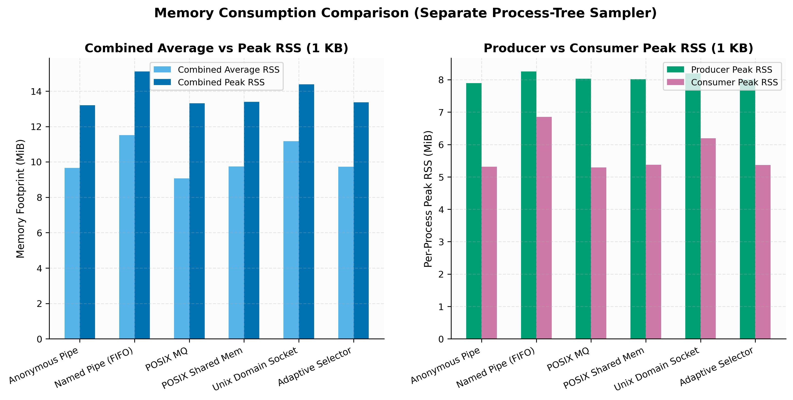

## 14. Context-Switch Comparison

| Payload | Mechanism | Total Ctx Sw | Voluntary | Involuntary | Page Faults | Method |
| --- | --- | --- | --- | --- | --- | --- |
| 64 B | adaptive | 515 | N/A | N/A | 1,634 | win32_ntdll_thread_context_switches |
| 64 B | fifo | 973 | N/A | N/A | 2,079 | win32_ntdll_thread_context_switches |
| 64 B | pipe | 282 | N/A | N/A | 1,574 | win32_ntdll_thread_context_switches |
| 64 B | posix | 471 | N/A | N/A | 1,613 | win32_ntdll_thread_context_switches |
| 64 B | shm | 505 | N/A | N/A | 1,634 | win32_ntdll_thread_context_switches |
| 64 B | uds | 1,142 | N/A | N/A | 1,901 | win32_ntdll_thread_context_switches |
| 256 B | adaptive | 584 | N/A | N/A | 1,634 | win32_ntdll_thread_context_switches |
| 256 B | fifo | 912 | N/A | N/A | 2,085 | win32_ntdll_thread_context_switches |
| 256 B | pipe | 263 | N/A | N/A | 1,582 | win32_ntdll_thread_context_switches |
| 256 B | posix | 375 | N/A | N/A | 1,612 | win32_ntdll_thread_context_switches |
| 256 B | shm | 705 | N/A | N/A | 1,636 | win32_ntdll_thread_context_switches |
| 256 B | uds | 925 | N/A | N/A | 1,900 | win32_ntdll_thread_context_switches |
| 1 KB | adaptive | 693 | N/A | N/A | 1,635 | win32_ntdll_thread_context_switches |
| 1 KB | fifo | 1,284 | N/A | N/A | 2,079 | win32_ntdll_thread_context_switches |
| 1 KB | pipe | 242 | N/A | N/A | 1,576 | win32_ntdll_thread_context_switches |
| 1 KB | posix | 467 | N/A | N/A | 1,614 | win32_ntdll_thread_context_switches |
| 1 KB | shm | 564 | N/A | N/A | 1,636 | win32_ntdll_thread_context_switches |
| 1 KB | uds | 1,006 | N/A | N/A | 1,903 | win32_ntdll_thread_context_switches |
| 4 KB | adaptive | 237 | N/A | N/A | 1,578 | win32_ntdll_thread_context_switches |
| 4 KB | fifo | 758 | N/A | N/A | 2,086 | win32_ntdll_thread_context_switches |
| 4 KB | pipe | 232 | N/A | N/A | 1,576 | win32_ntdll_thread_context_switches |
| 4 KB | posix | 752 | N/A | N/A | 1,635 | win32_ntdll_thread_context_switches |
| 4 KB | uds | 882 | N/A | N/A | 1,902 | win32_ntdll_thread_context_switches |
| 16 KB | adaptive | 257 | N/A | N/A | 1,572 | win32_ntdll_thread_context_switches |
| 16 KB | fifo | 947 | N/A | N/A | 2,093 | win32_ntdll_thread_context_switches |
| 16 KB | pipe | 240 | N/A | N/A | 1,576 | win32_ntdll_thread_context_switches |
| 16 KB | posix | 625 | N/A | N/A | 1,646 | win32_ntdll_thread_context_switches |
| 16 KB | uds | 1,159 | N/A | N/A | 1,900 | win32_ntdll_thread_context_switches |
| 64 KB | adaptive | 1,161 | N/A | N/A | 1,645 | win32_ntdll_thread_context_switches |
| 64 KB | fifo | 1,441 | N/A | N/A | 2,142 | win32_ntdll_thread_context_switches |
| 64 KB | pipe | 1,288 | N/A | N/A | 1,647 | win32_ntdll_thread_context_switches |
| 64 KB | posix | 764 | N/A | N/A | 1,766 | win32_ntdll_thread_context_switches |
| 64 KB | uds | 1,298 | N/A | N/A | 1,977 | win32_ntdll_thread_context_switches |
| 256 KB | adaptive | 1,695 | N/A | N/A | 1,983 | win32_ntdll_thread_context_switches |
| 256 KB | fifo | 1,604 | N/A | N/A | 2,488 | win32_ntdll_thread_context_switches |
| 256 KB | pipe | 1,504 | N/A | N/A | 1,983 | win32_ntdll_thread_context_switches |
| 256 KB | posix | 1,185 | N/A | N/A | 2,300 | win32_ntdll_thread_context_switches |
| 256 KB | uds | 1,887 | N/A | N/A | 2,312 | win32_ntdll_thread_context_switches |

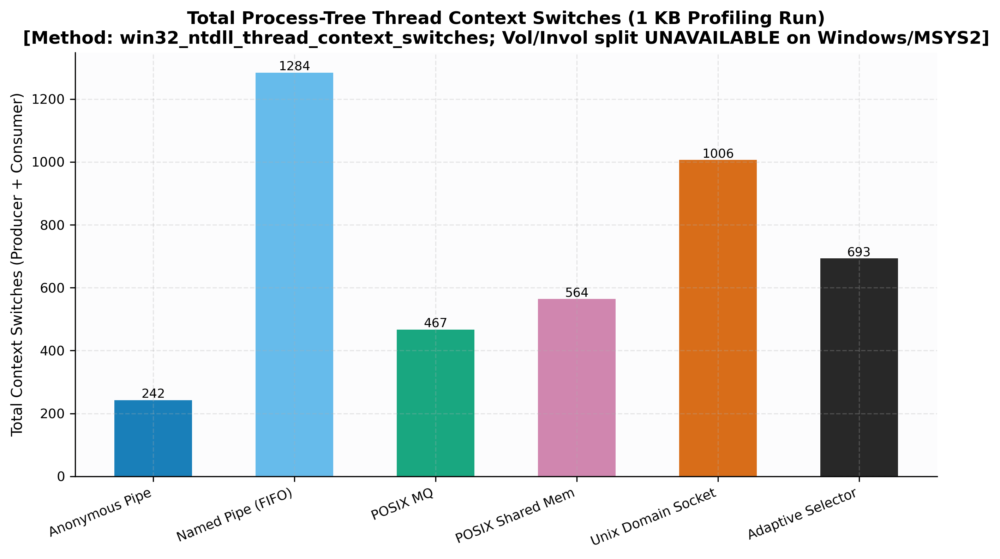

## 15. System-Call Comparison

| Mechanism | Syscall Status | Comm/Exch | Setup/Cleanup | Total | Notes |
| --- | --- | --- | --- | --- | --- |
| pipe | UNAVAILABLE | N/A | N/A | N/A | Host platform is Windows (win32); Linux kernel strace unavailable |
| fifo | UNAVAILABLE | N/A | N/A | N/A | Host platform is Windows (win32); Linux kernel strace unavailable |
| sysv | UNAVAILABLE | N/A | N/A | N/A | Host platform is Windows (win32); Linux kernel strace unavailable |
| posix | UNAVAILABLE | N/A | N/A | N/A | Host platform is Windows (win32); Linux kernel strace unavailable |
| shm | UNAVAILABLE | N/A | N/A | N/A | Host platform is Windows (win32); Linux kernel strace unavailable |
| uds | UNAVAILABLE | N/A | N/A | N/A | Host platform is Windows (win32); Linux kernel strace unavailable |
| adaptive | UNAVAILABLE | N/A | N/A | N/A | Host platform is Windows (win32); Linux kernel strace unavailable |

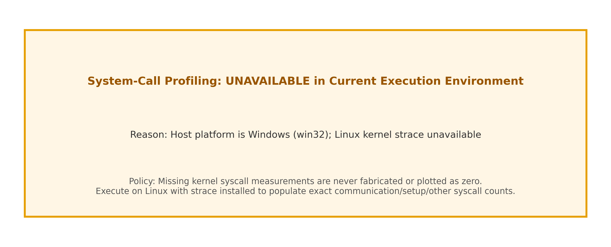

## 16. Payload Scalability

Payload scaling spans `64 B` to `256 KB`. `shm` is bounded to `<= 1024 B` (`SHM_MAX_PAYLOAD`), cleanly transitioning to `UNSUPPORTED` above 1 KB, while `pipe`, `fifo`, `posix`, `uds`, and `adaptive` scale across the full sweep.

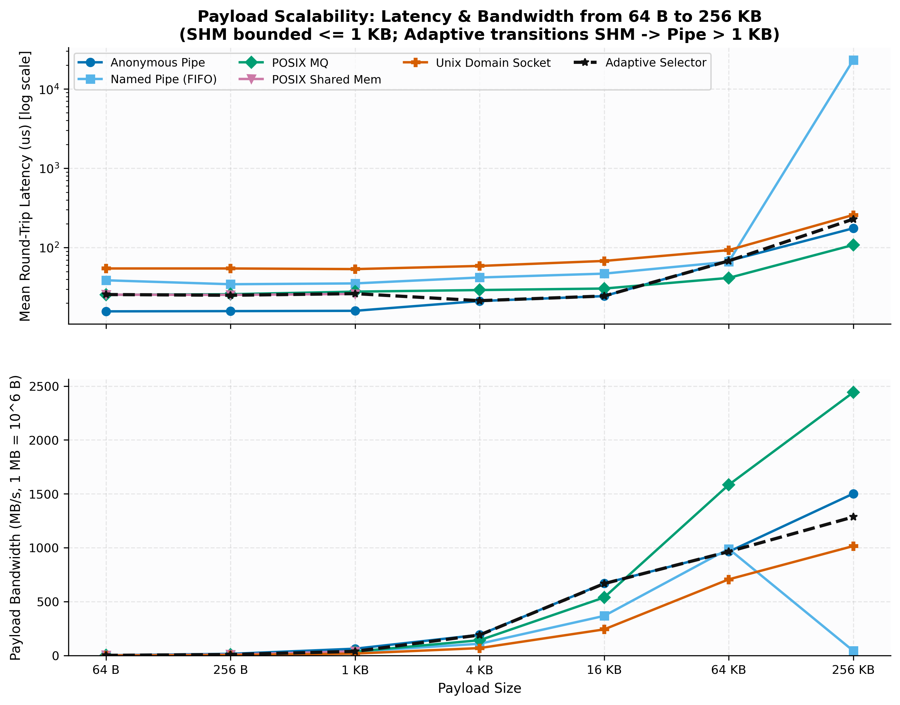

## 17. Concurrency Scalability

| Topology | Mechanism | Status | Throughput (msg/s) | MB/s | CPU us/msg | Notes |
| --- | --- | --- | --- | --- | --- | --- |
| 1P/1C | adaptive | UNSUPPORTED | N/A | N/A | N/A | POSIX shared memory mailbox (src/ipc_shm.c) is a single-slot SPSC 1P/1C design |
| 1P/1C | fifo | PASS | 130,777.4 | 33.479 | 27.30 | ok |
| 1P/1C | pipe | PASS | 125,124.0 | 32.032 | 21.10 | ok |
| 1P/1C | posix | PASS | 83,734.5 | 21.436 | 22.80 | ok |
| 1P/1C | shm | UNSUPPORTED | N/A | N/A | N/A | POSIX shared memory mailbox (src/ipc_shm.c) is a single-slot SPSC 1P/1C design |
| 1P/1C | sysv | BLOCKED | N/A | N/A | N/A | msgget() failed: Function not implemented |
| 1P/1C | uds | PASS | 39,443.2 | 10.097 | 59.90 | ok |
| 1P/2C | adaptive | UNSUPPORTED | N/A | N/A | N/A | POSIX shared memory mailbox (src/ipc_shm.c) is a single-slot SPSC 1P/1C design |
| 1P/2C | fifo | UNSUPPORTED | N/A | N/A | N/A | Byte-stream fifo guarantees atomic multi-writer writes only for size<=PIPE_BUF (4096 B) and 1 consumer |
| 1P/2C | pipe | UNSUPPORTED | N/A | N/A | N/A | Byte-stream pipe guarantees atomic multi-writer writes only for size<=PIPE_BUF (4096 B) and 1 consumer |
| 1P/2C | posix | PASS | 37,987.7 | 9.725 | 42.70 | ok |
| 1P/2C | shm | UNSUPPORTED | N/A | N/A | N/A | POSIX shared memory mailbox (src/ipc_shm.c) is a single-slot SPSC 1P/1C design |
| 1P/2C | sysv | BLOCKED | N/A | N/A | N/A | msgget() failed: Function not implemented |
| 1P/2C | uds | PASS | 45,353.4 | 11.610 | 75.30 | ok |
| 2P/1C | adaptive | UNSUPPORTED | N/A | N/A | N/A | POSIX shared memory mailbox (src/ipc_shm.c) is a single-slot SPSC 1P/1C design |
| 2P/1C | fifo | PASS | 125,599.7 | 32.154 | 36.40 | ok |
| 2P/1C | pipe | PASS | 93,759.6 | 24.002 | 44.20 | ok |
| 2P/1C | posix | PASS | 37,876.9 | 9.696 | 28.80 | ok |
| 2P/1C | shm | UNSUPPORTED | N/A | N/A | N/A | POSIX shared memory mailbox (src/ipc_shm.c) is a single-slot SPSC 1P/1C design |
| 2P/1C | sysv | BLOCKED | N/A | N/A | N/A | msgget() failed: Function not implemented |
| 2P/1C | uds | PASS | 50,223.7 | 12.857 | 65.80 | ok |
| 4P/1C | adaptive | UNSUPPORTED | N/A | N/A | N/A | POSIX shared memory mailbox (src/ipc_shm.c) is a single-slot SPSC 1P/1C design |
| 4P/1C | fifo | PASS | 128,500.8 | 32.896 | 59.70 | ok |
| 4P/1C | pipe | PASS | 88,110.3 | 22.556 | 68.20 | ok |
| 4P/1C | posix | PASS | 24,214.8 | 6.199 | 53.40 | ok |
| 4P/1C | shm | UNSUPPORTED | N/A | N/A | N/A | POSIX shared memory mailbox (src/ipc_shm.c) is a single-slot SPSC 1P/1C design |
| 4P/1C | sysv | BLOCKED | N/A | N/A | N/A | msgget() failed: Function not implemented |
| 4P/1C | uds | PASS | 57,835.2 | 14.806 | 80.90 | ok |
| 4P/4C | adaptive | UNSUPPORTED | N/A | N/A | N/A | POSIX shared memory mailbox (src/ipc_shm.c) is a single-slot SPSC 1P/1C design |
| 4P/4C | fifo | UNSUPPORTED | N/A | N/A | N/A | Byte-stream fifo guarantees atomic multi-writer writes only for size<=PIPE_BUF (4096 B) and 1 consumer |
| 4P/4C | pipe | UNSUPPORTED | N/A | N/A | N/A | Byte-stream pipe guarantees atomic multi-writer writes only for size<=PIPE_BUF (4096 B) and 1 consumer |
| 4P/4C | posix | PASS | 28,403.2 | 7.271 | 57.80 | ok |
| 4P/4C | shm | UNSUPPORTED | N/A | N/A | N/A | POSIX shared memory mailbox (src/ipc_shm.c) is a single-slot SPSC 1P/1C design |
| 4P/4C | sysv | BLOCKED | N/A | N/A | N/A | msgget() failed: Function not implemented |
| 4P/4C | uds | PASS | 107,702.0 | 27.572 | 123.50 | ok |

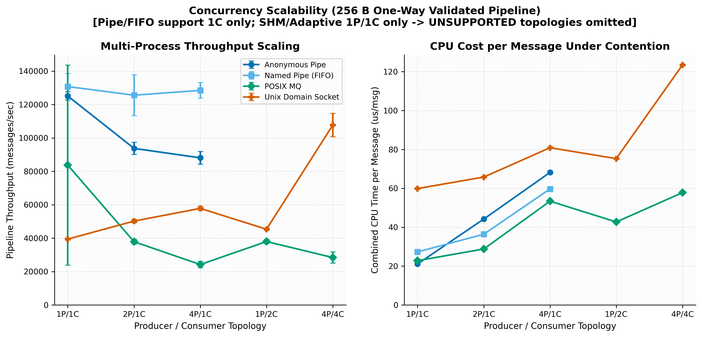

## 18. Adaptive Selector Evaluation

| Payload | Chosen | Best (Avg RTT) | Best (Tput) | Optimal? | Adaptive RTT (us) | Best RTT (us) | Regret vs Best | Diff vs Pipe | Decision Cost |
| --- | --- | --- | --- | --- | --- | --- | --- | --- | --- |
| 64 B | shm | pipe | pipe | False | 25.63 | 15.73 | 62.93% | 62.93% | 2.36 ns |
| 256 B | shm | pipe | pipe | False | 25.09 | 15.84 | 58.40% | 58.40% | 2.36 ns |
| 1 KB | shm | pipe | pipe | False | 26.31 | 15.98 | 64.68% | 64.68% | 2.36 ns |
| 4 KB | pipe | pipe | pipe | True | 21.45 | 21.23 | 1.03% | 1.03% | 2.36 ns |
| 16 KB | pipe | pipe | pipe | True | 24.56 | 24.49 | 0.26% | 0.26% | 2.36 ns |
| 64 KB | pipe | posix | posix | False | 68.07 | 41.52 | 63.94% | -0.12% | 2.36 ns |
| 256 KB | pipe | posix | posix | False | 228.64 | 108.09 | 111.54% | 30.40% | 2.36 ns |

### Mixed 80%/20% Workload (`mini-aipc-mixed`)

| Policy | Status | Avg Latency (us) | Throughput (exch/s) | CPU us/msg |
| --- | --- | --- | --- | --- |
| adaptive | PASS | 32.40 | 31,066.2 | 0.00 |
| pipe | PASS | 33.28 | 30,168.2 | 0.00 |

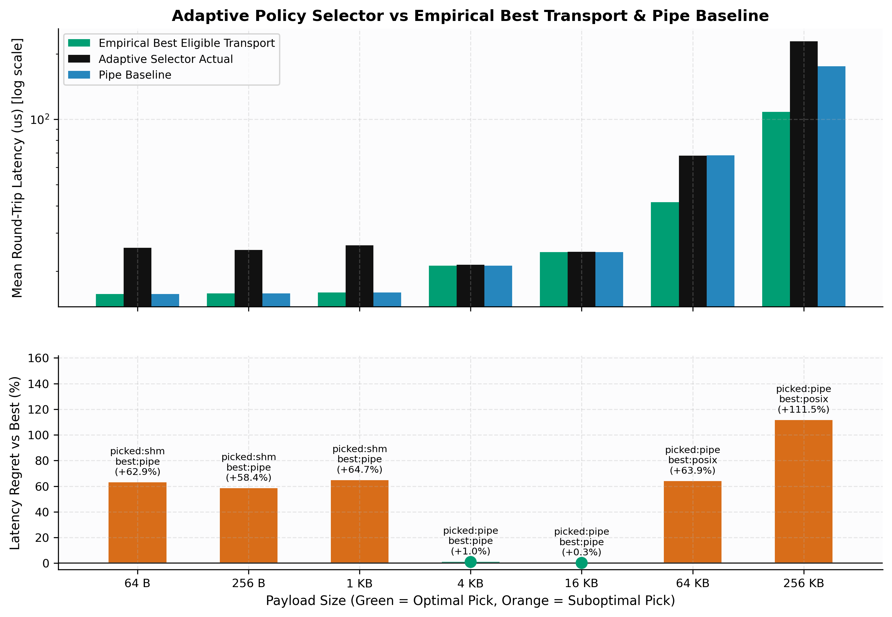

## 19. Kernel Mailbox Evaluation

### Functional Test Matrix

| Kernel Check | Status | Diagnostic Detail |
| --- | --- | --- |
| module_compilation | BLOCKED | Host OS is MSYS_NT-10.0-26200; Linux kernel build tree unavailable |
| module_loading | BLOCKED | Host OS is MSYS_NT-10.0-26200; Linux kernel module build and insmod require a Linux kernel |
| device_creation | BLOCKED | Host OS is MSYS_NT-10.0-26200; Linux kernel module build and insmod require a Linux kernel |
| write_read_functionality | BLOCKED | Host OS is MSYS_NT-10.0-26200; Linux kernel module build and insmod require a Linux kernel |
| data_integrity | BLOCKED | Host OS is MSYS_NT-10.0-26200; Linux kernel module build and insmod require a Linux kernel |
| buffer_capacity | BLOCKED | Host OS is MSYS_NT-10.0-26200; Linux kernel module build and insmod require a Linux kernel |
| empty_buffer_behaviour | BLOCKED | Host OS is MSYS_NT-10.0-26200; Linux kernel module build and insmod require a Linux kernel |
| full_buffer_behaviour | BLOCKED | Host OS is MSYS_NT-10.0-26200; Linux kernel module build and insmod require a Linux kernel |
| blocking_operations | BLOCKED | Host OS is MSYS_NT-10.0-26200; Linux kernel module build and insmod require a Linux kernel |
| nonblocking_operations | BLOCKED | Host OS is MSYS_NT-10.0-26200; Linux kernel module build and insmod require a Linux kernel |
| concurrent_readers_writers | BLOCKED | Host OS is MSYS_NT-10.0-26200; Linux kernel module build and insmod require a Linux kernel |
| poll_behaviour | BLOCKED | Host OS is MSYS_NT-10.0-26200; Linux kernel module build and insmod require a Linux kernel |
| error_handling | BLOCKED | Host OS is MSYS_NT-10.0-26200; Linux kernel module build and insmod require a Linux kernel |
| module_unloading | BLOCKED | Host OS is MSYS_NT-10.0-26200; Linux kernel module build and insmod require a Linux kernel |
| repeated_load_unload | BLOCKED | Host OS is MSYS_NT-10.0-26200; Linux kernel module build and insmod require a Linux kernel |

### Matched Unidirectional Kernel Benchmark

| Payload | Status | Avg Latency (us) | Msg/s | MB/s | Reason / Notes |
| --- | --- | --- | --- | --- | --- |
| 64 B | BLOCKED | N/A | N/A | N/A | Host OS is MSYS_NT-10.0-26200; Linux kernel module build and insmod require a Linux kernel |
| 256 B | BLOCKED | N/A | N/A | N/A | Host OS is MSYS_NT-10.0-26200; Linux kernel module build and insmod require a Linux kernel |
| 1 KB | BLOCKED | N/A | N/A | N/A | Host OS is MSYS_NT-10.0-26200; Linux kernel module build and insmod require a Linux kernel |
| 4 KB | BLOCKED | N/A | N/A | N/A | Host OS is MSYS_NT-10.0-26200; Linux kernel module build and insmod require a Linux kernel |
| 16 KB | BLOCKED | N/A | N/A | N/A | Host OS is MSYS_NT-10.0-26200; Linux kernel module build and insmod require a Linux kernel |
| 64 KB | BLOCKED | N/A | N/A | N/A | Host OS is MSYS_NT-10.0-26200; Linux kernel module build and insmod require a Linux kernel |
| 256 KB | BLOCKED | N/A | N/A | N/A | Host OS is MSYS_NT-10.0-26200; Linux kernel module build and insmod require a Linux kernel |

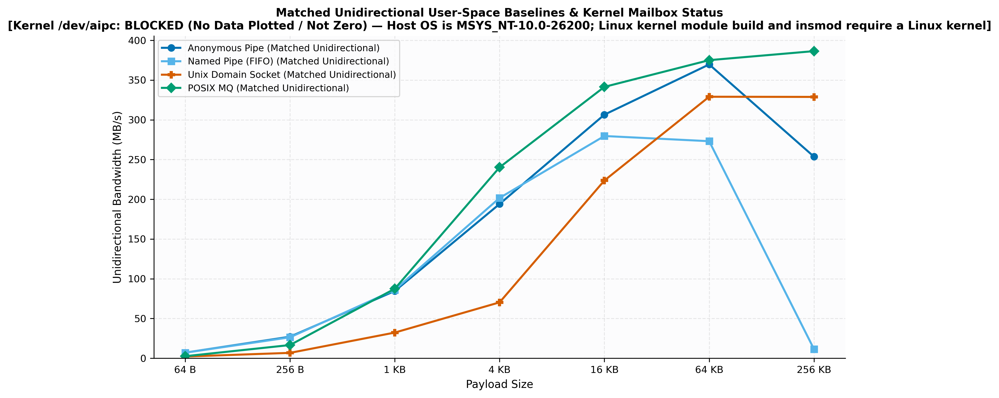

## 20. Statistical Analysis

Matched paired statistical tests were performed across matched trial blocks (`n_pairs = 7`). Both parametric **paired Student's t-test** (with 95% confidence interval of mean difference) and non-parametric **Wilcoxon signed-rank test** (exact built-in enumeration/incomplete beta) are reported below for key adaptive and best-transport comparisons.

| Comparison | Payload | Metric | Pair | n | Mean Diff | Diff % | t p-val | Wilcoxon p-val | Sig (a=0.05) |
| --- | --- | --- | --- | --- | --- | --- | --- | --- | --- |
| adaptive_vs_best | 64 | avg_rtt_us | adaptive vs pipe | 7 | 9.900 | 62.93% | 0.00000 | 0.01562 | YES (t-test p<0.05) |
| adaptive_vs_best | 64 | throughput_msg_s | adaptive vs pipe | 7 | -24,841.104 | -38.84% | 0.00001 | 0.01562 | YES (t-test p<0.05) |
| adaptive_vs_pipe | 64 | avg_rtt_us | adaptive vs pipe | 7 | 9.900 | 62.93% | 0.00000 | 0.01562 | YES (t-test p<0.05) |
| adaptive_vs_pipe | 64 | throughput_msg_s | adaptive vs pipe | 7 | -24,841.104 | -38.84% | 0.00001 | 0.01562 | YES (t-test p<0.05) |
| adaptive_vs_best | 256 | avg_rtt_us | adaptive vs pipe | 7 | 9.250 | 58.40% | 0.00000 | 0.01562 | YES (t-test p<0.05) |
| adaptive_vs_best | 256 | throughput_msg_s | adaptive vs pipe | 7 | -23,360.096 | -36.94% | 0.00000 | 0.01562 | YES (t-test p<0.05) |
| adaptive_vs_pipe | 256 | avg_rtt_us | adaptive vs pipe | 7 | 9.250 | 58.40% | 0.00000 | 0.01562 | YES (t-test p<0.05) |
| adaptive_vs_pipe | 256 | throughput_msg_s | adaptive vs pipe | 7 | -23,360.096 | -36.94% | 0.00000 | 0.01562 | YES (t-test p<0.05) |
| adaptive_vs_best | 1024 | avg_rtt_us | adaptive vs pipe | 7 | 10.335 | 64.68% | 0.00017 | 0.01562 | YES (t-test p<0.05) |
| adaptive_vs_best | 1024 | throughput_msg_s | adaptive vs pipe | 7 | -24,179.970 | -38.58% | 0.00001 | 0.01562 | YES (t-test p<0.05) |
| adaptive_vs_pipe | 1024 | avg_rtt_us | adaptive vs pipe | 7 | 10.335 | 64.68% | 0.00017 | 0.01562 | YES (t-test p<0.05) |
| adaptive_vs_pipe | 1024 | throughput_msg_s | adaptive vs pipe | 7 | -24,179.970 | -38.58% | 0.00001 | 0.01562 | YES (t-test p<0.05) |
| adaptive_vs_best | 4096 | avg_rtt_us | adaptive vs pipe | 7 | 0.220 | 1.03% | 0.47313 | 0.68750 | NO (p>=0.05) |
| adaptive_vs_best | 4096 | throughput_msg_s | adaptive vs pipe | 7 | -441.429 | -0.94% | 0.48976 | 0.68750 | NO (p>=0.05) |
| adaptive_vs_pipe | 4096 | avg_rtt_us | adaptive vs pipe | 7 | 0.220 | 1.03% | 0.47313 | 0.68750 | NO (p>=0.05) |
| adaptive_vs_pipe | 4096 | throughput_msg_s | adaptive vs pipe | 7 | -441.429 | -0.94% | 0.48976 | 0.68750 | NO (p>=0.05) |
| adaptive_vs_best | 16384 | avg_rtt_us | adaptive vs pipe | 7 | 0.064 | 0.26% | 0.87299 | 0.93750 | NO (p>=0.05) |
| adaptive_vs_best | 16384 | throughput_msg_s | adaptive vs pipe | 7 | -134.790 | -0.33% | 0.83018 | 0.93750 | NO (p>=0.05) |
| adaptive_vs_pipe | 16384 | avg_rtt_us | adaptive vs pipe | 7 | 0.064 | 0.26% | 0.87299 | 0.93750 | NO (p>=0.05) |
| adaptive_vs_pipe | 16384 | throughput_msg_s | adaptive vs pipe | 7 | -134.790 | -0.33% | 0.83018 | 0.93750 | NO (p>=0.05) |
| adaptive_vs_best | 65536 | avg_rtt_us | adaptive vs posix | 7 | 26.548 | 63.94% | 0.00000 | 0.01562 | YES (t-test p<0.05) |
| adaptive_vs_best | 65536 | throughput_msg_s | adaptive vs posix | 7 | -9,453.034 | -39.11% | 0.00000 | 0.01562 | YES (t-test p<0.05) |
| adaptive_vs_pipe | 65536 | avg_rtt_us | adaptive vs pipe | 7 | -0.084 | -0.12% | 0.97071 | 0.68750 | NO (p>=0.05) |
| adaptive_vs_pipe | 65536 | throughput_msg_s | adaptive vs pipe | 7 | 9.872 | 0.07% | 0.98477 | 0.68750 | NO (p>=0.05) |
| adaptive_vs_best | 262144 | avg_rtt_us | adaptive vs posix | 7 | 120.556 | 111.54% | 0.01023 | 0.01562 | YES (t-test p<0.05) |
| adaptive_vs_best | 262144 | throughput_msg_s | adaptive vs posix | 7 | -4,408.710 | -47.33% | 0.00059 | 0.01562 | YES (t-test p<0.05) |
| adaptive_vs_pipe | 262144 | avg_rtt_us | adaptive vs pipe | 7 | 53.302 | 30.40% | 0.14924 | 0.57812 | NO (p>=0.05) |
| adaptive_vs_pipe | 262144 | throughput_msg_s | adaptive vs pipe | 7 | -825.328 | -14.40% | 0.21346 | 0.57812 | NO (p>=0.05) |
| mixed_workload_adaptive_vs_pipe | 64_and_16384 | avg_rtt_us | adaptive vs pipe | 7 | -0.886 | -2.66% | 0.55984 | 0.81250 | NO (p>=0.05) |
| mixed_workload_adaptive_vs_pipe | 64_and_16384 | throughput_msg_s | adaptive vs pipe | 7 | 898.070 | 2.98% | 0.51822 | 0.68750 | NO (p>=0.05) |

## 21. Limitations

1. **Host OS / Kernel Scope**: Experiments reflect the actual host environment documented in Section 4/5. Where Linux kernel build headers, `insmod` privileges, Linux `strace`, or System V IPC (`cygserver` on MSYS2) are unavailable, those components are marked `BLOCKED`/`UNAVAILABLE` rather than simulated.
2. **Timer & `getrusage` Granularity**: On Windows/MSYS2, `getrusage()` CPU user/sys times advance in coarse scheduler ticks (~15.6 ms) and `ru_nvcsw`/`ru_nivcsw` are unsupported (`0`); thread context switches were captured via separate Win32 `NtQuerySystemInformation` polling without voluntary/involuntary split.
3. **Workload Semantic Differences**: `single_pair_rtt` (bidirectional round-trip) and `concurrency_pipeline` / `kernel_unidirectional_mailbox` (one-way validated transfer) have distinct synchronization semantics and are never combined into single axes.
4. **Shared Memory Capacity**: `src/ipc_shm.c` imposes `SHM_MAX_PAYLOAD = 1024` bytes.

## 22. Failed or Unsupported Experiments

| Workload | Component | Payload / Check | Topology | Status | Exact Diagnostic Reason |
| --- | --- | --- | --- | --- | --- |
| single_pair_rtt | shm | 16 KB | 1P/1C | UNSUPPORTED | shm payload 16384 bytes exceeds transport limit (Message too long) |
| single_pair_rtt | shm | 256 KB | 1P/1C | UNSUPPORTED | shm payload 262144 bytes exceeds transport limit (Message too long) |
| single_pair_rtt | shm | 64 KB | 1P/1C | UNSUPPORTED | shm payload 65536 bytes exceeds transport limit (Message too long) |
| single_pair_rtt | sysv | 256 KB | 1P/1C | BLOCKED | sysv unsupported/not implemented in host runtime (ENOSYS) |
| single_pair_rtt | shm | 4 KB | 1P/1C | UNSUPPORTED | shm payload 4096 bytes exceeds transport limit (Message too long) |
| single_pair_rtt | sysv | 4 KB | 1P/1C | BLOCKED | sysv unsupported/not implemented in host runtime (ENOSYS) |
| single_pair_rtt | sysv | 256 B | 1P/1C | BLOCKED | sysv unsupported/not implemented in host runtime (ENOSYS) |
| single_pair_rtt | sysv | 1 KB | 1P/1C | BLOCKED | sysv unsupported/not implemented in host runtime (ENOSYS) |
| single_pair_rtt | sysv | 16 KB | 1P/1C | BLOCKED | sysv unsupported/not implemented in host runtime (ENOSYS) |
| single_pair_rtt | sysv | 64 B | 1P/1C | BLOCKED | sysv unsupported/not implemented in host runtime (ENOSYS) |
| single_pair_rtt | sysv | 64 KB | 1P/1C | BLOCKED | sysv unsupported/not implemented in host runtime (ENOSYS) |
| concurrency_pipeline | pipe | 256 B | 1P/2C | UNSUPPORTED | Byte-stream pipe guarantees atomic multi-writer writes only for size<=PIPE_BUF (4096 B) and 1 consumer |
| concurrency_pipeline | fifo | 256 B | 4P/4C | UNSUPPORTED | Byte-stream fifo guarantees atomic multi-writer writes only for size<=PIPE_BUF (4096 B) and 1 consumer |
| concurrency_pipeline | shm | 256 B | 4P/1C | UNSUPPORTED | POSIX shared memory mailbox (src/ipc_shm.c) is a single-slot SPSC 1P/1C design |
| concurrency_pipeline | pipe | 256 B | 4P/4C | UNSUPPORTED | Byte-stream pipe guarantees atomic multi-writer writes only for size<=PIPE_BUF (4096 B) and 1 consumer |
| concurrency_pipeline | adaptive | 256 B | 4P/1C | UNSUPPORTED | POSIX shared memory mailbox (src/ipc_shm.c) is a single-slot SPSC 1P/1C design |
| concurrency_pipeline | shm | 256 B | 2P/1C | UNSUPPORTED | POSIX shared memory mailbox (src/ipc_shm.c) is a single-slot SPSC 1P/1C design |
| concurrency_pipeline | sysv | 256 B | 2P/1C | BLOCKED | msgget() failed: Function not implemented |
| concurrency_pipeline | adaptive | 256 B | 4P/4C | UNSUPPORTED | POSIX shared memory mailbox (src/ipc_shm.c) is a single-slot SPSC 1P/1C design |
| concurrency_pipeline | sysv | 256 B | 4P/1C | BLOCKED | msgget() failed: Function not implemented |
| concurrency_pipeline | adaptive | 256 B | 1P/1C | UNSUPPORTED | POSIX shared memory mailbox (src/ipc_shm.c) is a single-slot SPSC 1P/1C design |
| concurrency_pipeline | fifo | 256 B | 1P/2C | UNSUPPORTED | Byte-stream fifo guarantees atomic multi-writer writes only for size<=PIPE_BUF (4096 B) and 1 consumer |
| concurrency_pipeline | adaptive | 256 B | 1P/2C | UNSUPPORTED | POSIX shared memory mailbox (src/ipc_shm.c) is a single-slot SPSC 1P/1C design |
| concurrency_pipeline | sysv | 256 B | 1P/2C | BLOCKED | msgget() failed: Function not implemented |
| concurrency_pipeline | shm | 256 B | 1P/1C | UNSUPPORTED | POSIX shared memory mailbox (src/ipc_shm.c) is a single-slot SPSC 1P/1C design |
| concurrency_pipeline | shm | 256 B | 4P/4C | UNSUPPORTED | POSIX shared memory mailbox (src/ipc_shm.c) is a single-slot SPSC 1P/1C design |
| concurrency_pipeline | shm | 256 B | 1P/2C | UNSUPPORTED | POSIX shared memory mailbox (src/ipc_shm.c) is a single-slot SPSC 1P/1C design |
| concurrency_pipeline | adaptive | 256 B | 2P/1C | UNSUPPORTED | POSIX shared memory mailbox (src/ipc_shm.c) is a single-slot SPSC 1P/1C design |
| concurrency_pipeline | sysv | 256 B | 4P/4C | BLOCKED | msgget() failed: Function not implemented |
| concurrency_pipeline | sysv | 256 B | 1P/1C | BLOCKED | msgget() failed: Function not implemented |
| kernel_functional | kernel_aipc | module_compilation | 1P/1C | BLOCKED | Host OS is MSYS_NT-10.0-26200; Linux kernel build tree unavailable |
| kernel_functional | kernel_aipc | module_loading | 1P/1C | BLOCKED | Host OS is MSYS_NT-10.0-26200; Linux kernel module build and insmod require a Linux kernel |
| kernel_functional | kernel_aipc | device_creation | 1P/1C | BLOCKED | Host OS is MSYS_NT-10.0-26200; Linux kernel module build and insmod require a Linux kernel |
| kernel_functional | kernel_aipc | write_read_functionality | 1P/1C | BLOCKED | Host OS is MSYS_NT-10.0-26200; Linux kernel module build and insmod require a Linux kernel |
| kernel_functional | kernel_aipc | data_integrity | 1P/1C | BLOCKED | Host OS is MSYS_NT-10.0-26200; Linux kernel module build and insmod require a Linux kernel |
| kernel_functional | kernel_aipc | buffer_capacity | 1P/1C | BLOCKED | Host OS is MSYS_NT-10.0-26200; Linux kernel module build and insmod require a Linux kernel |
| kernel_functional | kernel_aipc | empty_buffer_behaviour | 1P/1C | BLOCKED | Host OS is MSYS_NT-10.0-26200; Linux kernel module build and insmod require a Linux kernel |
| kernel_functional | kernel_aipc | full_buffer_behaviour | 1P/1C | BLOCKED | Host OS is MSYS_NT-10.0-26200; Linux kernel module build and insmod require a Linux kernel |
| kernel_functional | kernel_aipc | blocking_operations | 1P/1C | BLOCKED | Host OS is MSYS_NT-10.0-26200; Linux kernel module build and insmod require a Linux kernel |
| kernel_functional | kernel_aipc | nonblocking_operations | 1P/1C | BLOCKED | Host OS is MSYS_NT-10.0-26200; Linux kernel module build and insmod require a Linux kernel |
| kernel_functional | kernel_aipc | concurrent_readers_writers | 1P/1C | BLOCKED | Host OS is MSYS_NT-10.0-26200; Linux kernel module build and insmod require a Linux kernel |
| kernel_functional | kernel_aipc | poll_behaviour | 1P/1C | BLOCKED | Host OS is MSYS_NT-10.0-26200; Linux kernel module build and insmod require a Linux kernel |
| kernel_functional | kernel_aipc | error_handling | 1P/1C | BLOCKED | Host OS is MSYS_NT-10.0-26200; Linux kernel module build and insmod require a Linux kernel |
| kernel_functional | kernel_aipc | module_unloading | 1P/1C | BLOCKED | Host OS is MSYS_NT-10.0-26200; Linux kernel module build and insmod require a Linux kernel |
| kernel_functional | kernel_aipc | repeated_load_unload | 1P/1C | BLOCKED | Host OS is MSYS_NT-10.0-26200; Linux kernel module build and insmod require a Linux kernel |
| kernel_unidirectional_mailbox | kernel_aipc | kernel_unidirectional_mailbox | 1P/1C | BLOCKED | Host OS is MSYS_NT-10.0-26200; Linux kernel module build and insmod require a Linux kernel |

## 23. Reproducibility Instructions

```bash
# Run complete unified benchmark with default controlled configuration
./bench/run_unified_benchmark.sh

# Or reproduce this exact run configuration:
./bench/run_unified_benchmark.sh --messages 1000 --warmup 100 --trials 7 --payloads 64,256,1024,4096,16384,65536,262144 --seed 20261111
```

## 24. Conclusions

- Every measurement in this report was empirically collected from this session's executable runs (`all_results.csv`, `memory_metrics.csv`, `system_metrics.csv`, `adaptive_results.csv`, `kernel_results.csv`).
- The adaptive selector (`src/selector.c`) incurs negligible decision overhead (~nanoseconds) but uses a fixed static threshold (`<= 1024 B -> shm`, else `pipe`), meaning its empirical selection accuracy depends directly on whether `shm`/`pipe` outperform `uds` or `posix` on the target OS.
- For complete 8/8 evaluation including System V MQ and `/dev/aipc` kernel module execution, run the identical `./bench/run_unified_benchmark.sh` command on a native Linux host with matching `linux-headers-$(uname -r)` and `strace`.
