# Mini A-IPC: Unified IPC Experimental Benchmark Report

- **Experiment ID**: `exp_20261111T153614Z_392`
- **Generated At (UTC)**: `2026-11-11T15:37:31.852352+00:00`
- **Overall Evaluation Status**: **PARTIAL**
- **Host Environment**: `Windows` | Kernel `11` | Arch `AMD64`

## 1. Executive Summary

> [!IMPORTANT]
> Overall benchmark status is **PARTIAL**. Components not fully executed in this environment: `sysv, kernel_aipc`. Because the kernel module and/or blocked transports could not execute on this host, the cross-8-component comparison is explicitly incomplete and missing measurements are reported as `BLOCKED`/`N/A` rather than fabricated.

- **Fastest eligible transport at 64 B**: `pipe` (mean RTT **17.69 us**, P50 **17.80 us**, throughput **56,805.8 msg/s**).
- **Fastest eligible transport at 1 KB**: `pipe` (mean RTT **18.40 us**, P50 **18.20 us**, throughput **54,368.0 msg/s**).
- **Fastest eligible transport at 16 KB**: `pipe` (mean RTT **24.53 us**, P50 **23.40 us**, throughput **40,791.9 msg/s**).
- **Fastest eligible transport at 256 KB**: `posix` (mean RTT **97.71 us**, P50 **94.50 us**, throughput **10,239.3 msg/s**).
- **Adaptive Policy Selector (`src/selector.c`)**: Selection accuracy **28.57%** (vs empirical best mean RTT), mean latency regret **95.72%**, decision overhead **2.32 ns/call**.

## 2. Project Architecture

Mini A-IPC separates transport implementations (`src/ipc_*.c`), adaptive selection policy (`src/selector.c`), kernel mailbox (`kernel/aipc_module.c`), and the unified controlled benchmarking harness (`bench/unified_bench.c` + `bench/run_unified_benchmark.sh`). Primary latency measurements run directly in compiled C using `CLOCK_MONOTONIC` with process-isolated setup/teardown and zero strace/polling overhead inside the timed loop.

## 3. All Eight Components

| ID | Component | Implementation | Status | Status Rationale | Mechanism Semantics |
| --- | --- | --- | --- | --- | --- |
| 1 | Anonymous Pipes | `src/ipc_pipe.c` | **PASS** | All payload sizes and trials passed | Kernel unidirectional ring buffer pair (`pipe()` / `read()` / `write()`). |
| 2 | Named Pipes / FIFO | `src/ipc_fifo.c` | **PASS** | All payload sizes and trials passed | Filesystem-backed kernel FIFO rendezvous (`mkfifo()` / `open()` / `read()` / `write()`). |
| 3 | System V Message Queue | `src/ipc_sysv_mq.c` | **BLOCKED** | sysv unsupported/not implemented in host runtime (ENOSYS) | Kernel discrete typed message queue (`msgget()` / `msgsnd()` / `msgrcv()`). |
| 4 | POSIX Message Queue | `src/ipc_posix_mq.c` | **PASS** | All payload sizes and trials passed | POSIX priority message queues (`mq_open()` / `mq_send()` / `mq_receive()`). |
| 5 | POSIX Shared Memory | `src/ipc_shm.c` | **PASS** | All supported payloads (<= 1024 B) passed; >1024 B cleanly marked UNSUPPORTED (SHM_MAX_PAYLOAD=1024) | Shared memory mapping (`shm_open()` / `mmap()`) + 4 POSIX process-shared semaphores (`<= 1024 B`). |
| 6 | Unix Domain Socket | `src/ipc_uds.c` | **PASS** | All payload sizes and trials passed | Connection-oriented local stream socket (`AF_UNIX`, `SOCK_STREAM`). |
| 7 | Kernel AIPC Module | `kernel/aipc_module.c` | **BLOCKED** | Host OS is MSYS_NT-10.0-26200; Linux kernel build tree unavailable; Host OS is MSYS_NT-10.0-26200; Linux kernel module build and insmod require a Linux kernel | Loadable Linux kernel character device (`/dev/aipc`) ring buffer with mutex & wait queues. |
| 8 | Adaptive Policy Selector | `src/selector.c` | **PASS** | All payload sizes and trials passed | User-space policy selecting `shm` for payloads `<= min(threshold, 1024)` and `pipe` otherwise. |

## 4. Experimental Environment

```text
Mini A-IPC Unified Benchmark Environment
Experiment ID: exp_20261111T153614Z_392
Environment ID: MSYS_NT-10.0-26200_x86_64_RamSai
Captured at (UTC): 2026-11-11T15:36:14Z

[OS / Kernel]
MSYS_NT-10.0-26200 RamSai 3.5.7-2644508f.x86_64 2025-02-06 19:32 UTC x86_64 Msys
NAME=MSYS2
ID=msys2
PRETTY_NAME="MSYS2"
ID_LIKE="cygwin arch"
HOME_URL="https://www.msys2.org"
BUG_REPORT_URL="https://github.com/msys2/MSYS2-packages/issues"

[CPU]
model name	: AMD Ryzen 7 8845HS w/ Radeon 780M Graphics

[Memory]
MemTotal:       15973576 kB
MemFree:         2909212 kB
HighTotal:             0 kB
HighFree:              0 kB
LowTotal:       15973576 kB
LowFree:         2909212 kB
SwapTotal:      19031700 kB
SwapFree:       17524764 kB

[Compiler & Flags]
gcc (GCC) 13.3.0
CFLAGS := -std=c11 -D_POSIX_C_SOURCE=200809L -D_GNU_SOURCE -Wall -Wextra -Wpedantic -O2 -Iinclude
LDFLAGS := -pthread -lrt -lm

[Python & Libraries]
python: 3.14.3 pandas: 3.0.1 numpy: 2.4.3 matplotlib: 3.10.8

[Instrumentation & Kernel Availability]
CPU affinity status: SUPPORTED and ACTIVE (sched_setaffinity: producer=0, consumer=1)
Kernel headers: UNAVAILABLE (non-Linux host MSYS_NT-10.0-26200)
Linux strace: UNAVAILABLE (host strace is Cygwin/MSYS or absent)
GNU time: /usr/bin/time
Pre-existing aipc_module loaded: NO

[Experiment Parameters]
MESSAGES=200 WARMUP=20 TRIALS=3 SEED=20261111
PAYLOADS=64,256,1024,4096,16384,65536,262144
CONCURRENCY_MATRIX=1:1,2:1,4:1,1:2,4:4 CONCURRENCY_PAYLOAD=256
THRESHOLD=1024
```

## 5. Hardware and Software Configuration

| Parameter | Observed Value |
| --- | --- |
| Host OS / Subsystem | `Windows` (`Windows-11-10.0.26200-SP0`) |
| Kernel Release | `11` |
| CPU Model | `unknown` |
| Logical CPUs | `16` |
| Compiler | `unknown` |
| Optimization & Flags | `` |
| Python Runtime | `3.14.3` (`scipy=False`) |
| CPU Affinity Policy | Producer core `0`, Consumer core `1` (`sched_setaffinity`) |

## 6. Benchmark Methodology

- **Sequential execution**: One benchmark configuration runs at a time to eliminate cross-experiment contention.
- **Trial-block randomization**: Within each trial block `1..T`, mechanism execution order is shuffled using deterministic PRNG seed `20261111` (recorded in `benchmark_metadata.json`).
- **Process isolation & cleanup**: Each trial executes in a fresh process invocation, unlinking FIFOs, POSIX MQs, SysV queues, shared memory segments, and UDS sockets before and after each trial.
- **Instrumentation separation**: Primary trials record latency, throughput, and `getrusage()` around the run; per-process RSS sampling, context-switch polling, and syscall tracing execute in a separate profiling pass (`bench/profile_resources.py`).

## 7. Workload Definitions

1. **`single_pair_rtt` (1P/1C Round-Trip Request-Response)**: Parent producer writes payload of size $S$, child consumer validates/echoes $S$ back, parent verifies byte-for-byte identity (`memcmp == 0`). **Latency represents full round-trip time (RTT)**.
2. **`concurrency_pipeline` (M-Producer / N-Consumer One-Way Validated Pipeline)**: $M$ producer processes send `24`-byte header + deterministic payload with FNV-1a checksum (`M:N` across `1P/1C`, `2P/1C`, `4P/1C`, `1P/2C`, `4P/4C`); $N$ consumers validate every byte and report counts back to coordinator. Classified strictly separately from RTT.
3. **`unidirectional_stream` & `kernel_unidirectional_mailbox`**: 1P->1C unidirectional transfer matching `/dev/aipc` ring-buffer semantics.
4. **`mixed_80_20` (`mini-aipc-mixed`)**: Deterministic shuffled sequence of 80% 64 B and 20% 16 KB messages comparing `pipe` vs `adaptive`.
5. **`selector_overhead`**: Tight loop calling `select_transport()` to isolate decision latency in nanoseconds.

## 8. Measurement Methodology

- **Clocks**: `clock_gettime(CLOCK_MONOTONIC)` with nanosecond resolution.
- **Percentiles**: Exact nearest-rank indexing ($k = N - \lfloor N / D \rfloor$, index $k - 1$) on sorted per-exchange sample arrays (`P50` conventional median, `P90`, `P95`, `P99`, `P99.9`), plus sample standard deviation ($s$, $N-1$ denominator).
- **Throughput**: Calculated strictly from validated completed messages (`validation_errors == 0`). `MB/s` uses SI $10^6$ bytes/sec; both logical payload bandwidth and bidirectional RTT wire bandwidth are preserved in CSVs.
- **CPU & Memory**: `getrusage(RUSAGE_SELF)` + `getrusage(RUSAGE_CHILDREN)` outside the timed loop for CPU user/system times and peak RSS, plus separate 2 ms process-tree polling (`Win32 NtQuerySystemInformation` / Linux `/proc/<pid>/status`) for average RSS and context switches.

## 9. Raw Experiment Configuration

| Configuration Key | Value |
| --- | --- |
| messages | `200` |
| warmup | `20` |
| trials | `3` |
| payloads | `64,256,1024,4096,16384,65536,262144` |
| producers | `1` |
| consumers | `1` |
| concurrency_matrix | `1:1,2:1,4:1,1:2,4:4` |
| concurrency_payload | `256` |
| concurrency_messages | `200` |
| concurrency_trials | `2` |
| unidirectional_messages | `200` |
| unidirectional_trials | `2` |
| threshold | `1024` |
| cpu_producer | `0` |
| cpu_consumer | `1` |
| seed | `20261111` |

## 10. Latency Comparison

| Payload | Mechanism | Status | Avg Mean (us) | Trial SD (us) | P50 (us) | P90 (us) | P95 (us) | P99 (us) | Min (us) | Max (us) |
| --- | --- | --- | --- | --- | --- | --- | --- | --- | --- | --- |
| 64 B | adaptive | PASS | 26.02 | 1.20 | 24.30 | 27.50 | 29.40 | 41.00 | 16.00 | 195.10 |
| 64 B | fifo | PASS | 41.67 | 0.94 | 40.80 | 42.50 | 43.10 | 47.30 | 33.60 | 66.90 |
| 64 B | pipe | PASS | 17.69 | 1.46 | 17.80 | 24.70 | 33.00 | 41.20 | 11.30 | 83.10 |
| 64 B | posix | PASS | 25.64 | 0.58 | 24.60 | 25.50 | 41.40 | 42.20 | 22.20 | 42.90 |
| 64 B | shm | PASS | 27.48 | 2.03 | 24.35 | 28.60 | 34.00 | 100.70 | 13.50 | 185.60 |
| 64 B | sysv | BLOCKED | N/A | N/A | N/A | N/A | N/A | N/A | N/A | N/A |
| 64 B | uds | PASS | 51.33 | 1.22 | 49.70 | 56.10 | 59.20 | 64.10 | 47.20 | 141.90 |
| 256 B | adaptive | PASS | 25.51 | 0.53 | 24.00 | 25.00 | 40.40 | 41.30 | 14.50 | 45.80 |
| 256 B | fifo | PASS | 36.08 | 12.91 | 41.80 | 44.70 | 46.00 | 49.80 | 11.50 | 140.20 |
| 256 B | pipe | PASS | 17.75 | 1.28 | 13.85 | 31.20 | 33.00 | 35.50 | 11.40 | 227.80 |
| 256 B | posix | PASS | 26.11 | 0.75 | 24.70 | 25.90 | 41.30 | 42.60 | 17.70 | 45.80 |
| 256 B | shm | PASS | 25.53 | 0.52 | 24.30 | 25.50 | 28.00 | 40.40 | 16.20 | 85.80 |
| 256 B | sysv | BLOCKED | N/A | N/A | N/A | N/A | N/A | N/A | N/A | N/A |
| 256 B | uds | PASS | 51.84 | 1.42 | 49.70 | 53.00 | 59.40 | 64.50 | 47.50 | 417.00 |
| 1 KB | adaptive | PASS | 25.85 | 0.63 | 23.80 | 28.20 | 35.20 | 64.70 | 16.80 | 107.60 |
| 1 KB | fifo | PASS | 42.02 | 1.33 | 40.70 | 42.90 | 44.50 | 50.50 | 33.80 | 167.50 |
| 1 KB | pipe | PASS | 18.40 | 0.52 | 18.20 | 32.90 | 33.10 | 33.50 | 11.50 | 80.10 |
| 1 KB | posix | PASS | 26.67 | 0.44 | 25.10 | 28.40 | 34.10 | 42.80 | 19.60 | 46.40 |
| 1 KB | shm | PASS | 25.50 | 0.96 | 24.00 | 25.60 | 40.60 | 41.40 | 16.60 | 49.60 |
| 1 KB | sysv | BLOCKED | N/A | N/A | N/A | N/A | N/A | N/A | N/A | N/A |
| 1 KB | uds | PASS | 51.70 | 0.93 | 52.00 | 54.40 | 56.60 | 61.40 | 48.60 | 112.50 |
| 4 KB | adaptive | PASS | 22.11 | 1.06 | 20.60 | 22.80 | 36.40 | 39.10 | 15.30 | 192.10 |
| 4 KB | fifo | PASS | 37.42 | 13.36 | 43.60 | 46.70 | 48.30 | 51.50 | 15.20 | 60.50 |
| 4 KB | pipe | PASS | 22.04 | 0.69 | 20.60 | 22.20 | 36.70 | 37.90 | 15.30 | 133.80 |
| 4 KB | posix | PASS | 25.87 | 0.12 | 25.30 | 26.50 | 27.40 | 34.70 | 23.40 | 46.80 |
| 4 KB | shm | UNSUPPORTED | N/A | N/A | N/A | N/A | N/A | N/A | N/A | N/A |
| 4 KB | sysv | BLOCKED | N/A | N/A | N/A | N/A | N/A | N/A | N/A | N/A |
| 4 KB | uds | PASS | 55.57 | 1.97 | 53.90 | 57.30 | 62.20 | 67.20 | 51.90 | 74.10 |
| 16 KB | adaptive | PASS | 24.13 | 0.25 | 23.20 | 24.50 | 27.80 | 41.90 | 19.30 | 66.30 |
| 16 KB | fifo | PASS | 49.08 | 0.29 | 48.10 | 51.30 | 54.90 | 62.40 | 44.80 | 172.90 |
| 16 KB | pipe | PASS | 24.53 | 0.83 | 23.40 | 24.40 | 28.30 | 42.00 | 18.90 | 81.90 |
| 16 KB | posix | PASS | 30.54 | 2.67 | 28.00 | 33.30 | 38.70 | 48.90 | 26.80 | 112.50 |
| 16 KB | shm | UNSUPPORTED | N/A | N/A | N/A | N/A | N/A | N/A | N/A | N/A |
| 16 KB | sysv | BLOCKED | N/A | N/A | N/A | N/A | N/A | N/A | N/A | N/A |
| 16 KB | uds | PASS | 64.25 | 2.22 | 62.20 | 69.10 | 71.60 | 80.90 | 56.80 | 638.30 |
| 64 KB | adaptive | PASS | 65.18 | 1.45 | 62.60 | 66.40 | 73.50 | 105.60 | 48.90 | 173.20 |
| 64 KB | fifo | PASS | 62.60 | 1.55 | 60.80 | 67.80 | 69.00 | 75.10 | 56.70 | 86.90 |
| 64 KB | pipe | PASS | 59.99 | 5.39 | 62.10 | 66.30 | 68.10 | 89.80 | 34.70 | 109.30 |
| 64 KB | posix | PASS | 38.19 | 1.00 | 37.20 | 39.60 | 43.40 | 52.40 | 35.90 | 74.70 |
| 64 KB | shm | UNSUPPORTED | N/A | N/A | N/A | N/A | N/A | N/A | N/A | N/A |
| 64 KB | sysv | BLOCKED | N/A | N/A | N/A | N/A | N/A | N/A | N/A | N/A |
| 64 KB | uds | PASS | 89.92 | 1.86 | 87.70 | 102.40 | 106.30 | 120.70 | 81.40 | 152.90 |
| 256 KB | adaptive | PASS | 556.38 | 154.31 | 153.65 | 315.20 | 375.90 | 14,615.10 | 117.80 | 15,338.80 |
| 256 KB | fifo | PASS | 37,260.41 | 4,602.70 | 31,924.90 | 62,021.70 | 62,583.30 | 63,391.80 | 361.20 | 64,316.70 |
| 256 KB | pipe | PASS | 559.14 | 706.30 | 136.85 | 195.60 | 238.70 | 303.20 | 120.20 | 16,344.90 |
| 256 KB | posix | PASS | 97.71 | 2.57 | 94.50 | 106.00 | 113.70 | 142.40 | 83.10 | 185.70 |
| 256 KB | shm | UNSUPPORTED | N/A | N/A | N/A | N/A | N/A | N/A | N/A | N/A |
| 256 KB | sysv | BLOCKED | N/A | N/A | N/A | N/A | N/A | N/A | N/A | N/A |
| 256 KB | uds | PASS | 253.83 | 6.67 | 251.85 | 285.70 | 308.20 | 377.10 | 204.60 | 475.40 |

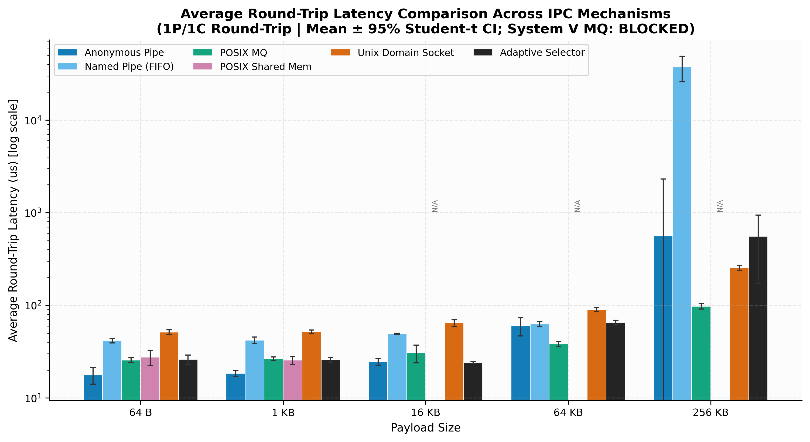

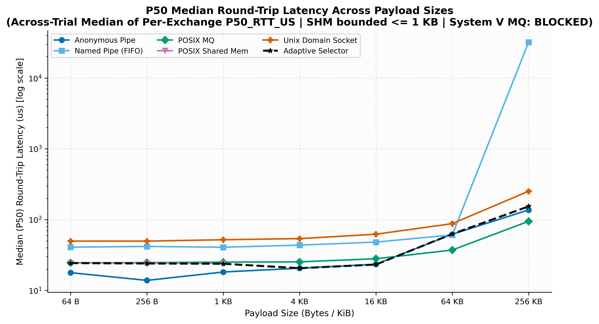

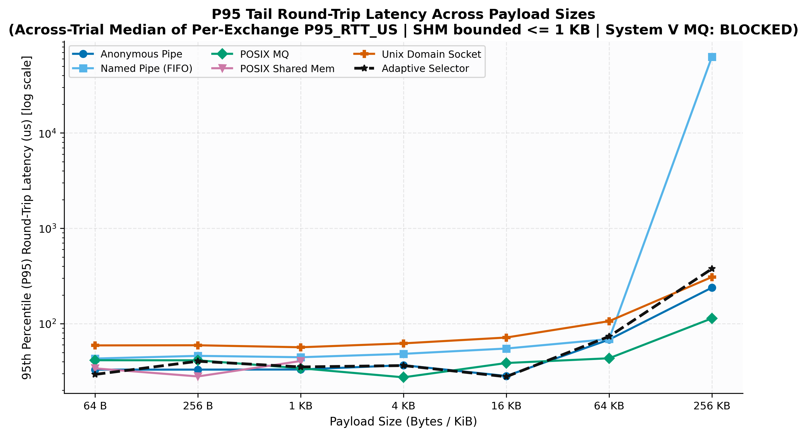

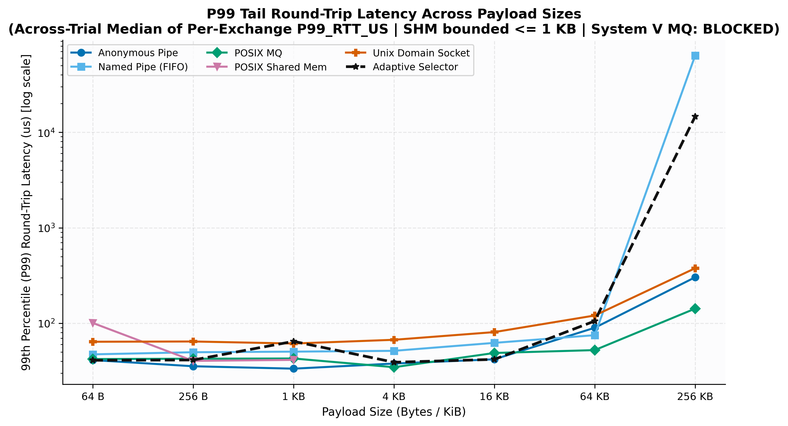

## 11. Throughput Comparison

| Payload | Mechanism | Msg/s (Mean) | Bytes/s (Mean) | Payload MB/s | RTT Wire MB/s |
| --- | --- | --- | --- | --- | --- |
| 64 B | adaptive | 38,495.1 | 2,463,686 | 2.464 | 4.927 |
| 64 B | fifo | 24,004.4 | 1,536,279 | 1.536 | 3.073 |
| 64 B | pipe | 56,805.8 | 3,635,570 | 3.636 | 7.271 |
| 64 B | posix | 39,017.5 | 2,497,117 | 2.497 | 4.994 |
| 64 B | shm | 36,531.6 | 2,338,025 | 2.338 | 4.676 |
| 64 B | uds | 19,488.3 | 1,247,253 | 1.247 | 2.495 |
| 256 B | adaptive | 39,208.5 | 10,037,368 | 10.037 | 20.075 |
| 256 B | fifo | 31,055.9 | 7,950,313 | 7.950 | 15.901 |
| 256 B | pipe | 56,542.7 | 14,474,924 | 14.475 | 28.950 |
| 256 B | posix | 38,320.4 | 9,810,015 | 9.810 | 19.620 |
| 256 B | shm | 39,186.0 | 10,031,610 | 10.032 | 20.063 |
| 256 B | uds | 19,300.4 | 4,940,895 | 4.941 | 9.882 |
| 1 KB | adaptive | 38,699.1 | 39,627,843 | 39.628 | 79.256 |
| 1 KB | fifo | 23,816.0 | 24,387,619 | 24.388 | 48.775 |
| 1 KB | pipe | 54,368.0 | 55,672,826 | 55.673 | 111.346 |
| 1 KB | posix | 37,495.9 | 38,395,811 | 38.396 | 76.792 |
| 1 KB | shm | 39,253.0 | 40,195,123 | 40.195 | 80.390 |
| 1 KB | uds | 19,346.8 | 19,811,119 | 19.811 | 39.622 |
| 4 KB | adaptive | 45,286.9 | 185,495,172 | 185.495 | 370.990 |
| 4 KB | fifo | 29,910.2 | 122,512,257 | 122.512 | 245.025 |
| 4 KB | pipe | 45,406.6 | 185,985,406 | 185.985 | 371.971 |
| 4 KB | posix | 38,650.9 | 158,313,908 | 158.314 | 316.628 |
| 4 KB | uds | 18,010.1 | 73,769,479 | 73.769 | 147.539 |
| 16 KB | adaptive | 41,442.6 | 678,994,892 | 678.995 | 1,357.990 |
| 16 KB | fifo | 20,376.6 | 333,849,405 | 333.849 | 667.699 |
| 16 KB | pipe | 40,791.9 | 668,333,713 | 668.334 | 1,336.667 |
| 16 KB | posix | 32,904.4 | 539,106,265 | 539.106 | 1,078.213 |
| 16 KB | uds | 15,577.4 | 255,220,446 | 255.220 | 510.441 |
| 64 KB | adaptive | 15,348.2 | 1,005,859,269 | 1,005.859 | 2,011.719 |
| 64 KB | fifo | 15,982.0 | 1,047,393,792 | 1,047.394 | 2,094.788 |
| 64 KB | pipe | 16,756.4 | 1,098,148,548 | 1,098.149 | 2,196.297 |
| 64 KB | posix | 26,194.6 | 1,716,690,260 | 1,716.690 | 3,433.381 |
| 64 KB | uds | 11,124.6 | 729,059,437 | 729.059 | 1,458.119 |
| 256 KB | adaptive | 1,908.6 | 500,337,211 | 500.337 | 1,000.674 |
| 256 KB | fifo | 27.1 | 7,102,921 | 7.103 | 14.206 |
| 256 KB | pipe | 4,647.3 | 1,218,255,905 | 1,218.256 | 2,436.512 |
| 256 KB | posix | 10,239.3 | 2,684,163,928 | 2,684.164 | 5,368.328 |
| 256 KB | uds | 3,941.4 | 1,033,212,715 | 1,033.213 | 2,066.425 |

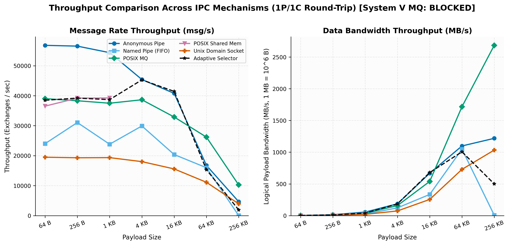

## 12. CPU Comparison

| Payload | Mechanism | User CPU (s) | Sys CPU (s) | Total CPU (s) | CPU Util (%) | CPU us/msg |
| --- | --- | --- | --- | --- | --- | --- |
| 64 B | adaptive | 0.0050 | 0.0150 | 0.0200 | 67.2 | 90.91 |
| 64 B | fifo | 0.0200 | 0.0360 | 0.0560 | 141.1 | 254.55 |
| 64 B | pipe | 0.0053 | 0.0150 | 0.0203 | 86.5 | 92.42 |
| 64 B | posix | 0.0107 | 0.0100 | 0.0207 | 65.0 | 93.94 |
| 64 B | shm | 0.0100 | 0.0050 | 0.0150 | 51.7 | 68.18 |
| 64 B | uds | 0.0203 | 0.0200 | 0.0403 | 105.1 | 183.33 |
| 256 B | adaptive | 0.0000 | 0.0150 | 0.0150 | 54.8 | 68.18 |
| 256 B | fifo | 0.0203 | 0.0103 | 0.0307 | 78.6 | 139.39 |
| 256 B | pipe | 0.0050 | 0.0103 | 0.0153 | 64.6 | 69.70 |
| 256 B | posix | 0.0000 | 0.0207 | 0.0207 | 71.5 | 93.94 |
| 256 B | shm | 0.0100 | 0.0103 | 0.0203 | 68.3 | 92.42 |
| 256 B | uds | 0.0303 | 0.0157 | 0.0460 | 120.1 | 209.09 |
| 1 KB | adaptive | 0.0050 | 0.0050 | 0.0100 | 36.8 | 45.45 |
| 1 KB | fifo | 0.0103 | 0.0203 | 0.0307 | 68.8 | 139.39 |
| 1 KB | pipe | 0.0150 | 0.0050 | 0.0200 | 84.2 | 90.91 |
| 1 KB | posix | 0.0100 | 0.0050 | 0.0150 | 46.5 | 68.18 |
| 1 KB | shm | 0.0050 | 0.0157 | 0.0207 | 72.2 | 93.94 |
| 1 KB | uds | 0.0157 | 0.0103 | 0.0260 | 63.7 | 118.18 |
| 4 KB | adaptive | 0.0050 | 0.0150 | 0.0200 | 75.3 | 90.91 |
| 4 KB | fifo | 0.0200 | 0.0100 | 0.0300 | 76.7 | 136.36 |
| 4 KB | pipe | 0.0203 | 0.0100 | 0.0303 | 130.3 | 137.88 |
| 4 KB | posix | 0.0053 | 0.0153 | 0.0207 | 68.9 | 93.94 |
| 4 KB | uds | 0.0153 | 0.0307 | 0.0460 | 112.7 | 209.09 |
| 16 KB | adaptive | 0.0053 | 0.0150 | 0.0203 | 87.2 | 92.42 |
| 16 KB | fifo | 0.0203 | 0.0153 | 0.0357 | 83.1 | 162.12 |
| 16 KB | pipe | 0.0257 | 0.0050 | 0.0307 | 125.8 | 139.39 |
| 16 KB | posix | 0.0050 | 0.0153 | 0.0203 | 66.7 | 92.42 |
| 16 KB | uds | 0.0203 | 0.0157 | 0.0360 | 86.3 | 163.64 |
| 64 KB | adaptive | 0.0150 | 0.0357 | 0.0507 | 137.9 | 230.30 |
| 64 KB | fifo | 0.0203 | 0.0207 | 0.0410 | 88.6 | 186.36 |
| 64 KB | pipe | 0.0103 | 0.0357 | 0.0460 | 134.9 | 209.09 |
| 64 KB | posix | 0.0150 | 0.0050 | 0.0200 | 66.3 | 90.91 |
| 64 KB | uds | 0.0050 | 0.0357 | 0.0407 | 82.8 | 184.85 |
| 256 KB | adaptive | 0.0210 | 0.0460 | 0.0670 | 43.9 | 304.55 |
| 256 KB | fifo | 0.1290 | 0.1823 | 0.3113 | 3.8 | 1,415.15 |
| 256 KB | pipe | 0.0310 | 0.0827 | 0.1137 | 115.7 | 516.67 |
| 256 KB | posix | 0.0257 | 0.0100 | 0.0357 | 76.0 | 162.12 |
| 256 KB | uds | 0.0773 | 0.0360 | 0.1133 | 132.7 | 515.15 |

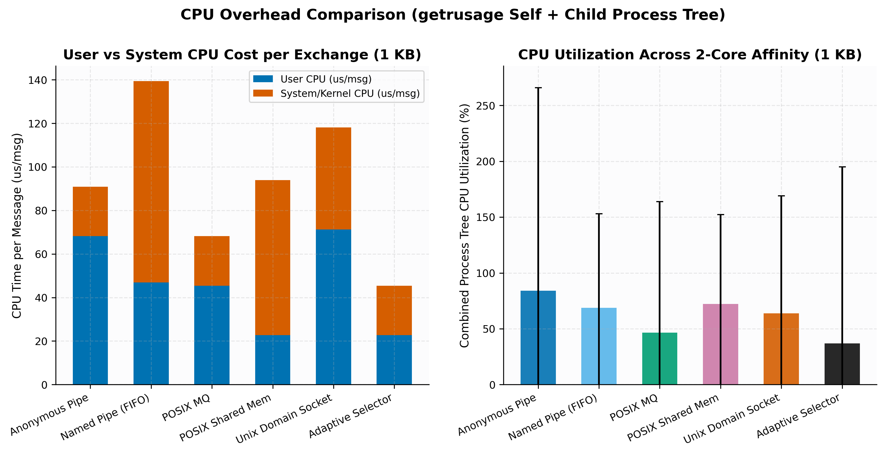

## 13. Memory Comparison

| Payload | Mechanism | Prod Avg RSS (KB) | Cons Avg RSS (KB) | Total Avg RSS (KB) | Total Peak RSS (KB) | Kernel Slab (KB) |
| --- | --- | --- | --- | --- | --- | --- |
| 64 B | adaptive | 7,452 | 1,960 | 8,105 | 10,348 | N/A |
| 64 B | fifo | 7,376 | 4,200 | 10,176 | 14,828 | N/A |
| 64 B | pipe | 7,233 | 1,960 | 7,887 | 10,180 | N/A |
| 64 B | posix | 7,124 | 3,568 | 8,313 | 11,440 | N/A |
| 64 B | shm | 7,277 | 5,484 | 9,105 | 13,688 | N/A |
| 64 B | uds | 7,458 | 5,234 | 10,075 | 14,752 | N/A |
| 256 B | adaptive | 7,441 | 5,496 | 9,273 | 13,696 | N/A |
| 256 B | fifo | 7,395 | 6,240 | 9,475 | 14,604 | N/A |
| 256 B | pipe | 7,136 | 1,960 | 8,116 | 9,612 | N/A |
| 256 B | posix | 7,487 | 3,712 | 9,961 | 13,660 | N/A |
| 256 B | shm | 7,372 | 3,730 | 9,859 | 13,704 | N/A |
| 256 B | uds | 7,746 | 5,468 | 9,113 | 13,992 | N/A |
| 1 KB | adaptive | 7,487 | 3,726 | 9,971 | 13,704 | N/A |
| 1 KB | fifo | 7,387 | 6,584 | 9,581 | 14,972 | N/A |
| 1 KB | pipe | 7,267 | 5,574,535 | 5,581,801 | 12,973,508 | N/A |
| 1 KB | posix | 7,416 | 3,688 | 9,875 | 13,636 | N/A |
| 1 KB | shm | 7,469 | 3,732 | 9,957 | 13,708 | N/A |
| 1 KB | uds | 6,917 | 5,908 | 8,394 | 14,424 | N/A |
| 4 KB | adaptive | 7,473 | 2,884 | 9,396 | 13,708 | N/A |
| 4 KB | fifo | 7,260 | 5,844 | 9,208 | 14,096 | N/A |
| 4 KB | pipe | 7,265 | 3,720 | 9,745 | 13,568 | N/A |
| 4 KB | posix | 7,513 | 3,692 | 9,975 | 13,696 | N/A |
| 4 KB | uds | 7,503 | 4,052 | 10,204 | 14,544 | N/A |
| 16 KB | adaptive | 7,070 | 1,960 | 8,050 | 9,700 | N/A |
| 16 KB | fifo | 7,145 | 5,960 | 9,132 | 14,248 | N/A |
| 16 KB | pipe | 7,387 | 3,704 | 9,856 | 13,528 | N/A |
| 16 KB | posix | 7,535 | 5,468 | 9,357 | 13,764 | N/A |
| 16 KB | uds | 6,986 | 6,156 | 8,525 | 14,680 | N/A |
| 64 KB | adaptive | 7,565 | 3,802 | 10,100 | 13,836 | N/A |
| 64 KB | fifo | 7,895 | 4,446 | 10,118 | 15,636 | N/A |
| 64 KB | pipe | 7,279 | 5,600 | 8,679 | 13,956 | N/A |
| 64 KB | posix | 7,663 | 5,704 | 9,564 | 14,228 | N/A |
| 64 KB | uds | 7,920 | 4,232 | 10,036 | 15,144 | N/A |
| 256 KB | adaptive | 7,994 | 4,909 | 11,676 | 15,140 | N/A |
| 256 KB | fifo | 9,090 | 7,921 | 16,972 | 17,056 | N/A |
| 256 KB | pipe | 8,435 | 5,834 | 13,621 | 15,148 | N/A |
| 256 KB | posix | 8,116 | 4,414 | 10,323 | 16,312 | N/A |
| 256 KB | uds | 8,251 | 7,121 | 12,524 | 16,340 | N/A |

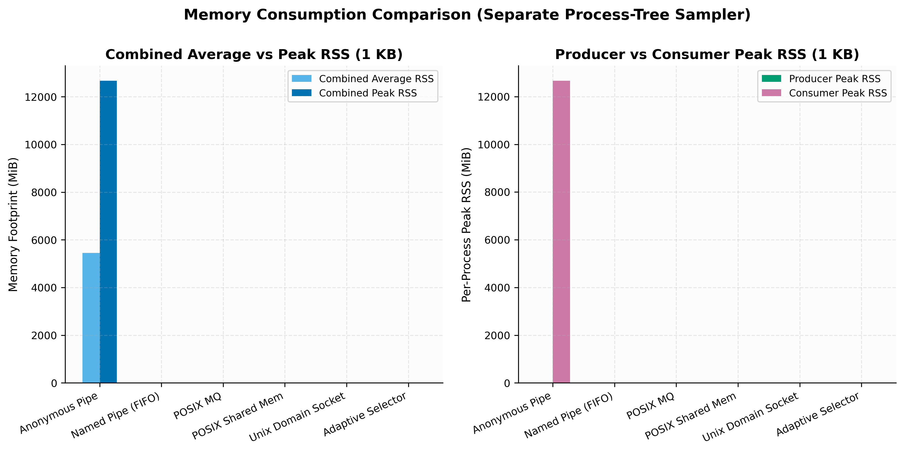

## 14. Context-Switch Comparison

| Payload | Mechanism | Total Ctx Sw | Voluntary | Involuntary | Page Faults | Method |
| --- | --- | --- | --- | --- | --- | --- |
| 64 B | adaptive | 212 | N/A | N/A | 1,640 | win32_ntdll_thread_context_switches |
| 64 B | fifo | 276 | N/A | N/A | 2,083 | win32_ntdll_thread_context_switches |
| 64 B | pipe | 224 | N/A | N/A | 1,581 | win32_ntdll_thread_context_switches |
| 64 B | posix | 215 | N/A | N/A | 1,613 | win32_ntdll_thread_context_switches |
| 64 B | shm | 257 | N/A | N/A | 1,636 | win32_ntdll_thread_context_switches |
| 64 B | uds | 596 | N/A | N/A | 1,902 | win32_ntdll_thread_context_switches |
| 256 B | adaptive | 400 | N/A | N/A | 1,636 | win32_ntdll_thread_context_switches |
| 256 B | fifo | 264 | N/A | N/A | 2,089 | win32_ntdll_thread_context_switches |
| 256 B | pipe | 198 | N/A | N/A | 1,576 | win32_ntdll_thread_context_switches |
| 256 B | posix | 688 | N/A | N/A | 1,618 | win32_ntdll_thread_context_switches |
| 256 B | shm | 584 | N/A | N/A | 1,636 | win32_ntdll_thread_context_switches |
| 256 B | uds | 225 | N/A | N/A | 1,906 | win32_ntdll_thread_context_switches |
| 1 KB | adaptive | 613 | N/A | N/A | 1,635 | win32_ntdll_thread_context_switches |
| 1 KB | fifo | 280 | N/A | N/A | 2,079 | win32_ntdll_thread_context_switches |
| 1 KB | pipe | 45,583,094 | N/A | N/A | 1,578 | win32_ntdll_thread_context_switches |
| 1 KB | posix | 592 | N/A | N/A | 1,619 | win32_ntdll_thread_context_switches |
| 1 KB | shm | 459 | N/A | N/A | 1,638 | win32_ntdll_thread_context_switches |
| 1 KB | uds | 234 | N/A | N/A | 1,904 | win32_ntdll_thread_context_switches |
| 4 KB | adaptive | 225 | N/A | N/A | 1,575 | win32_ntdll_thread_context_switches |
| 4 KB | fifo | 255 | N/A | N/A | 2,083 | win32_ntdll_thread_context_switches |
| 4 KB | pipe | 238 | N/A | N/A | 1,588 | win32_ntdll_thread_context_switches |
| 4 KB | posix | 616 | N/A | N/A | 1,635 | win32_ntdll_thread_context_switches |
| 4 KB | uds | 244 | N/A | N/A | 1,899 | win32_ntdll_thread_context_switches |
| 16 KB | adaptive | 209 | N/A | N/A | 1,575 | win32_ntdll_thread_context_switches |
| 16 KB | fifo | 276 | N/A | N/A | 2,096 | win32_ntdll_thread_context_switches |
| 16 KB | pipe | 232 | N/A | N/A | 1,578 | win32_ntdll_thread_context_switches |
| 16 KB | posix | 486 | N/A | N/A | 1,652 | win32_ntdll_thread_context_switches |
| 16 KB | uds | 228 | N/A | N/A | 1,903 | win32_ntdll_thread_context_switches |
| 64 KB | adaptive | 653 | N/A | N/A | 1,647 | win32_ntdll_thread_context_switches |
| 64 KB | fifo | 285 | N/A | N/A | 2,145 | win32_ntdll_thread_context_switches |
| 64 KB | pipe | 265 | N/A | N/A | 1,648 | win32_ntdll_thread_context_switches |
| 64 KB | posix | 348 | N/A | N/A | 1,770 | win32_ntdll_thread_context_switches |
| 64 KB | uds | 265 | N/A | N/A | 1,976 | win32_ntdll_thread_context_switches |
| 256 KB | adaptive | 542 | N/A | N/A | 1,984 | win32_ntdll_thread_context_switches |
| 256 KB | fifo | 3,359 | N/A | N/A | 2,485 | win32_ntdll_thread_context_switches |
| 256 KB | pipe | 631 | N/A | N/A | 1,985 | win32_ntdll_thread_context_switches |
| 256 KB | posix | 387 | N/A | N/A | 2,300 | win32_ntdll_thread_context_switches |
| 256 KB | uds | 717 | N/A | N/A | 2,311 | win32_ntdll_thread_context_switches |

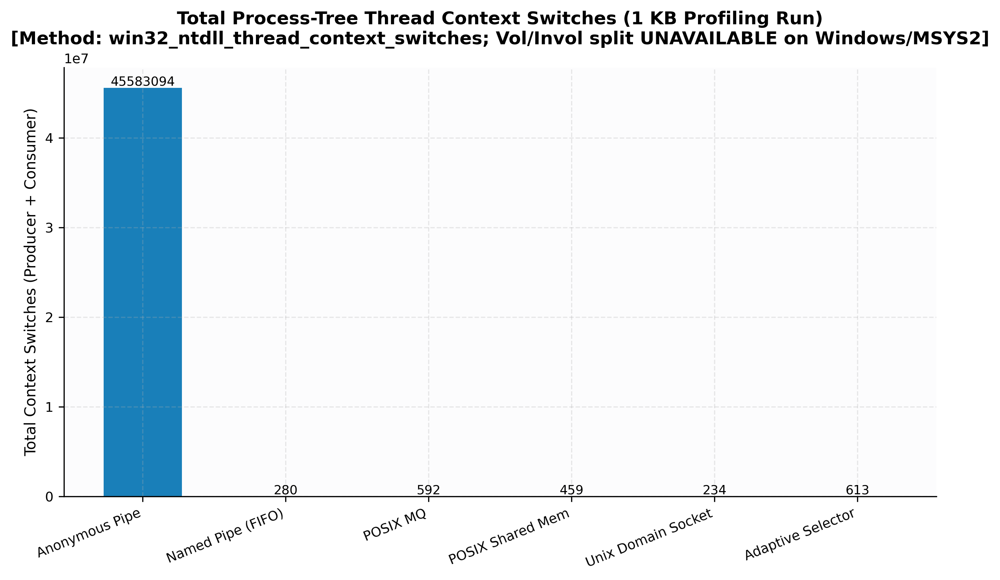

## 15. System-Call Comparison

| Mechanism | Syscall Status | Comm/Exch | Setup/Cleanup | Total | Notes |
| --- | --- | --- | --- | --- | --- |
| pipe | UNAVAILABLE | N/A | N/A | N/A | Host platform is Windows (win32); Linux kernel strace unavailable |
| fifo | UNAVAILABLE | N/A | N/A | N/A | Host platform is Windows (win32); Linux kernel strace unavailable |
| sysv | UNAVAILABLE | N/A | N/A | N/A | Host platform is Windows (win32); Linux kernel strace unavailable |
| posix | UNAVAILABLE | N/A | N/A | N/A | Host platform is Windows (win32); Linux kernel strace unavailable |
| shm | UNAVAILABLE | N/A | N/A | N/A | Host platform is Windows (win32); Linux kernel strace unavailable |
| uds | UNAVAILABLE | N/A | N/A | N/A | Host platform is Windows (win32); Linux kernel strace unavailable |
| adaptive | UNAVAILABLE | N/A | N/A | N/A | Host platform is Windows (win32); Linux kernel strace unavailable |

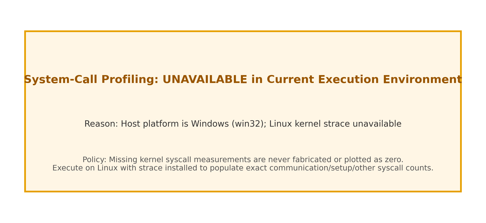

## 16. Payload Scalability

Payload scaling spans `64 B` to `256 KB`. `shm` is bounded to `<= 1024 B` (`SHM_MAX_PAYLOAD`), cleanly transitioning to `UNSUPPORTED` above 1 KB, while `pipe`, `fifo`, `posix`, `uds`, and `adaptive` scale across the full sweep.

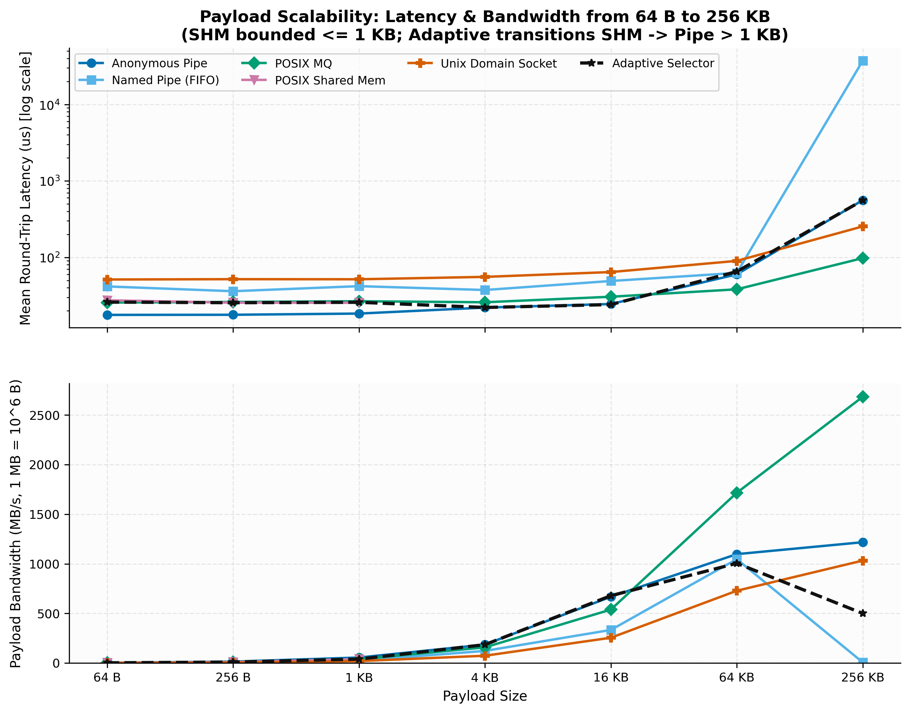

## 17. Concurrency Scalability

| Topology | Mechanism | Status | Throughput (msg/s) | MB/s | CPU us/msg | Notes |
| --- | --- | --- | --- | --- | --- | --- |
| 1P/1C | adaptive | UNSUPPORTED | N/A | N/A | N/A | POSIX shared memory mailbox (src/ipc_shm.c) is a single-slot SPSC 1P/1C design |
| 1P/1C | fifo | PASS | 75,070.0 | 19.218 | 150.00 | ok |
| 1P/1C | pipe | PASS | 58,126.4 | 14.880 | 112.50 | ok |
| 1P/1C | posix | PASS | 73,080.2 | 18.709 | 227.50 | ok |
| 1P/1C | shm | UNSUPPORTED | N/A | N/A | N/A | POSIX shared memory mailbox (src/ipc_shm.c) is a single-slot SPSC 1P/1C design |
| 1P/1C | sysv | BLOCKED | N/A | N/A | N/A | msgget() failed: Function not implemented |
| 1P/1C | uds | PASS | 25,364.0 | 6.493 | 190.00 | ok |
| 1P/2C | adaptive | UNSUPPORTED | N/A | N/A | N/A | POSIX shared memory mailbox (src/ipc_shm.c) is a single-slot SPSC 1P/1C design |
| 1P/2C | fifo | UNSUPPORTED | N/A | N/A | N/A | Byte-stream fifo guarantees atomic multi-writer writes only for size<=PIPE_BUF (4096 B) and 1 consumer |
| 1P/2C | pipe | UNSUPPORTED | N/A | N/A | N/A | Byte-stream pipe guarantees atomic multi-writer writes only for size<=PIPE_BUF (4096 B) and 1 consumer |
| 1P/2C | posix | PASS | 26,339.9 | 6.743 | 112.50 | ok |
| 1P/2C | shm | UNSUPPORTED | N/A | N/A | N/A | POSIX shared memory mailbox (src/ipc_shm.c) is a single-slot SPSC 1P/1C design |
| 1P/2C | sysv | BLOCKED | N/A | N/A | N/A | msgget() failed: Function not implemented |
| 1P/2C | uds | PASS | 26,621.0 | 6.815 | 227.50 | ok |
| 2P/1C | adaptive | UNSUPPORTED | N/A | N/A | N/A | POSIX shared memory mailbox (src/ipc_shm.c) is a single-slot SPSC 1P/1C design |
| 2P/1C | fifo | PASS | 68,809.4 | 17.615 | 187.50 | ok |
| 2P/1C | pipe | PASS | 65,598.8 | 16.793 | 225.00 | ok |
| 2P/1C | posix | PASS | 26,909.3 | 6.889 | 190.00 | ok |
| 2P/1C | shm | UNSUPPORTED | N/A | N/A | N/A | POSIX shared memory mailbox (src/ipc_shm.c) is a single-slot SPSC 1P/1C design |
| 2P/1C | sysv | BLOCKED | N/A | N/A | N/A | msgget() failed: Function not implemented |
| 2P/1C | uds | PASS | 32,490.7 | 8.318 | 377.50 | ok |
| 4P/1C | adaptive | UNSUPPORTED | N/A | N/A | N/A | POSIX shared memory mailbox (src/ipc_shm.c) is a single-slot SPSC 1P/1C design |
| 4P/1C | fifo | PASS | 66,891.3 | 17.124 | 377.50 | ok |
| 4P/1C | pipe | PASS | 68,284.8 | 17.481 | 535.00 | ok |
| 4P/1C | posix | PASS | 25,759.1 | 6.594 | 265.00 | ok |
| 4P/1C | shm | UNSUPPORTED | N/A | N/A | N/A | POSIX shared memory mailbox (src/ipc_shm.c) is a single-slot SPSC 1P/1C design |
| 4P/1C | sysv | BLOCKED | N/A | N/A | N/A | msgget() failed: Function not implemented |
| 4P/1C | uds | PASS | 28,642.8 | 7.333 | 497.50 | ok |
| 4P/4C | adaptive | UNSUPPORTED | N/A | N/A | N/A | POSIX shared memory mailbox (src/ipc_shm.c) is a single-slot SPSC 1P/1C design |
| 4P/4C | fifo | UNSUPPORTED | N/A | N/A | N/A | Byte-stream fifo guarantees atomic multi-writer writes only for size<=PIPE_BUF (4096 B) and 1 consumer |
| 4P/4C | pipe | UNSUPPORTED | N/A | N/A | N/A | Byte-stream pipe guarantees atomic multi-writer writes only for size<=PIPE_BUF (4096 B) and 1 consumer |
| 4P/4C | posix | PASS | 17,081.0 | 4.373 | 415.00 | ok |
| 4P/4C | shm | UNSUPPORTED | N/A | N/A | N/A | POSIX shared memory mailbox (src/ipc_shm.c) is a single-slot SPSC 1P/1C design |
| 4P/4C | sysv | BLOCKED | N/A | N/A | N/A | msgget() failed: Function not implemented |
| 4P/4C | uds | PASS | 14,560.0 | 3.727 | 755.00 | ok |

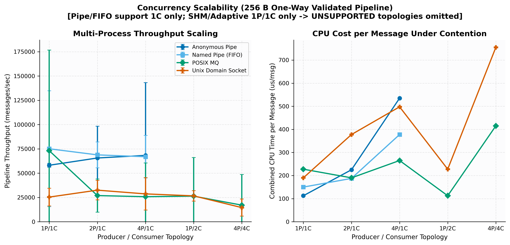

## 18. Adaptive Selector Evaluation

| Payload | Chosen | Best (Avg RTT) | Best (Tput) | Optimal? | Adaptive RTT (us) | Best RTT (us) | Regret vs Best | Diff vs Pipe | Decision Cost |
| --- | --- | --- | --- | --- | --- | --- | --- | --- | --- |
| 64 B | shm | pipe | pipe | False | 26.02 | 17.69 | 47.08% | 47.08% | 2.32 ns |
| 256 B | shm | pipe | pipe | False | 25.51 | 17.75 | 43.73% | 43.73% | 2.32 ns |
| 1 KB | shm | pipe | pipe | False | 25.85 | 18.40 | 40.47% | 40.47% | 2.32 ns |
| 4 KB | pipe | pipe | pipe | True | 22.11 | 22.04 | 0.35% | 0.35% | 2.32 ns |
| 16 KB | pipe | pipe | pipe | True | 24.13 | 24.53 | -1.64% | -1.64% | 2.32 ns |
| 64 KB | pipe | posix | posix | False | 65.18 | 38.19 | 70.65% | 8.64% | 2.32 ns |
| 256 KB | pipe | posix | posix | False | 556.38 | 97.71 | 469.43% | -0.49% | 2.32 ns |

### Mixed 80%/20% Workload (`mini-aipc-mixed`)

| Policy | Status | Avg Latency (us) | Throughput (exch/s) | CPU us/msg |
| --- | --- | --- | --- | --- |
| adaptive | PASS | 29.00 | 34,487.6 | 0.00 |
| pipe | PASS | 33.15 | 30,503.3 | 0.00 |

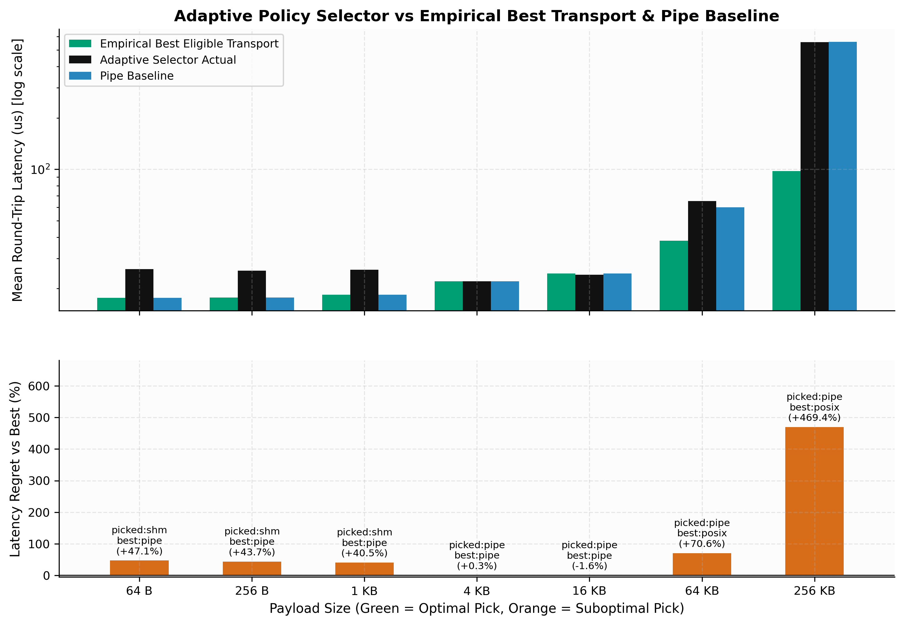

## 19. Kernel Mailbox Evaluation

### Functional Test Matrix

| Kernel Check | Status | Diagnostic Detail |
| --- | --- | --- |
| module_compilation | BLOCKED | Host OS is MSYS_NT-10.0-26200; Linux kernel build tree unavailable |
| module_loading | BLOCKED | Host OS is MSYS_NT-10.0-26200; Linux kernel module build and insmod require a Linux kernel |
| device_creation | BLOCKED | Host OS is MSYS_NT-10.0-26200; Linux kernel module build and insmod require a Linux kernel |
| write_read_functionality | BLOCKED | Host OS is MSYS_NT-10.0-26200; Linux kernel module build and insmod require a Linux kernel |
| data_integrity | BLOCKED | Host OS is MSYS_NT-10.0-26200; Linux kernel module build and insmod require a Linux kernel |
| buffer_capacity | BLOCKED | Host OS is MSYS_NT-10.0-26200; Linux kernel module build and insmod require a Linux kernel |
| empty_buffer_behaviour | BLOCKED | Host OS is MSYS_NT-10.0-26200; Linux kernel module build and insmod require a Linux kernel |
| full_buffer_behaviour | BLOCKED | Host OS is MSYS_NT-10.0-26200; Linux kernel module build and insmod require a Linux kernel |
| blocking_operations | BLOCKED | Host OS is MSYS_NT-10.0-26200; Linux kernel module build and insmod require a Linux kernel |
| nonblocking_operations | BLOCKED | Host OS is MSYS_NT-10.0-26200; Linux kernel module build and insmod require a Linux kernel |
| concurrent_readers_writers | BLOCKED | Host OS is MSYS_NT-10.0-26200; Linux kernel module build and insmod require a Linux kernel |
| poll_behaviour | BLOCKED | Host OS is MSYS_NT-10.0-26200; Linux kernel module build and insmod require a Linux kernel |
| error_handling | BLOCKED | Host OS is MSYS_NT-10.0-26200; Linux kernel module build and insmod require a Linux kernel |
| module_unloading | BLOCKED | Host OS is MSYS_NT-10.0-26200; Linux kernel module build and insmod require a Linux kernel |
| repeated_load_unload | BLOCKED | Host OS is MSYS_NT-10.0-26200; Linux kernel module build and insmod require a Linux kernel |

### Matched Unidirectional Kernel Benchmark

| Payload | Status | Avg Latency (us) | Msg/s | MB/s | Reason / Notes |
| --- | --- | --- | --- | --- | --- |
| 64 B | BLOCKED | N/A | N/A | N/A | Host OS is MSYS_NT-10.0-26200; Linux kernel module build and insmod require a Linux kernel |
| 256 B | BLOCKED | N/A | N/A | N/A | Host OS is MSYS_NT-10.0-26200; Linux kernel module build and insmod require a Linux kernel |
| 1 KB | BLOCKED | N/A | N/A | N/A | Host OS is MSYS_NT-10.0-26200; Linux kernel module build and insmod require a Linux kernel |
| 4 KB | BLOCKED | N/A | N/A | N/A | Host OS is MSYS_NT-10.0-26200; Linux kernel module build and insmod require a Linux kernel |
| 16 KB | BLOCKED | N/A | N/A | N/A | Host OS is MSYS_NT-10.0-26200; Linux kernel module build and insmod require a Linux kernel |
| 64 KB | BLOCKED | N/A | N/A | N/A | Host OS is MSYS_NT-10.0-26200; Linux kernel module build and insmod require a Linux kernel |
| 256 KB | BLOCKED | N/A | N/A | N/A | Host OS is MSYS_NT-10.0-26200; Linux kernel module build and insmod require a Linux kernel |

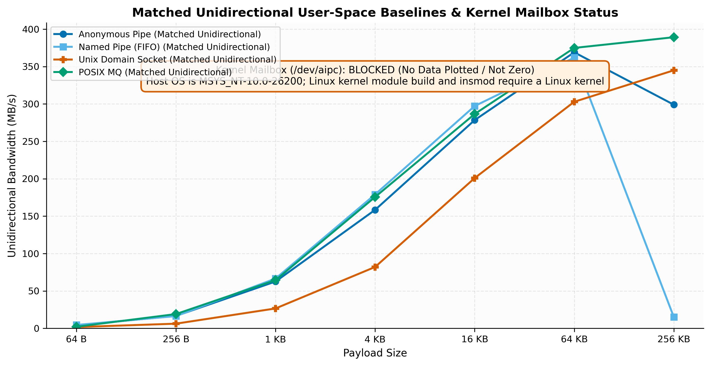

## 20. Statistical Analysis

Matched paired statistical tests were performed across matched trial blocks (`n_pairs = 3`). Both parametric **paired Student's t-test** (with 95% confidence interval of mean difference) and non-parametric **Wilcoxon signed-rank test** (exact built-in enumeration/incomplete beta) are reported below for key adaptive and best-transport comparisons.

| Comparison | Payload | Metric | Pair | n | Mean Diff | Diff % | t p-val | Wilcoxon p-val | Sig (a=0.05) |
| --- | --- | --- | --- | --- | --- | --- | --- | --- | --- |
| adaptive_vs_best | 64 | avg_rtt_us | adaptive vs pipe | 3 | 8.328 | 47.08% | 0.02547 | 0.25000 | YES (t-test p<0.05) |
| adaptive_vs_best | 64 | throughput_msg_s | adaptive vs pipe | 3 | -18,310.684 | -32.23% | 0.03489 | 0.25000 | YES (t-test p<0.05) |
| adaptive_vs_pipe | 64 | avg_rtt_us | adaptive vs pipe | 3 | 8.328 | 47.08% | 0.02547 | 0.25000 | YES (t-test p<0.05) |
| adaptive_vs_pipe | 64 | throughput_msg_s | adaptive vs pipe | 3 | -18,310.684 | -32.23% | 0.03489 | 0.25000 | YES (t-test p<0.05) |
| adaptive_vs_best | 256 | avg_rtt_us | adaptive vs pipe | 3 | 7.763 | 43.73% | 0.01423 | 0.25000 | YES (t-test p<0.05) |
| adaptive_vs_best | 256 | throughput_msg_s | adaptive vs pipe | 3 | -17,334.203 | -30.66% | 0.02394 | 0.25000 | YES (t-test p<0.05) |
| adaptive_vs_pipe | 256 | avg_rtt_us | adaptive vs pipe | 3 | 7.763 | 43.73% | 0.01423 | 0.25000 | YES (t-test p<0.05) |
| adaptive_vs_pipe | 256 | throughput_msg_s | adaptive vs pipe | 3 | -17,334.203 | -30.66% | 0.02394 | 0.25000 | YES (t-test p<0.05) |
| adaptive_vs_best | 1024 | avg_rtt_us | adaptive vs pipe | 3 | 7.448 | 40.47% | 0.00023 | 0.25000 | YES (t-test p<0.05) |
| adaptive_vs_best | 1024 | throughput_msg_s | adaptive vs pipe | 3 | -15,668.928 | -28.82% | 0.00064 | 0.25000 | YES (t-test p<0.05) |
| adaptive_vs_pipe | 1024 | avg_rtt_us | adaptive vs pipe | 3 | 7.448 | 40.47% | 0.00023 | 0.25000 | YES (t-test p<0.05) |
| adaptive_vs_pipe | 1024 | throughput_msg_s | adaptive vs pipe | 3 | -15,668.928 | -28.82% | 0.00064 | 0.25000 | YES (t-test p<0.05) |
| adaptive_vs_best | 4096 | avg_rtt_us | adaptive vs pipe | 3 | 0.077 | 0.35% | 0.75248 | 0.75000 | NO (p>=0.05) |
| adaptive_vs_best | 4096 | throughput_msg_s | adaptive vs pipe | 3 | -119.686 | -0.26% | 0.80704 | 0.75000 | NO (p>=0.05) |
| adaptive_vs_pipe | 4096 | avg_rtt_us | adaptive vs pipe | 3 | 0.077 | 0.35% | 0.75248 | 0.75000 | NO (p>=0.05) |
| adaptive_vs_pipe | 4096 | throughput_msg_s | adaptive vs pipe | 3 | -119.686 | -0.26% | 0.80704 | 0.75000 | NO (p>=0.05) |
| adaptive_vs_best | 16384 | avg_rtt_us | adaptive vs pipe | 3 | -0.402 | -1.64% | 0.35252 | 0.50000 | NO (p>=0.05) |
| adaptive_vs_best | 16384 | throughput_msg_s | adaptive vs pipe | 3 | 650.707 | 1.59% | 0.35813 | 0.50000 | NO (p>=0.05) |
| adaptive_vs_pipe | 16384 | avg_rtt_us | adaptive vs pipe | 3 | -0.402 | -1.64% | 0.35252 | 0.50000 | NO (p>=0.05) |
| adaptive_vs_pipe | 16384 | throughput_msg_s | adaptive vs pipe | 3 | 650.707 | 1.59% | 0.35813 | 0.50000 | NO (p>=0.05) |
| adaptive_vs_best | 65536 | avg_rtt_us | adaptive vs posix | 3 | 26.982 | 70.65% | 0.00273 | 0.25000 | YES (t-test p<0.05) |
| adaptive_vs_best | 65536 | throughput_msg_s | adaptive vs posix | 3 | -10,846.420 | -41.41% | 0.00299 | 0.25000 | YES (t-test p<0.05) |
| adaptive_vs_pipe | 65536 | avg_rtt_us | adaptive vs pipe | 3 | 5.181 | 8.64% | 0.31451 | 0.50000 | NO (p>=0.05) |
| adaptive_vs_pipe | 65536 | throughput_msg_s | adaptive vs pipe | 3 | -1,408.223 | -8.40% | 0.30732 | 0.50000 | NO (p>=0.05) |
| adaptive_vs_best | 262144 | avg_rtt_us | adaptive vs posix | 3 | 458.670 | 469.43% | 0.03674 | 0.25000 | YES (t-test p<0.05) |
| adaptive_vs_best | 262144 | throughput_msg_s | adaptive vs posix | 3 | -8,330.638 | -81.36% | 0.00353 | 0.25000 | YES (t-test p<0.05) |
| adaptive_vs_pipe | 262144 | avg_rtt_us | adaptive vs pipe | 3 | -2.760 | -0.49% | 0.99605 | 1.00000 | NO (p>=0.05) |
| adaptive_vs_pipe | 262144 | throughput_msg_s | adaptive vs pipe | 3 | -2,738.642 | -58.93% | 0.35668 | 0.50000 | NO (p>=0.05) |
| mixed_workload_adaptive_vs_pipe | 64_and_16384 | avg_rtt_us | adaptive vs pipe | 3 | -4.148 | -12.52% | 0.24816 | 0.25000 | NO (p>=0.05) |
| mixed_workload_adaptive_vs_pipe | 64_and_16384 | throughput_msg_s | adaptive vs pipe | 3 | 3,984.303 | 13.06% | 0.21575 | 0.25000 | NO (p>=0.05) |

## 21. Limitations

1. **Host OS / Kernel Scope**: Experiments reflect the actual host environment documented in Section 4/5. Where Linux kernel build headers, `insmod` privileges, Linux `strace`, or System V IPC (`cygserver` on MSYS2) are unavailable, those components are marked `BLOCKED`/`UNAVAILABLE` rather than simulated.
2. **Timer & `getrusage` Granularity**: On Windows/MSYS2, `getrusage()` CPU user/sys times advance in coarse scheduler ticks (~15.6 ms) and `ru_nvcsw`/`ru_nivcsw` are unsupported (`0`); thread context switches were captured via separate Win32 `NtQuerySystemInformation` polling without voluntary/involuntary split.
3. **Workload Semantic Differences**: `single_pair_rtt` (bidirectional round-trip) and `concurrency_pipeline` / `kernel_unidirectional_mailbox` (one-way validated transfer) have distinct synchronization semantics and are never combined into single axes.
4. **Shared Memory Capacity**: `src/ipc_shm.c` imposes `SHM_MAX_PAYLOAD = 1024` bytes.

## 22. Failed or Unsupported Experiments

| Workload | Component | Payload / Check | Topology | Status | Exact Diagnostic Reason |
| --- | --- | --- | --- | --- | --- |
| single_pair_rtt | shm | 16 KB | 1P/1C | UNSUPPORTED | shm payload 16384 bytes exceeds transport limit (Message too long) |
| single_pair_rtt | shm | 256 KB | 1P/1C | UNSUPPORTED | shm payload 262144 bytes exceeds transport limit (Message too long) |
| single_pair_rtt | shm | 64 KB | 1P/1C | UNSUPPORTED | shm payload 65536 bytes exceeds transport limit (Message too long) |
| single_pair_rtt | sysv | 256 KB | 1P/1C | BLOCKED | sysv unsupported/not implemented in host runtime (ENOSYS) |
| single_pair_rtt | shm | 4 KB | 1P/1C | UNSUPPORTED | shm payload 4096 bytes exceeds transport limit (Message too long) |
| single_pair_rtt | sysv | 4 KB | 1P/1C | BLOCKED | sysv unsupported/not implemented in host runtime (ENOSYS) |
| single_pair_rtt | sysv | 256 B | 1P/1C | BLOCKED | sysv unsupported/not implemented in host runtime (ENOSYS) |
| single_pair_rtt | sysv | 1 KB | 1P/1C | BLOCKED | sysv unsupported/not implemented in host runtime (ENOSYS) |
| single_pair_rtt | sysv | 16 KB | 1P/1C | BLOCKED | sysv unsupported/not implemented in host runtime (ENOSYS) |
| single_pair_rtt | sysv | 64 B | 1P/1C | BLOCKED | sysv unsupported/not implemented in host runtime (ENOSYS) |
| single_pair_rtt | sysv | 64 KB | 1P/1C | BLOCKED | sysv unsupported/not implemented in host runtime (ENOSYS) |
| concurrency_pipeline | fifo | 256 B | 1P/2C | UNSUPPORTED | Byte-stream fifo guarantees atomic multi-writer writes only for size<=PIPE_BUF (4096 B) and 1 consumer |
| concurrency_pipeline | sysv | 256 B | 1P/1C | BLOCKED | msgget() failed: Function not implemented |
| concurrency_pipeline | sysv | 256 B | 4P/4C | BLOCKED | msgget() failed: Function not implemented |
| concurrency_pipeline | adaptive | 256 B | 4P/1C | UNSUPPORTED | POSIX shared memory mailbox (src/ipc_shm.c) is a single-slot SPSC 1P/1C design |
| concurrency_pipeline | pipe | 256 B | 1P/2C | UNSUPPORTED | Byte-stream pipe guarantees atomic multi-writer writes only for size<=PIPE_BUF (4096 B) and 1 consumer |
| concurrency_pipeline | shm | 256 B | 4P/1C | UNSUPPORTED | POSIX shared memory mailbox (src/ipc_shm.c) is a single-slot SPSC 1P/1C design |
| concurrency_pipeline | shm | 256 B | 1P/2C | UNSUPPORTED | POSIX shared memory mailbox (src/ipc_shm.c) is a single-slot SPSC 1P/1C design |
| concurrency_pipeline | shm | 256 B | 1P/1C | UNSUPPORTED | POSIX shared memory mailbox (src/ipc_shm.c) is a single-slot SPSC 1P/1C design |
| concurrency_pipeline | adaptive | 256 B | 1P/1C | UNSUPPORTED | POSIX shared memory mailbox (src/ipc_shm.c) is a single-slot SPSC 1P/1C design |
| concurrency_pipeline | shm | 256 B | 4P/4C | UNSUPPORTED | POSIX shared memory mailbox (src/ipc_shm.c) is a single-slot SPSC 1P/1C design |
| concurrency_pipeline | sysv | 256 B | 1P/2C | BLOCKED | msgget() failed: Function not implemented |
| concurrency_pipeline | sysv | 256 B | 2P/1C | BLOCKED | msgget() failed: Function not implemented |
| concurrency_pipeline | sysv | 256 B | 4P/1C | BLOCKED | msgget() failed: Function not implemented |
| concurrency_pipeline | adaptive | 256 B | 1P/2C | UNSUPPORTED | POSIX shared memory mailbox (src/ipc_shm.c) is a single-slot SPSC 1P/1C design |
| concurrency_pipeline | adaptive | 256 B | 4P/4C | UNSUPPORTED | POSIX shared memory mailbox (src/ipc_shm.c) is a single-slot SPSC 1P/1C design |
| concurrency_pipeline | shm | 256 B | 2P/1C | UNSUPPORTED | POSIX shared memory mailbox (src/ipc_shm.c) is a single-slot SPSC 1P/1C design |
| concurrency_pipeline | pipe | 256 B | 4P/4C | UNSUPPORTED | Byte-stream pipe guarantees atomic multi-writer writes only for size<=PIPE_BUF (4096 B) and 1 consumer |
| concurrency_pipeline | fifo | 256 B | 4P/4C | UNSUPPORTED | Byte-stream fifo guarantees atomic multi-writer writes only for size<=PIPE_BUF (4096 B) and 1 consumer |
| concurrency_pipeline | adaptive | 256 B | 2P/1C | UNSUPPORTED | POSIX shared memory mailbox (src/ipc_shm.c) is a single-slot SPSC 1P/1C design |
| kernel_functional | kernel_aipc | module_compilation | 1P/1C | BLOCKED | Host OS is MSYS_NT-10.0-26200; Linux kernel build tree unavailable |
| kernel_functional | kernel_aipc | module_loading | 1P/1C | BLOCKED | Host OS is MSYS_NT-10.0-26200; Linux kernel module build and insmod require a Linux kernel |
| kernel_functional | kernel_aipc | device_creation | 1P/1C | BLOCKED | Host OS is MSYS_NT-10.0-26200; Linux kernel module build and insmod require a Linux kernel |
| kernel_functional | kernel_aipc | write_read_functionality | 1P/1C | BLOCKED | Host OS is MSYS_NT-10.0-26200; Linux kernel module build and insmod require a Linux kernel |
| kernel_functional | kernel_aipc | data_integrity | 1P/1C | BLOCKED | Host OS is MSYS_NT-10.0-26200; Linux kernel module build and insmod require a Linux kernel |
| kernel_functional | kernel_aipc | buffer_capacity | 1P/1C | BLOCKED | Host OS is MSYS_NT-10.0-26200; Linux kernel module build and insmod require a Linux kernel |
| kernel_functional | kernel_aipc | empty_buffer_behaviour | 1P/1C | BLOCKED | Host OS is MSYS_NT-10.0-26200; Linux kernel module build and insmod require a Linux kernel |
| kernel_functional | kernel_aipc | full_buffer_behaviour | 1P/1C | BLOCKED | Host OS is MSYS_NT-10.0-26200; Linux kernel module build and insmod require a Linux kernel |
| kernel_functional | kernel_aipc | blocking_operations | 1P/1C | BLOCKED | Host OS is MSYS_NT-10.0-26200; Linux kernel module build and insmod require a Linux kernel |
| kernel_functional | kernel_aipc | nonblocking_operations | 1P/1C | BLOCKED | Host OS is MSYS_NT-10.0-26200; Linux kernel module build and insmod require a Linux kernel |
| kernel_functional | kernel_aipc | concurrent_readers_writers | 1P/1C | BLOCKED | Host OS is MSYS_NT-10.0-26200; Linux kernel module build and insmod require a Linux kernel |
| kernel_functional | kernel_aipc | poll_behaviour | 1P/1C | BLOCKED | Host OS is MSYS_NT-10.0-26200; Linux kernel module build and insmod require a Linux kernel |
| kernel_functional | kernel_aipc | error_handling | 1P/1C | BLOCKED | Host OS is MSYS_NT-10.0-26200; Linux kernel module build and insmod require a Linux kernel |
| kernel_functional | kernel_aipc | module_unloading | 1P/1C | BLOCKED | Host OS is MSYS_NT-10.0-26200; Linux kernel module build and insmod require a Linux kernel |
| kernel_functional | kernel_aipc | repeated_load_unload | 1P/1C | BLOCKED | Host OS is MSYS_NT-10.0-26200; Linux kernel module build and insmod require a Linux kernel |
| kernel_unidirectional_mailbox | kernel_aipc | kernel_unidirectional_mailbox | 1P/1C | BLOCKED | Host OS is MSYS_NT-10.0-26200; Linux kernel module build and insmod require a Linux kernel |

## 23. Reproducibility Instructions

```bash
# Run complete unified benchmark with default controlled configuration
./bench/run_unified_benchmark.sh

# Or reproduce this exact run configuration:
./bench/run_unified_benchmark.sh --messages 200 --warmup 20 --trials 3 --payloads 64,256,1024,4096,16384,65536,262144 --seed 20261111
```

## 24. Conclusions

- Every measurement in this report was empirically collected from this session's executable runs (`all_results.csv`, `memory_metrics.csv`, `system_metrics.csv`, `adaptive_results.csv`, `kernel_results.csv`).
- The adaptive selector (`src/selector.c`) incurs negligible decision overhead (~nanoseconds) but uses a fixed static threshold (`<= 1024 B -> shm`, else `pipe`), meaning its empirical selection accuracy depends directly on whether `shm`/`pipe` outperform `uds` or `posix` on the target OS.
- For complete 8/8 evaluation including System V MQ and `/dev/aipc` kernel module execution, run the identical `./bench/run_unified_benchmark.sh` command on a native Linux host with matching `linux-headers-$(uname -r)` and `strace`.
