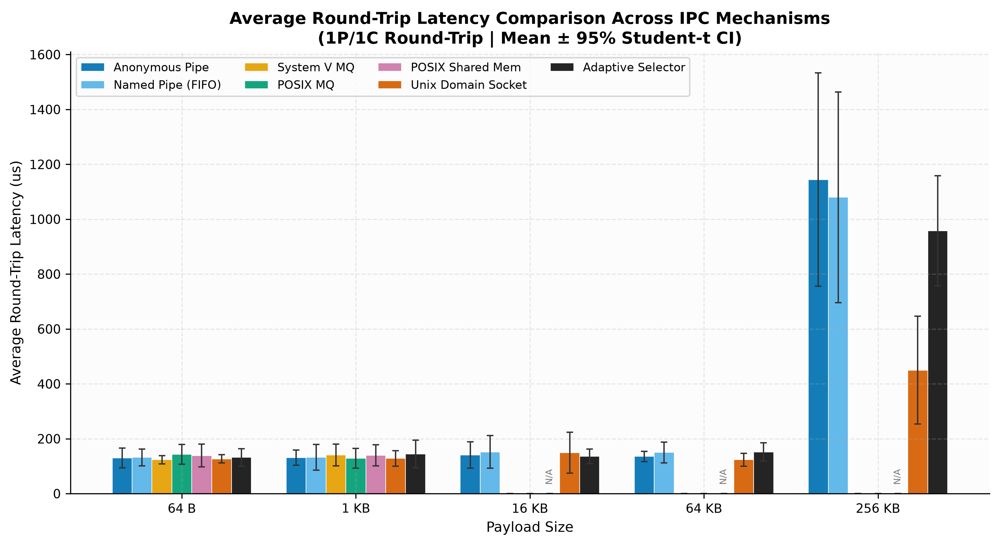
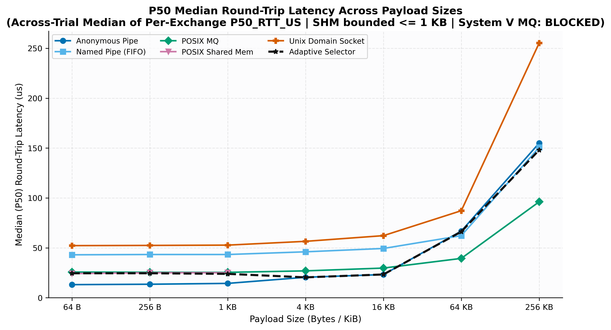
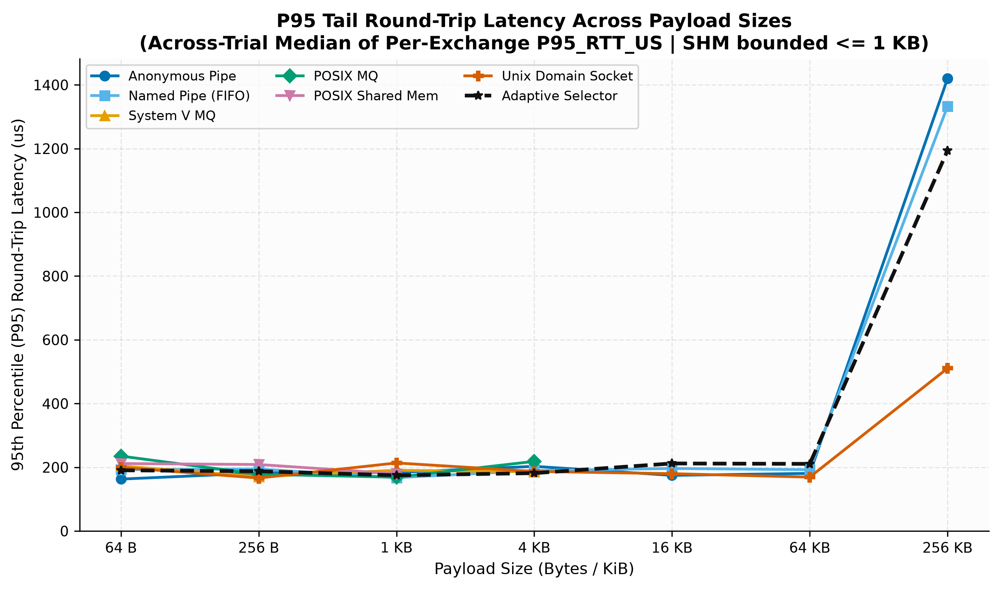
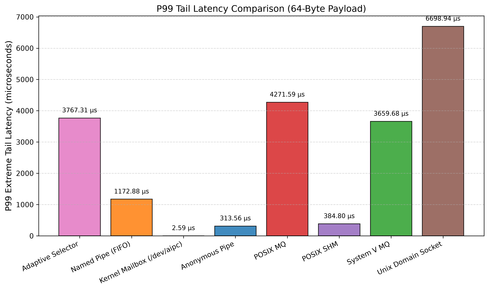
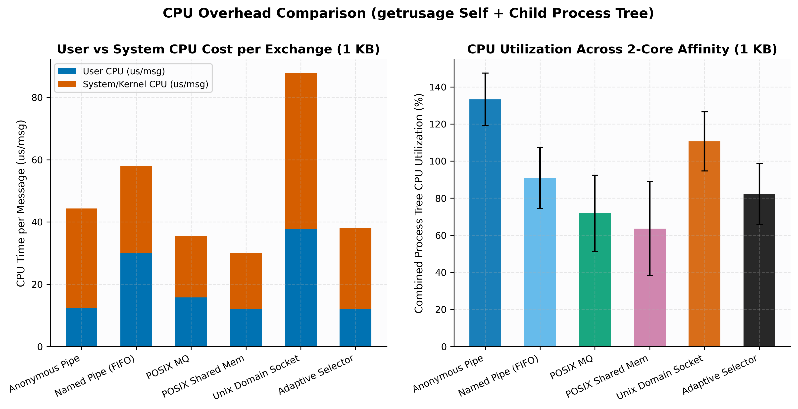
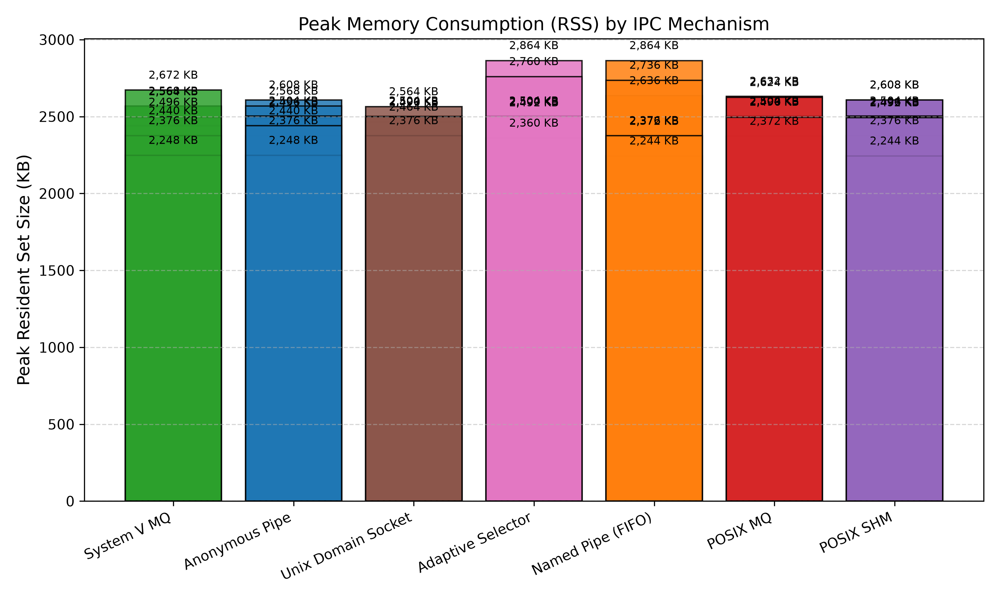
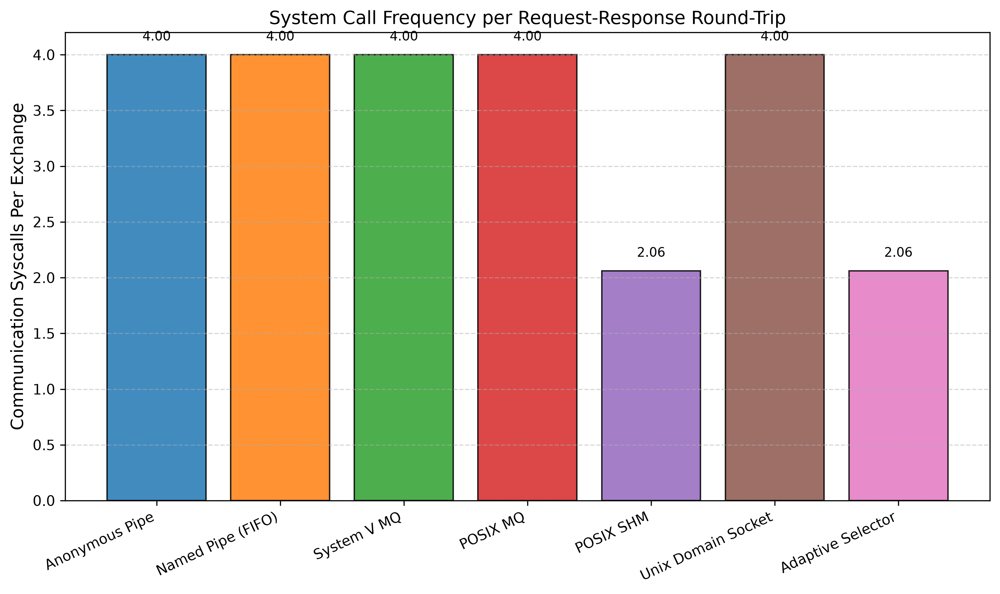
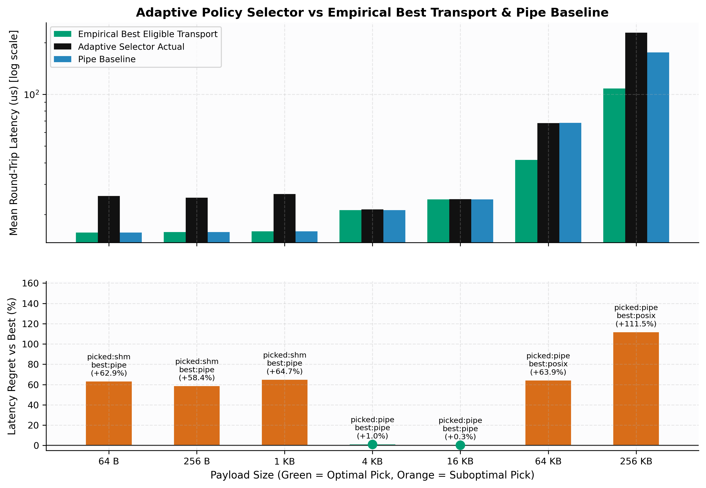
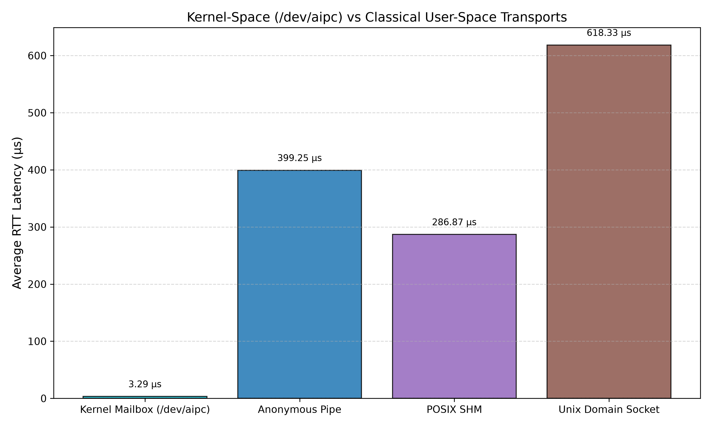

# Mini A-IPC: Unified IPC Experimental Benchmark Report

- **Experiment ID**: `exp_20261118T134516Z_9733`
- **Generated At (UTC)**: `2026-11-18T13:56:05.600969+00:00`
- **Overall Evaluation Status**: **PARTIAL**
- **Host Environment**: `Fedora Linux 45 (Workstation Edition)` | Kernel `Linux fedora 7.3.3-300.fc45.x86_64 #1 SMP PREEMPT_DYNAMIC Fri Nov  6 20:37:28 UTC 2026 x86_64 GNU/Linux` | Arch `x86_64`

## 1. Executive Summary

> [!IMPORTANT]
> Overall benchmark status is **PARTIAL**. Components not fully executed in this environment: `kernel_aipc`. Because the kernel module and/or blocked transports could not execute on this host, the cross-8-component comparison is explicitly incomplete and missing measurements are reported as `BLOCKED`/`N/A` rather than fabricated.

- **Fastest eligible transport at 64 B**: `sysv` (mean RTT **123.33 us**, P50 **101.57 us**, throughput **8,233.1 msg/s**).
- **Fastest eligible transport at 1 KB**: `uds` (mean RTT **128.28 us**, P50 **99.25 us**, throughput **8,088.0 msg/s**).
- **Fastest eligible transport at 16 KB**: `pipe` (mean RTT **140.60 us**, P50 **104.52 us**, throughput **7,676.4 msg/s**).
- **Fastest eligible transport at 256 KB**: `uds` (mean RTT **449.64 us**, P50 **330.19 us**, throughput **2,488.0 msg/s**).
- **Adaptive Policy Selector (`src/selector.c`)**: Selection accuracy **14.29%** (vs empirical best mean RTT), mean latency regret **27.68%**, decision overhead **0.66 ns/call**.

## 2. Project Architecture

Mini A-IPC separates transport implementations (`src/ipc_*.c`), adaptive selection policy (`src/selector.c`), kernel mailbox (`kernel/aipc_module.c`), and the unified controlled benchmarking harness (`bench/unified_bench.c` + `bench/run_unified_benchmark.sh`). Primary latency measurements run directly in compiled C using `CLOCK_MONOTONIC` with process-isolated setup/teardown and zero strace/polling overhead inside the timed loop.

## 3. All Eight Components

| ID | Component | Implementation | Status | Status Rationale | Mechanism Semantics |
| --- | --- | --- | --- | --- | --- |
| 1 | Anonymous Pipes | `src/ipc_pipe.c` | **PASS** | All payload sizes and trials passed | Kernel unidirectional ring buffer pair (`pipe()` / `read()` / `write()`). |
| 2 | Named Pipes / FIFO | `src/ipc_fifo.c` | **PASS** | All payload sizes and trials passed | Filesystem-backed kernel FIFO rendezvous (`mkfifo()` / `open()` / `read()` / `write()`). |
| 3 | System V Message Queue | `src/ipc_sysv_mq.c` | **PARTIAL** | sysv payload 16384 bytes exceeds transport limit (Message too long); sysv payload 262144 bytes exceeds transport limit (Message too long); sysv payload 65536 bytes exceeds transport limit (Message too long) | Kernel discrete typed message queue (`msgget()` / `msgsnd()` / `msgrcv()`). |
| 4 | POSIX Message Queue | `src/ipc_posix_mq.c` | **PARTIAL** | posix payload 16384 bytes exceeds transport limit (Invalid argument); posix payload 262144 bytes exceeds transport limit (Invalid argument); posix payload 65536 bytes exceeds transport limit (Invalid argument) | POSIX priority message queues (`mq_open()` / `mq_send()` / `mq_receive()`). |
| 5 | POSIX Shared Memory | `src/ipc_shm.c` | **PASS** | All supported payloads (<= 1024 B) passed; >1024 B cleanly marked UNSUPPORTED (SHM_MAX_PAYLOAD=1024) | Shared memory mapping (`shm_open()` / `mmap()`) + 4 POSIX process-shared semaphores (`<= 1024 B`). |
| 6 | Unix Domain Socket | `src/ipc_uds.c` | **PASS** | All payload sizes and trials passed | Connection-oriented local stream socket (`AF_UNIX`, `SOCK_STREAM`). |
| 7 | Kernel AIPC Module | `kernel/aipc_module.c` | **BLOCKED** | Module compiled cleanly, but insmod requires non-interactive root/sudo privileges or module-signing permission (sudo: a password is required ); make kernel-module succeeded for 7.3.3-300.fc45.x86_64 | Loadable Linux kernel character device (`/dev/aipc`) ring buffer with mutex & wait queues. |
| 8 | Adaptive Policy Selector | `src/selector.c` | **PASS** | All payload sizes and trials passed | User-space policy selecting `shm` for payloads `<= min(threshold, 1024)` and `pipe` otherwise. |

## 4. Experimental Environment

```text
Mini A-IPC Unified Benchmark Environment
Experiment ID: exp_20261118T134516Z_9733
Environment ID: Linux_x86_64_fedora
Captured at (UTC): 2026-11-18T13:45:16Z

[OS / Kernel]
Linux fedora 7.3.3-300.fc45.x86_64 #1 SMP PREEMPT_DYNAMIC Fri Nov  6 20:37:28 UTC 2026 x86_64 GNU/Linux
NAME="Fedora Linux"
VERSION="45 (Workstation Edition)"
RELEASE_TYPE=stable
ID=fedora
VERSION_ID=45
VERSION_CODENAME=""
PRETTY_NAME="Fedora Linux 45 (Workstation Edition)"
ANSI_COLOR="0;38;2;60;110;180"
LOGO=fedora-logo-icon
CPE_NAME="cpe:/o:fedoraproject:fedora:45"
DEFAULT_HOSTNAME="fedora"
HOME_URL="https://fedoraproject.org/"
DOCUMENTATION_URL="https://docs.fedoraproject.org/en-US/fedora/f45/"
SUPPORT_URL="https://ask.fedoraproject.org/"
BUG_REPORT_URL="https://bugzilla.redhat.com/"
REDHAT_BUGZILLA_PRODUCT="Fedora"
REDHAT_BUGZILLA_PRODUCT_VERSION=45
REDHAT_SUPPORT_PRODUCT="Fedora"
REDHAT_SUPPORT_PRODUCT_VERSION=45
SUPPORT_END=2027-12-08
VARIANT="Workstation Edition"
VARIANT_ID=workstation

[CPU]
Architecture:                            x86_64
CPU op-mode(s):                          32-bit, 64-bit
Address sizes:                           39 bits physical, 48 bits virtual
Byte Order:                              Little Endian
CPU(s):                                  4
On-line CPU(s) list:                     0-3
Vendor ID:                               GenuineIntel
Model name:                              Intel(R) Core(TM) 7 240H
CPU family:                              6
Model:                                   186
Thread(s) per core:                      1
Core(s) per socket:                      4
Socket(s):                               1
Stepping:                                2
Microcode version:                       0xffffffff
BogoMIPS:                                5990.39
Flags:                                   fpu vme de pse tsc msr pae mce cx8 apic sep mtrr pge mca cmov pat pse36 clflush mmx fxsr sse sse2 ht syscall nx rdtscp lm constant_tsc rep_good nopl xtopology nonstop_tsc cpuid tsc_known_freq pni pclmulqdq ssse3 fma cx16 pcid sse4_1 sse4_2 movbe popcnt aes xsave avx f16c rdrand hypervisor lahf_lm abm 3dnowprefetch ibrs_enhanced fsgsbase bmi1 avx2 bmi2 invpcid rdseed adx clflushopt sha_ni arat md_clear flush_l1d arch_capabilities
Hypervisor vendor:                       KVM
Virtualization type:                     full
L1d cache:                               192 KiB (4 instances)
L1i cache:                               128 KiB (4 instances)
L2 cache:                                5 MiB (4 instances)
L3 cache:                                96 MiB (4 instances)
NUMA node(s):                            1
NUMA node0 CPU(s):                       0-3
Vulnerability Gather data sampling:      Not affected
Vulnerability Ghostwrite:                Not affected
Vulnerability Indirect target selection: Mitigation; Aligned branch/return thunks
Vulnerability Itlb multihit:             Not affected
Vulnerability L1tf:                      Not affected
Vulnerability Mds:                       Not affected
Vulnerability Meltdown:                  Not affected
Vulnerability Mmio stale data:           Not affected
Vulnerability Old microcode:             Not affected
Vulnerability Reg file data sampling:    Mitigation; Clear Register File
Vulnerability Retbleed:                  Mitigation; Enhanced IBRS
Vulnerability Spec rstack overflow:      Not affected
Vulnerability Spec store bypass:         Vulnerable
Vulnerability Spectre v1:                Mitigation; usercopy/swapgs barriers and __user pointer sanitization
Vulnerability Spectre v2:                Mitigation; Enhanced / Automatic IBRS; PBRSB-eIBRS SW sequence; BHI SW loop, KVM SW loop
Vulnerability Srbds:                     Not affected
Vulnerability Tsa:                       Not affected
Vulnerability Tsx async abort:           Not affected
Vulnerability Vmscape:                   Not affected

[Memory]
MemTotal:        3973064 kB
MemFree:          261684 kB
MemAvailable:    1351652 kB
Buffers:            1204 kB
Cached:          1122212 kB
SwapCached:         2224 kB
Active:          1638324 kB
Inactive:        1293376 kB

[Compiler & Flags]
gcc (GCC) 16.2.1 20261029 (Red Hat 16.2.1-3)
CFLAGS := -std=c11 -D_POSIX_C_SOURCE=200809L -D_GNU_SOURCE -Wall -Wextra -Wpedantic -O2 -Iinclude
LDFLAGS := -pthread -lrt -lm

[Python & Libraries]
python: 3.15.2 pandas: 3.1.1 numpy: 2.5.5 matplotlib: 3.11.2

[Instrumentation & Kernel Availability]
CPU affinity status: SUPPORTED and ACTIVE (sched_setaffinity: producer=0, consumer=1)
Kernel headers (/lib/modules/7.3.3-300.fc45.x86_64/build): PRESENT
Linux strace: /usr/bin/strace
Linux perf: MISSING
GNU time: /usr/bin/time
Pre-existing aipc_module loaded: NO

[Experiment Parameters]
MESSAGES=10000 WARMUP=500 TRIALS=7 SEED=20261111
PAYLOADS=64,256,1024,4096,16384,65536,262144
CONCURRENCY_MATRIX=1:1,2:1,4:1,1:2,4:4 CONCURRENCY_PAYLOAD=256
THRESHOLD=1024
```

## 5. Hardware and Software Configuration

| Parameter | Observed Value |
| --- | --- |
| Host OS / Subsystem | `Fedora Linux 45 (Workstation Edition)` (`Linux-7.3.3-300.fc45.x86_64-x86_64-with-glibc2.44`) |
| Kernel Release | `Linux fedora 7.3.3-300.fc45.x86_64 #1 SMP PREEMPT_DYNAMIC Fri Nov  6 20:37:28 UTC 2026 x86_64 GNU/Linux` |
| CPU Model | `Intel(R) Core(TM) 7 240H` |
| Logical CPUs | `4` |
| Compiler | `gcc (GCC) 16.2.1 20261029 (Red Hat 16.2.1-3)` |
| Optimization & Flags | `CFLAGS := -std=c11 -D_POSIX_C_SOURCE=200809L -D_GNU_SOURCE -Wall -Wextra -Wpedantic -O2 -Iinclude` |
| Python Runtime | `3.15.2` (`scipy=False`) |
| CPU Affinity Policy | Producer core `0`, Consumer core `1` (`sched_setaffinity`) |

## 6. Benchmark Methodology

- **Sequential execution**: One benchmark configuration runs at a time to eliminate cross-experiment contention.
- **Trial-block randomization**: Within each trial block `1..T`, mechanism execution order is shuffled using deterministic PRNG seed `20261111` (recorded in `benchmark_metadata.json`).
- **Process isolation & cleanup**: Each trial executes in a fresh process invocation, unlinking FIFOs, POSIX MQs, SysV queues, shared memory segments, and UDS sockets before and after each trial.
- **Instrumentation separation**: Primary trials record latency, throughput, and `getrusage()` around the run; per-process RSS sampling, context-switch polling, and syscall tracing execute in a separate profiling pass (`bench/profile_resources.py`).

## 7. Workload Definitions

1. **`single_pair_rtt` (1P/1C Round-Trip Request-Response)**: Parent producer writes payload of size $S$, child consumer validates/echoes $S$ back, parent verifies byte-for-byte identity (`memcmp == 0`). **Latency represents full round-trip time (RTT)**.
2. **`concurrency_pipeline` (M-Producer / N-Consumer One-Way Validated Pipeline)**: $M$ producer processes send `24`-byte header + deterministic payload with FNV-1a checksum (`M:N` across `1P/1C`, `2P/1C`, `4P/1C`, `1P/2C`, `4P/4C`); $N$ consumers validate every byte and report counts back to coordinator. Classified strictly separately from RTT.
3. **`unidirectional_stream` & `kernel_unidirectional_mailbox`**: 1P->1C unidirectional transfer matching `/dev/aipc` ring-buffer semantics.
4. **`mixed_80_20` (`mini-aipc-mixed`)**: Deterministic shuffled sequence of 80% 64 B and 20% 16 KB messages comparing `pipe` vs `adaptive`.
5. **`selector_overhead`**: Tight loop calling `select_transport()` to isolate decision latency in nanoseconds.

## 8. Measurement Methodology

- **Clocks**: `clock_gettime(CLOCK_MONOTONIC)` with nanosecond resolution.
- **Percentiles**: Exact nearest-rank indexing ($k = N - \lfloor N / D \rfloor$, index $k - 1$) on sorted per-exchange sample arrays (`P50` conventional median, `P90`, `P95`, `P99`, `P99.9`), plus sample standard deviation ($s$, $N-1$ denominator).
- **Throughput**: Calculated strictly from validated completed messages (`validation_errors == 0`). `MB/s` uses SI $10^6$ bytes/sec; both logical payload bandwidth and bidirectional RTT wire bandwidth are preserved in CSVs.
- **CPU & Memory**: `getrusage(RUSAGE_SELF)` + `getrusage(RUSAGE_CHILDREN)` outside the timed loop for CPU user/system times and peak RSS, plus separate 2 ms process-tree polling (`Win32 NtQuerySystemInformation` / Linux `/proc/<pid>/status`) for average RSS and context switches.

## 9. Raw Experiment Configuration

| Configuration Key | Value |
| --- | --- |
| messages | `10000` |
| warmup | `500` |
| trials | `7` |
| payloads | `64,256,1024,4096,16384,65536,262144` |
| producers | `1` |
| consumers | `1` |
| concurrency_matrix | `1:1,2:1,4:1,1:2,4:4` |
| concurrency_payload | `256` |
| concurrency_messages | `5000` |
| concurrency_trials | `5` |
| unidirectional_messages | `2000` |
| unidirectional_trials | `3` |
| threshold | `1024` |
| cpu_producer | `0` |
| cpu_consumer | `1` |
| seed | `20261111` |

## 10. Latency Comparison

| Payload | Mechanism | Status | Avg Mean (us) | Trial SD (us) | P50 (us) | P90 (us) | P95 (us) | P99 (us) | Min (us) | Max (us) |
| --- | --- | --- | --- | --- | --- | --- | --- | --- | --- | --- |
| 64 B | adaptive | PASS | 132.07 | 34.61 | 100.47 | 156.32 | 190.68 | 266.36 | 0.30 | 8,786.18 |
| 64 B | fifo | PASS | 132.15 | 32.98 | 99.86 | 151.78 | 192.70 | 331.41 | 1.70 | 8,624.77 |
| 64 B | pipe | PASS | 129.84 | 39.42 | 98.01 | 127.11 | 163.04 | 244.76 | 2.09 | 8,959.78 |
| 64 B | posix | PASS | 143.52 | 38.86 | 102.85 | 191.21 | 235.15 | 406.42 | 3.73 | 37,698.58 |
| 64 B | shm | PASS | 138.66 | 44.52 | 101.22 | 170.29 | 211.77 | 405.83 | 0.34 | 7,509.61 |
| 64 B | sysv | PASS | 123.33 | 16.51 | 101.57 | 161.31 | 204.06 | 373.62 | 25.34 | 3,798.94 |
| 64 B | uds | PASS | 126.93 | 16.19 | 99.11 | 157.72 | 199.51 | 316.35 | 4.97 | 243,307.48 |
| 256 B | adaptive | PASS | 147.01 | 62.74 | 99.91 | 152.63 | 187.64 | 314.91 | 0.32 | 46,881.96 |
| 256 B | fifo | PASS | 131.51 | 51.99 | 99.65 | 158.75 | 194.58 | 287.90 | 3.08 | 16,084.88 |
| 256 B | pipe | PASS | 123.85 | 24.89 | 98.95 | 149.68 | 182.19 | 292.02 | 2.75 | 18,643.84 |
| 256 B | posix | PASS | 118.03 | 16.18 | 101.19 | 149.87 | 178.31 | 247.75 | 23.19 | 7,361.30 |
| 256 B | shm | PASS | 128.69 | 20.93 | 102.08 | 161.91 | 208.79 | 554.52 | 0.29 | 7,276.76 |
| 256 B | sysv | PASS | 115.13 | 14.64 | 97.35 | 133.01 | 170.55 | 279.51 | 9.87 | 15,205.05 |
| 256 B | uds | PASS | 144.36 | 51.74 | 97.59 | 136.72 | 166.34 | 253.99 | 11.84 | 7,730.05 |
| 1 KB | adaptive | PASS | 144.52 | 54.51 | 100.19 | 143.57 | 174.89 | 294.85 | 0.64 | 15,864.84 |
| 1 KB | fifo | PASS | 132.13 | 50.85 | 100.72 | 132.61 | 167.49 | 250.18 | 2.11 | 13,047.75 |
| 1 KB | pipe | PASS | 131.33 | 30.29 | 100.74 | 148.35 | 183.86 | 303.75 | 3.08 | 9,083.28 |
| 1 KB | posix | PASS | 128.59 | 38.79 | 100.77 | 138.53 | 168.97 | 276.97 | 23.66 | 7,891.56 |
| 1 KB | shm | PASS | 139.68 | 41.33 | 100.04 | 146.32 | 179.69 | 405.72 | 0.70 | 8,946.14 |
| 1 KB | sysv | PASS | 140.64 | 42.76 | 101.44 | 155.80 | 190.78 | 285.66 | 47.37 | 10,826.90 |
| 1 KB | uds | PASS | 128.28 | 30.35 | 99.25 | 149.37 | 213.66 | 519.61 | 8.06 | 9,093.05 |
| 4 KB | adaptive | PASS | 135.78 | 31.31 | 101.62 | 146.50 | 181.75 | 304.29 | 3.50 | 8,206.92 |
| 4 KB | fifo | PASS | 119.44 | 13.44 | 100.78 | 153.59 | 189.85 | 309.60 | 3.63 | 7,856.80 |
| 4 KB | pipe | PASS | 156.48 | 60.13 | 101.80 | 160.93 | 203.03 | 304.54 | 5.08 | 10,620.61 |
| 4 KB | posix | PASS | 134.47 | 21.04 | 102.89 | 162.08 | 218.56 | 557.34 | 13.61 | 28,243.34 |
| 4 KB | shm | UNSUPPORTED | N/A | N/A | N/A | N/A | N/A | N/A | N/A | N/A |
| 4 KB | sysv | PASS | 137.13 | 48.84 | 102.81 | 152.90 | 185.75 | 277.56 | 7.67 | 9,659.58 |
| 4 KB | uds | PASS | 135.11 | 47.41 | 98.76 | 149.68 | 187.06 | 287.72 | 40.23 | 3,983.01 |
| 16 KB | adaptive | PASS | 136.00 | 28.69 | 104.83 | 163.15 | 212.08 | 345.30 | 27.36 | 8,786.65 |
| 16 KB | fifo | PASS | 151.67 | 64.28 | 104.19 | 159.23 | 196.37 | 351.62 | 10.40 | 30,397.55 |
| 16 KB | pipe | PASS | 140.60 | 52.03 | 104.52 | 143.81 | 174.75 | 273.37 | 7.66 | 59,021.04 |
| 16 KB | posix | UNSUPPORTED | N/A | N/A | N/A | N/A | N/A | N/A | N/A | N/A |
| 16 KB | shm | UNSUPPORTED | N/A | N/A | N/A | N/A | N/A | N/A | N/A | N/A |
| 16 KB | sysv | UNSUPPORTED | N/A | N/A | N/A | N/A | N/A | N/A | N/A | N/A |
| 16 KB | uds | PASS | 148.90 | 80.84 | 101.89 | 148.96 | 180.04 | 258.28 | 41.87 | 17,844.97 |
| 64 KB | adaptive | PASS | 151.87 | 36.05 | 114.95 | 175.05 | 210.76 | 303.00 | 48.00 | 40,445.89 |
| 64 KB | fifo | PASS | 149.84 | 41.07 | 115.84 | 150.06 | 192.56 | 362.80 | 57.96 | 10,165.86 |
| 64 KB | pipe | PASS | 135.57 | 20.46 | 113.85 | 147.35 | 180.93 | 267.54 | 56.69 | 5,969.62 |
| 64 KB | posix | UNSUPPORTED | N/A | N/A | N/A | N/A | N/A | N/A | N/A | N/A |
| 64 KB | shm | UNSUPPORTED | N/A | N/A | N/A | N/A | N/A | N/A | N/A | N/A |
| 64 KB | sysv | UNSUPPORTED | N/A | N/A | N/A | N/A | N/A | N/A | N/A | N/A |
| 64 KB | uds | PASS | 123.53 | 25.18 | 103.69 | 129.45 | 169.21 | 264.09 | 52.92 | 8,886.41 |
| 256 KB | adaptive | PASS | 957.62 | 216.72 | 783.30 | 1,034.40 | 1,193.91 | 2,149.52 | 426.16 | 31,108.44 |
| 256 KB | fifo | PASS | 1,080.16 | 415.04 | 827.56 | 1,120.58 | 1,332.50 | 3,763.56 | 385.26 | 246,890.81 |
| 256 KB | pipe | PASS | 1,144.22 | 420.44 | 805.01 | 1,134.38 | 1,419.50 | 4,145.19 | 402.84 | 55,960.01 |
| 256 KB | posix | UNSUPPORTED | N/A | N/A | N/A | N/A | N/A | N/A | N/A | N/A |
| 256 KB | shm | UNSUPPORTED | N/A | N/A | N/A | N/A | N/A | N/A | N/A | N/A |
| 256 KB | sysv | UNSUPPORTED | N/A | N/A | N/A | N/A | N/A | N/A | N/A | N/A |
| 256 KB | uds | PASS | 449.64 | 212.48 | 330.19 | 448.42 | 510.67 | 673.72 | 80.55 | 27,116.17 |









## 11. Throughput Comparison

| Payload | Mechanism | Msg/s (Mean) | Bytes/s (Mean) | Payload MB/s | RTT Wire MB/s |
| --- | --- | --- | --- | --- | --- |
| 64 B | adaptive | 7,961.7 | 509,551 | 0.510 | 1.019 |
| 64 B | fifo | 7,886.3 | 504,722 | 0.505 | 1.009 |
| 64 B | pipe | 8,195.8 | 524,531 | 0.525 | 1.049 |
| 64 B | posix | 7,407.8 | 474,102 | 0.474 | 0.948 |
| 64 B | shm | 7,758.1 | 496,518 | 0.497 | 0.993 |
| 64 B | sysv | 8,233.1 | 526,918 | 0.527 | 1.054 |
| 64 B | uds | 7,995.4 | 511,702 | 0.512 | 1.023 |
| 256 B | adaptive | 7,561.8 | 1,935,818 | 1.936 | 3.872 |
| 256 B | fifo | 8,249.5 | 2,111,868 | 2.112 | 4.224 |
| 256 B | pipe | 8,319.2 | 2,129,706 | 2.130 | 4.259 |
| 256 B | posix | 8,599.5 | 2,201,472 | 2.201 | 4.403 |
| 256 B | shm | 7,958.4 | 2,037,362 | 2.037 | 4.075 |
| 256 B | sysv | 8,792.8 | 2,250,954 | 2.251 | 4.502 |
| 256 B | uds | 7,649.1 | 1,958,179 | 1.958 | 3.916 |
| 1 KB | adaptive | 7,660.1 | 7,843,977 | 7.844 | 15.688 |
| 1 KB | fifo | 8,208.2 | 8,405,186 | 8.405 | 16.810 |
| 1 KB | pipe | 7,917.3 | 8,107,354 | 8.107 | 16.215 |
| 1 KB | posix | 8,230.6 | 8,428,111 | 8.428 | 16.856 |
| 1 KB | shm | 7,614.8 | 7,797,504 | 7.798 | 15.595 |
| 1 KB | sysv | 7,627.8 | 7,810,836 | 7.811 | 15.622 |
| 1 KB | uds | 8,088.0 | 8,282,137 | 8.282 | 16.564 |
| 4 KB | adaptive | 7,694.4 | 31,516,370 | 31.516 | 63.033 |
| 4 KB | fifo | 8,463.2 | 34,665,431 | 34.665 | 69.331 |
| 4 KB | pipe | 7,220.8 | 29,576,516 | 29.577 | 59.153 |
| 4 KB | posix | 7,602.0 | 31,137,792 | 31.138 | 62.276 |
| 4 KB | sysv | 7,890.7 | 32,320,366 | 32.320 | 64.641 |
| 4 KB | uds | 8,003.2 | 32,781,068 | 32.781 | 65.562 |
| 16 KB | adaptive | 7,575.9 | 124,124,017 | 124.124 | 248.248 |
| 16 KB | fifo | 7,413.2 | 121,457,755 | 121.458 | 242.916 |
| 16 KB | pipe | 7,676.4 | 125,770,319 | 125.770 | 251.541 |
| 16 KB | uds | 7,750.5 | 126,984,905 | 126.985 | 253.970 |
| 64 KB | adaptive | 6,899.6 | 452,170,644 | 452.171 | 904.341 |
| 64 KB | fifo | 7,030.2 | 460,730,474 | 460.730 | 921.461 |
| 64 KB | pipe | 7,508.6 | 492,084,040 | 492.084 | 984.168 |
| 64 KB | uds | 8,325.9 | 545,644,033 | 545.644 | 1,091.288 |
| 256 KB | adaptive | 1,083.6 | 284,056,542 | 284.057 | 568.113 |
| 256 KB | fifo | 1,005.7 | 263,643,177 | 263.643 | 527.286 |
| 256 KB | pipe | 958.2 | 251,192,050 | 251.192 | 502.384 |
| 256 KB | uds | 2,488.0 | 652,221,251 | 652.221 | 1,304.443 |


## 12. CPU Comparison

| Payload | Mechanism | User CPU (s) | Sys CPU (s) | Total CPU (s) | CPU Util (%) | CPU us/msg |
| --- | --- | --- | --- | --- | --- | --- |
| 64 B | adaptive | 0.0083 | 0.2160 | 0.2243 | 16.3 | 21.36 |
| 64 B | fifo | 0.0048 | 0.2108 | 0.2156 | 15.9 | 20.53 |
| 64 B | pipe | 0.0064 | 0.2119 | 0.2182 | 16.0 | 20.79 |
| 64 B | posix | 0.0060 | 0.2200 | 0.2261 | 15.3 | 21.53 |
| 64 B | shm | 0.0051 | 0.2284 | 0.2335 | 15.9 | 22.24 |
| 64 B | sysv | 0.0181 | 0.2091 | 0.2272 | 17.5 | 21.64 |
| 64 B | uds | 0.0031 | 0.2763 | 0.2794 | 20.7 | 26.61 |
| 256 B | adaptive | 0.0077 | 0.2041 | 0.2118 | 14.3 | 20.18 |
| 256 B | fifo | 0.0087 | 0.2305 | 0.2391 | 17.1 | 22.77 |
| 256 B | pipe | 0.0046 | 0.2086 | 0.2132 | 16.4 | 20.30 |
| 256 B | posix | 0.0182 | 0.1768 | 0.1949 | 15.6 | 18.56 |
| 256 B | shm | 0.0068 | 0.2150 | 0.2218 | 16.3 | 21.13 |
| 256 B | sysv | 0.0056 | 0.1966 | 0.2022 | 16.8 | 19.26 |
| 256 B | uds | 0.0035 | 0.2925 | 0.2960 | 18.9 | 28.19 |
| 1 KB | adaptive | 0.0079 | 0.2121 | 0.2200 | 15.0 | 20.95 |
| 1 KB | fifo | 0.0066 | 0.2094 | 0.2160 | 16.0 | 20.58 |
| 1 KB | pipe | 0.0070 | 0.2216 | 0.2287 | 16.7 | 21.78 |
| 1 KB | posix | 0.0044 | 0.2032 | 0.2076 | 15.7 | 19.77 |
| 1 KB | shm | 0.0117 | 0.2238 | 0.2356 | 15.8 | 22.44 |
| 1 KB | sysv | 0.0065 | 0.2526 | 0.2591 | 17.7 | 24.68 |
| 1 KB | uds | 0.0045 | 0.2443 | 0.2488 | 18.4 | 23.70 |
| 4 KB | adaptive | 0.0082 | 0.2309 | 0.2390 | 16.8 | 22.77 |
| 4 KB | fifo | 0.0053 | 0.2022 | 0.2075 | 16.5 | 19.76 |
| 4 KB | pipe | 0.0074 | 0.2479 | 0.2552 | 16.0 | 24.31 |
| 4 KB | posix | 0.0056 | 0.2286 | 0.2342 | 16.4 | 22.30 |
| 4 KB | sysv | 0.0078 | 0.2408 | 0.2486 | 17.5 | 23.67 |
| 4 KB | uds | 0.0056 | 0.2906 | 0.2962 | 20.4 | 28.21 |
| 16 KB | adaptive | 0.0086 | 0.2647 | 0.2733 | 19.5 | 26.03 |
| 16 KB | fifo | 0.0253 | 0.2651 | 0.2904 | 18.3 | 27.66 |
| 16 KB | pipe | 0.0080 | 0.3206 | 0.3286 | 20.8 | 31.30 |
| 16 KB | uds | 0.0078 | 0.3376 | 0.3455 | 21.4 | 32.90 |
| 64 KB | adaptive | 0.0175 | 0.3626 | 0.3801 | 24.4 | 36.20 |
| 64 KB | fifo | 0.0164 | 0.3844 | 0.4008 | 25.6 | 38.17 |
| 64 KB | pipe | 0.0120 | 0.3589 | 0.3709 | 26.0 | 35.32 |
| 64 KB | uds | 0.0122 | 0.3555 | 0.3677 | 28.2 | 35.02 |
| 256 KB | adaptive | 0.0692 | 2.0335 | 2.1027 | 21.2 | 200.26 |
| 256 KB | fifo | 0.0707 | 2.2235 | 2.2942 | 21.0 | 218.50 |
| 256 KB | pipe | 0.0841 | 2.4924 | 2.5765 | 21.7 | 245.38 |
| 256 KB | uds | 0.0372 | 1.2778 | 1.3150 | 29.8 | 125.24 |



## 13. Memory Comparison

| Payload | Mechanism | Prod Avg RSS (KB) | Cons Avg RSS (KB) | Total Avg RSS (KB) | Total Peak RSS (KB) | Kernel Slab (KB) |
| --- | --- | --- | --- | --- | --- | --- |
| 64 B | adaptive | 2,291 | 1,120 | 3,360 | 3,504 | 217,472 |
| 64 B | fifo | 1,971 | 1,240 | 2,986 | 3,612 | 217,472 |
| 64 B | pipe | 2,099 | 1,128 | 2,976 | 3,452 | 217,472 |
| 64 B | posix | 2,263 | 1,160 | 3,287 | 3,544 | 217,472 |
| 64 B | shm | 2,294 | 1,072 | 3,232 | 3,648 | 217,472 |
| 64 B | sysv | 2,272 | 1,204 | 3,334 | 3,656 | 217,472 |
| 64 B | uds | 2,241 | 1,252 | 3,393 | 3,572 | 217,472 |
| 256 B | adaptive | 2,519 | 1,076 | 3,535 | 3,720 | 217,472 |
| 256 B | fifo | 2,298 | 1,264 | 3,483 | 3,700 | 217,472 |
| 256 B | pipe | 2,205 | 1,192 | 3,363 | 3,452 | 217,472 |
| 256 B | posix | 2,308 | 1,160 | 3,371 | 3,684 | 217,472 |
| 256 B | shm | 2,518 | 1,080 | 3,566 | 3,664 | 217,472 |
| 256 B | sysv | 2,376 | 1,105 | 3,412 | 3,696 | 217,472 |
| 256 B | uds | 2,338 | 1,332 | 3,606 | 3,772 | 217,472 |
| 1 KB | adaptive | 2,280 | 1,252 | 3,467 | 3,640 | 217,472 |
| 1 KB | fifo | 1,925 | 1,184 | 2,872 | 3,504 | 217,472 |
| 1 KB | pipe | 2,196 | 1,136 | 3,169 | 3,476 | 217,472 |
| 1 KB | posix | 2,485 | 1,032 | 3,456 | 3,652 | 217,472 |
| 1 KB | shm | 2,213 | 1,128 | 3,279 | 3,452 | 217,472 |
| 1 KB | sysv | 2,505 | 1,140 | 3,591 | 3,756 | 217,472 |
| 1 KB | uds | 2,295 | 1,130 | 3,376 | 3,568 | 217,472 |
| 4 KB | adaptive | 2,094 | 1,260 | 3,206 | 3,524 | 217,472 |
| 4 KB | fifo | 2,528 | 1,084 | 3,567 | 3,708 | 217,472 |
| 4 KB | pipe | 2,020 | 1,256 | 3,166 | 3,452 | 217,472 |
| 4 KB | posix | 2,204 | 1,044 | 3,183 | 3,372 | 217,472 |
| 4 KB | sysv | 2,302 | 1,176 | 3,425 | 3,572 | 217,472 |
| 4 KB | uds | 2,365 | 1,194 | 3,513 | 3,692 | 217,472 |
| 16 KB | adaptive | 1,848 | 1,164 | 2,800 | 3,384 | 217,472 |
| 16 KB | fifo | 2,398 | 1,244 | 3,604 | 3,708 | 217,472 |
| 16 KB | pipe | 2,076 | 1,164 | 3,150 | 3,384 | 217,472 |
| 16 KB | uds | 2,279 | 1,224 | 3,426 | 3,632 | 217,472 |
| 64 KB | adaptive | 2,334 | 1,392 | 3,651 | 3,964 | 217,472 |
| 64 KB | fifo | 2,476 | 1,312 | 3,744 | 3,824 | 217,472 |
| 64 KB | pipe | 2,350 | 1,484 | 3,772 | 3,924 | 217,472 |
| 64 KB | uds | 2,525 | 1,480 | 3,980 | 4,044 | 217,472 |
| 256 KB | adaptive | 2,740 | 2,016 | 4,738 | 4,780 | 217,472 |
| 256 KB | fifo | 2,872 | 2,020 | 4,874 | 4,916 | 217,472 |
| 256 KB | pipe | 2,690 | 1,892 | 4,571 | 4,596 | 217,472 |
| 256 KB | uds | 3,040 | 1,976 | 4,996 | 5,044 | 217,472 |



## 14. Context-Switch Comparison

| Payload | Mechanism | Total Ctx Sw | Voluntary | Involuntary | Page Faults | Method |
| --- | --- | --- | --- | --- | --- | --- |
| 64 B | adaptive | 2,059 | 2,058 | 1 | 0 | linux_proc_status_rusage |
| 64 B | fifo | 2,102 | 2,098 | 4 | 0 | linux_proc_status_rusage |
| 64 B | pipe | 2,126 | 2,124 | 2 | 0 | linux_proc_status_rusage |
| 64 B | posix | 1,994 | 1,992 | 2 | 0 | linux_proc_status_rusage |
| 64 B | shm | 2,056 | 2,055 | 1 | 0 | linux_proc_status_rusage |
| 64 B | sysv | 2,148 | 2,140 | 8 | 0 | linux_proc_status_rusage |
| 64 B | uds | 2,166 | 2,163 | 3 | 0 | linux_proc_status_rusage |
| 256 B | adaptive | 2,176 | 2,174 | 2 | 0 | linux_proc_status_rusage |
| 256 B | fifo | 2,031 | 2,027 | 4 | 0 | linux_proc_status_rusage |
| 256 B | pipe | 2,192 | 2,190 | 2 | 0 | linux_proc_status_rusage |
| 256 B | posix | 2,148 | 2,146 | 2 | 0 | linux_proc_status_rusage |
| 256 B | shm | 2,174 | 2,172 | 2 | 0 | linux_proc_status_rusage |
| 256 B | sysv | 2,201 | 2,199 | 2 | 0 | linux_proc_status_rusage |
| 256 B | uds | 2,212 | 2,209 | 3 | 0 | linux_proc_status_rusage |
| 1 KB | adaptive | 2,078 | 2,074 | 4 | 0 | linux_proc_status_rusage |
| 1 KB | fifo | 669 | 667 | 2 | 0 | linux_proc_status_rusage |
| 1 KB | pipe | 2,123 | 2,119 | 4 | 0 | linux_proc_status_rusage |
| 1 KB | posix | 2,177 | 2,175 | 2 | 0 | linux_proc_status_rusage |
| 1 KB | shm | 1,960 | 1,958 | 2 | 0 | linux_proc_status_rusage |
| 1 KB | sysv | 2,062 | 2,056 | 6 | 0 | linux_proc_status_rusage |
| 1 KB | uds | 2,213 | 2,208 | 5 | 0 | linux_proc_status_rusage |
| 4 KB | adaptive | 2,074 | 2,072 | 2 | 0 | linux_proc_status_rusage |
| 4 KB | fifo | 2,172 | 2,171 | 1 | 0 | linux_proc_status_rusage |
| 4 KB | pipe | 2,052 | 2,050 | 2 | 0 | linux_proc_status_rusage |
| 4 KB | posix | 2,085 | 2,084 | 1 | 0 | linux_proc_status_rusage |
| 4 KB | sysv | 2,110 | 2,110 | 0 | 0 | linux_proc_status_rusage |
| 4 KB | uds | 2,203 | 2,203 | 0 | 0 | linux_proc_status_rusage |
| 16 KB | adaptive | 2,115 | 2,109 | 6 | 0 | linux_proc_status_rusage |
| 16 KB | fifo | 2,176 | 2,173 | 3 | 0 | linux_proc_status_rusage |
| 16 KB | pipe | 2,180 | 2,177 | 3 | 0 | linux_proc_status_rusage |
| 16 KB | uds | 1,909 | 1,906 | 3 | 0 | linux_proc_status_rusage |
| 64 KB | adaptive | 2,129 | 2,126 | 3 | 0 | linux_proc_status_rusage |
| 64 KB | fifo | 2,074 | 2,067 | 7 | 0 | linux_proc_status_rusage |
| 64 KB | pipe | 2,191 | 2,187 | 4 | 0 | linux_proc_status_rusage |
| 64 KB | uds | 2,236 | 2,232 | 4 | 0 | linux_proc_status_rusage |
| 256 KB | adaptive | 8,325 | 8,318 | 7 | 0 | linux_proc_status_rusage |
| 256 KB | fifo | 8,290 | 8,285 | 5 | 0 | linux_proc_status_rusage |
| 256 KB | pipe | 8,343 | 8,339 | 4 | 0 | linux_proc_status_rusage |
| 256 KB | uds | 3,567 | 3,565 | 2 | 0 | linux_proc_status_rusage |


## 15. System-Call Comparison

| Mechanism | Syscall Status | Comm/Exch | Setup/Cleanup | Total | Notes |
| --- | --- | --- | --- | --- | --- |
| pipe | PASS | 4.00 | 28 | 462 | ok |
| fifo | PASS | 4.00 | 32 | 468 | ok |
| sysv | PASS | 4.00 | 22 | 461 | ok |
| posix | PASS | 4.00 | 28 | 465 | ok |
| shm | PASS | 2.06 | 24 | 266 | ok |
| uds | PASS | 4.00 | 30 | 465 | ok |
| adaptive | PASS | 2.08 | 24 | 268 | ok |



## 16. Payload Scalability

Payload scaling spans `64 B` to `256 KB`. `shm` is bounded to `<= 1024 B` (`SHM_MAX_PAYLOAD`), cleanly transitioning to `UNSUPPORTED` above 1 KB, while `pipe`, `fifo`, `posix`, `uds`, and `adaptive` scale across the full sweep.


## 17. Concurrency Scalability

| Topology | Mechanism | Status | Throughput (msg/s) | MB/s | CPU us/msg | Notes |
| --- | --- | --- | --- | --- | --- | --- |
| 1P/1C | adaptive | UNSUPPORTED | N/A | N/A | N/A | POSIX shared memory mailbox (src/ipc_shm.c) is a single-slot SPSC 1P/1C design |
| 1P/1C | fifo | PASS | 1,921,603.4 | 491.930 | 1.05 | ok |
| 1P/1C | pipe | PASS | 1,885,498.4 | 482.688 | 1.05 | ok |
| 1P/1C | posix | PASS | 122,285.6 | 31.305 | 2.46 | ok |
| 1P/1C | shm | UNSUPPORTED | N/A | N/A | N/A | POSIX shared memory mailbox (src/ipc_shm.c) is a single-slot SPSC 1P/1C design |
| 1P/1C | sysv | PASS | 1,023,332.9 | 261.973 | 1.47 | ok |
| 1P/1C | uds | PASS | 966,692.5 | 247.473 | 1.62 | ok |
| 1P/2C | adaptive | UNSUPPORTED | N/A | N/A | N/A | POSIX shared memory mailbox (src/ipc_shm.c) is a single-slot SPSC 1P/1C design |
| 1P/2C | fifo | UNSUPPORTED | N/A | N/A | N/A | Byte-stream fifo guarantees atomic multi-writer writes only for size<=PIPE_BUF (4096 B) and 1 consumer |
| 1P/2C | pipe | UNSUPPORTED | N/A | N/A | N/A | Byte-stream pipe guarantees atomic multi-writer writes only for size<=PIPE_BUF (4096 B) and 1 consumer |
| 1P/2C | posix | PASS | 129,083.3 | 33.045 | 3.77 | ok |
| 1P/2C | shm | UNSUPPORTED | N/A | N/A | N/A | POSIX shared memory mailbox (src/ipc_shm.c) is a single-slot SPSC 1P/1C design |
| 1P/2C | sysv | PASS | 712,546.2 | 182.412 | 1.88 | ok |
| 1P/2C | uds | PASS | 735,758.1 | 188.354 | 2.02 | ok |
| 2P/1C | adaptive | UNSUPPORTED | N/A | N/A | N/A | POSIX shared memory mailbox (src/ipc_shm.c) is a single-slot SPSC 1P/1C design |
| 2P/1C | fifo | PASS | 1,578,698.7 | 404.147 | 1.26 | ok |
| 2P/1C | pipe | PASS | 1,566,476.6 | 401.018 | 1.22 | ok |
| 2P/1C | posix | PASS | 115,482.4 | 29.563 | 4.09 | ok |
| 2P/1C | shm | UNSUPPORTED | N/A | N/A | N/A | POSIX shared memory mailbox (src/ipc_shm.c) is a single-slot SPSC 1P/1C design |
| 2P/1C | sysv | PASS | 747,034.2 | 191.241 | 1.87 | ok |
| 2P/1C | uds | PASS | 1,077,915.4 | 275.946 | 1.68 | ok |
| 4P/1C | adaptive | UNSUPPORTED | N/A | N/A | N/A | POSIX shared memory mailbox (src/ipc_shm.c) is a single-slot SPSC 1P/1C design |
| 4P/1C | fifo | PASS | 1,392,696.0 | 356.530 | 1.44 | ok |
| 4P/1C | pipe | PASS | 1,431,126.2 | 366.368 | 1.48 | ok |
| 4P/1C | posix | PASS | 83,422.2 | 21.356 | 10.46 | ok |
| 4P/1C | shm | UNSUPPORTED | N/A | N/A | N/A | POSIX shared memory mailbox (src/ipc_shm.c) is a single-slot SPSC 1P/1C design |
| 4P/1C | sysv | PASS | 194,895.9 | 49.893 | 6.37 | ok |
| 4P/1C | uds | PASS | 1,115,311.0 | 285.520 | 1.79 | ok |
| 4P/4C | adaptive | UNSUPPORTED | N/A | N/A | N/A | POSIX shared memory mailbox (src/ipc_shm.c) is a single-slot SPSC 1P/1C design |
| 4P/4C | fifo | UNSUPPORTED | N/A | N/A | N/A | Byte-stream fifo guarantees atomic multi-writer writes only for size<=PIPE_BUF (4096 B) and 1 consumer |
| 4P/4C | pipe | UNSUPPORTED | N/A | N/A | N/A | Byte-stream pipe guarantees atomic multi-writer writes only for size<=PIPE_BUF (4096 B) and 1 consumer |
| 4P/4C | posix | PASS | 429,577.2 | 109.972 | 4.23 | ok |
| 4P/4C | shm | UNSUPPORTED | N/A | N/A | N/A | POSIX shared memory mailbox (src/ipc_shm.c) is a single-slot SPSC 1P/1C design |
| 4P/4C | sysv | PASS | 896,203.2 | 229.428 | 3.42 | ok |
| 4P/4C | uds | PASS | 1,737,338.0 | 444.759 | 2.16 | ok |


## 18. Adaptive Selector Evaluation

| Payload | Chosen | Best (Avg RTT) | Best (Tput) | Optimal? | Adaptive RTT (us) | Best RTT (us) | Regret vs Best | Diff vs Pipe | Decision Cost |
| --- | --- | --- | --- | --- | --- | --- | --- | --- | --- |
| 64 B | shm | sysv | sysv | False | 132.06 | 123.33 | 7.08% | 1.72% | 0.66 ns |
| 256 B | shm | sysv | sysv | False | 147.01 | 115.13 | 27.69% | 18.70% | 0.66 ns |
| 1 KB | shm | uds | posix | False | 144.52 | 128.28 | 12.66% | 10.05% | 0.66 ns |
| 4 KB | pipe | fifo | fifo | False | 135.78 | 119.44 | 13.69% | -13.22% | 0.66 ns |
| 16 KB | pipe | pipe | uds | True | 136.00 | 140.60 | -3.27% | -3.27% | 0.66 ns |
| 64 KB | pipe | uds | uds | False | 151.87 | 123.53 | 22.94% | 12.02% | 0.66 ns |
| 256 KB | pipe | uds | uds | False | 957.62 | 449.64 | 112.97% | -16.31% | 0.66 ns |

### Mixed 80%/20% Workload (`mini-aipc-mixed`)

| Policy | Status | Avg Latency (us) | Throughput (exch/s) | CPU us/msg |
| --- | --- | --- | --- | --- |
| adaptive | PASS | 79.43 | 34,619.2 | 16.86 |
| pipe | PASS | 57.21 | 75,004.6 | 13.14 |



## 19. Kernel Mailbox Evaluation

### Functional Test Matrix

| Kernel Check | Status | Diagnostic Detail |
| --- | --- | --- |
| module_compilation | PASS | make kernel-module succeeded for 7.3.3-300.fc45.x86_64 |
| module_loading | BLOCKED | Module compiled cleanly, but insmod requires non-interactive root/sudo privileges or module-signing permission (sudo: a password is required ) |
| device_creation | BLOCKED | Module compiled cleanly, but insmod requires non-interactive root/sudo privileges or module-signing permission (sudo: a password is required ) |
| write_read_functionality | BLOCKED | Module compiled cleanly, but insmod requires non-interactive root/sudo privileges or module-signing permission (sudo: a password is required ) |
| data_integrity | BLOCKED | Module compiled cleanly, but insmod requires non-interactive root/sudo privileges or module-signing permission (sudo: a password is required ) |
| buffer_capacity | BLOCKED | Module compiled cleanly, but insmod requires non-interactive root/sudo privileges or module-signing permission (sudo: a password is required ) |
| empty_buffer_behaviour | BLOCKED | Module compiled cleanly, but insmod requires non-interactive root/sudo privileges or module-signing permission (sudo: a password is required ) |
| full_buffer_behaviour | BLOCKED | Module compiled cleanly, but insmod requires non-interactive root/sudo privileges or module-signing permission (sudo: a password is required ) |
| blocking_operations | BLOCKED | Module compiled cleanly, but insmod requires non-interactive root/sudo privileges or module-signing permission (sudo: a password is required ) |
| nonblocking_operations | BLOCKED | Module compiled cleanly, but insmod requires non-interactive root/sudo privileges or module-signing permission (sudo: a password is required ) |
| concurrent_readers_writers | BLOCKED | Module compiled cleanly, but insmod requires non-interactive root/sudo privileges or module-signing permission (sudo: a password is required ) |
| poll_behaviour | BLOCKED | Module compiled cleanly, but insmod requires non-interactive root/sudo privileges or module-signing permission (sudo: a password is required ) |
| error_handling | BLOCKED | Module compiled cleanly, but insmod requires non-interactive root/sudo privileges or module-signing permission (sudo: a password is required ) |
| module_unloading | BLOCKED | Module compiled cleanly, but insmod requires non-interactive root/sudo privileges or module-signing permission (sudo: a password is required ) |
| repeated_load_unload | BLOCKED | Module compiled cleanly, but insmod requires non-interactive root/sudo privileges or module-signing permission (sudo: a password is required ) |

### Matched Unidirectional Kernel Benchmark

| Payload | Status | Avg Latency (us) | Msg/s | MB/s | Reason / Notes |
| --- | --- | --- | --- | --- | --- |
| 64 B | BLOCKED | N/A | N/A | N/A | Module compiled cleanly, but insmod requires non-interactive root/sudo privileges or module-signing permission (sudo: a password is required ) |
| 256 B | BLOCKED | N/A | N/A | N/A | Module compiled cleanly, but insmod requires non-interactive root/sudo privileges or module-signing permission (sudo: a password is required ) |
| 1 KB | BLOCKED | N/A | N/A | N/A | Module compiled cleanly, but insmod requires non-interactive root/sudo privileges or module-signing permission (sudo: a password is required ) |
| 4 KB | BLOCKED | N/A | N/A | N/A | Module compiled cleanly, but insmod requires non-interactive root/sudo privileges or module-signing permission (sudo: a password is required ) |
| 16 KB | BLOCKED | N/A | N/A | N/A | Module compiled cleanly, but insmod requires non-interactive root/sudo privileges or module-signing permission (sudo: a password is required ) |
| 64 KB | BLOCKED | N/A | N/A | N/A | Module compiled cleanly, but insmod requires non-interactive root/sudo privileges or module-signing permission (sudo: a password is required ) |
| 256 KB | BLOCKED | N/A | N/A | N/A | Module compiled cleanly, but insmod requires non-interactive root/sudo privileges or module-signing permission (sudo: a password is required ) |



## 20. Statistical Analysis

Matched paired statistical tests were performed across matched trial blocks (`n_pairs = 7`). Both parametric **paired Student's t-test** (with 95% confidence interval of mean difference) and non-parametric **Wilcoxon signed-rank test** (exact built-in enumeration/incomplete beta) are reported below for key adaptive and best-transport comparisons.

| Comparison | Payload | Metric | Pair | n | Mean Diff | Diff % | t p-val | Wilcoxon p-val | Sig (a=0.05) |
| --- | --- | --- | --- | --- | --- | --- | --- | --- | --- |
| adaptive_vs_best | 64 | avg_rtt_us | adaptive vs sysv | 7 | 8.732 | 7.08% | 0.50606 | 0.93750 | NO (p>=0.05) |
| adaptive_vs_best | 64 | throughput_msg_s | adaptive vs sysv | 7 | -271.373 | -3.30% | 0.68208 | 0.93750 | NO (p>=0.05) |
| adaptive_vs_pipe | 64 | avg_rtt_us | adaptive vs pipe | 7 | 2.229 | 1.72% | 0.86436 | 0.93750 | NO (p>=0.05) |
| adaptive_vs_pipe | 64 | throughput_msg_s | adaptive vs pipe | 7 | -234.063 | -2.86% | 0.76677 | 0.81250 | NO (p>=0.05) |
| adaptive_vs_best | 256 | avg_rtt_us | adaptive vs sysv | 7 | 31.880 | 27.69% | 0.13966 | 0.07812 | NO (p>=0.05) |
| adaptive_vs_best | 256 | throughput_msg_s | adaptive vs sysv | 7 | -1,231.002 | -14.00% | 0.06209 | 0.07812 | NO (p>=0.05) |
| adaptive_vs_pipe | 256 | avg_rtt_us | adaptive vs pipe | 7 | 23.157 | 18.70% | 0.35169 | 0.46875 | NO (p>=0.05) |
| adaptive_vs_pipe | 256 | throughput_msg_s | adaptive vs pipe | 7 | -757.377 | -9.10% | 0.41391 | 0.46875 | NO (p>=0.05) |
| adaptive_vs_best | 1024 | avg_rtt_us | adaptive vs uds | 7 | 16.244 | 12.66% | 0.40208 | 0.93750 | NO (p>=0.05) |
| adaptive_vs_best | 1024 | throughput_msg_s | adaptive vs uds | 7 | -427.891 | -5.29% | 0.53467 | 0.93750 | NO (p>=0.05) |
| adaptive_vs_pipe | 1024 | avg_rtt_us | adaptive vs pipe | 7 | 13.198 | 10.05% | 0.57478 | 1.00000 | NO (p>=0.05) |
| adaptive_vs_pipe | 1024 | throughput_msg_s | adaptive vs pipe | 7 | -257.205 | -3.25% | 0.79509 | 0.93750 | NO (p>=0.05) |
| adaptive_vs_best | 4096 | avg_rtt_us | adaptive vs fifo | 7 | 16.347 | 13.69% | 0.20242 | 0.37500 | NO (p>=0.05) |
| adaptive_vs_best | 4096 | throughput_msg_s | adaptive vs fifo | 7 | -768.814 | -9.08% | 0.25773 | 0.37500 | NO (p>=0.05) |
| adaptive_vs_pipe | 4096 | avg_rtt_us | adaptive vs pipe | 7 | -20.695 | -13.22% | 0.46424 | 0.68750 | NO (p>=0.05) |
| adaptive_vs_pipe | 4096 | throughput_msg_s | adaptive vs pipe | 7 | 473.597 | 6.56% | 0.68164 | 0.81250 | NO (p>=0.05) |
| adaptive_vs_best | 16384 | avg_rtt_us | adaptive vs pipe | 7 | -4.600 | -3.27% | 0.85604 | 0.68750 | NO (p>=0.05) |
| adaptive_vs_best | 16384 | throughput_msg_s | adaptive vs pipe | 7 | -100.482 | -1.31% | 0.91392 | 0.57812 | NO (p>=0.05) |
| adaptive_vs_pipe | 16384 | avg_rtt_us | adaptive vs pipe | 7 | -4.600 | -3.27% | 0.85604 | 0.68750 | NO (p>=0.05) |
| adaptive_vs_pipe | 16384 | throughput_msg_s | adaptive vs pipe | 7 | -100.482 | -1.31% | 0.91392 | 0.57812 | NO (p>=0.05) |
| adaptive_vs_best | 65536 | avg_rtt_us | adaptive vs uds | 7 | 28.334 | 22.94% | 0.06228 | 0.01562 | NO (p>=0.05) |
| adaptive_vs_best | 65536 | throughput_msg_s | adaptive vs uds | 7 | -1,426.291 | -17.13% | 0.03307 | 0.01562 | YES (t-test p<0.05) |
| adaptive_vs_pipe | 65536 | avg_rtt_us | adaptive vs pipe | 7 | 16.300 | 12.02% | 0.30673 | 0.21875 | NO (p>=0.05) |
| adaptive_vs_pipe | 65536 | throughput_msg_s | adaptive vs pipe | 7 | -609.030 | -8.11% | 0.37692 | 0.29688 | NO (p>=0.05) |
| adaptive_vs_best | 262144 | avg_rtt_us | adaptive vs uds | 7 | 507.978 | 112.97% | 0.00109 | 0.01562 | YES (t-test p<0.05) |
| adaptive_vs_best | 262144 | throughput_msg_s | adaptive vs uds | 7 | -1,404.437 | -56.45% | 0.00062 | 0.01562 | YES (t-test p<0.05) |
| adaptive_vs_pipe | 262144 | avg_rtt_us | adaptive vs pipe | 7 | -186.600 | -16.31% | 0.09671 | 0.01562 | NO (p>=0.05) |
| adaptive_vs_pipe | 262144 | throughput_msg_s | adaptive vs pipe | 7 | 125.368 | 13.08% | 0.02133 | 0.01562 | YES (t-test p<0.05) |
| mixed_workload_adaptive_vs_pipe | 64_and_16384 | avg_rtt_us | adaptive vs pipe | 7 | 22.214 | 38.83% | 0.41844 | 0.57812 | NO (p>=0.05) |
| mixed_workload_adaptive_vs_pipe | 64_and_16384 | throughput_msg_s | adaptive vs pipe | 7 | -40,385.396 | -53.84% | 0.44192 | 0.57812 | NO (p>=0.05) |

## 21. Limitations

1. **Host OS / Kernel Scope**: Experiments reflect the actual host environment documented in Section 4/5. Where Linux kernel build headers, `insmod` privileges, Linux `strace`, or System V IPC (`cygserver` on MSYS2) are unavailable, those components are marked `BLOCKED`/`UNAVAILABLE` rather than simulated.
2. **Timer & `getrusage` Granularity**: On Windows/MSYS2, `getrusage()` CPU user/sys times advance in coarse scheduler ticks (~15.6 ms) and `ru_nvcsw`/`ru_nivcsw` are unsupported (`0`); thread context switches were captured via separate Win32 `NtQuerySystemInformation` polling without voluntary/involuntary split.
3. **Workload Semantic Differences**: `single_pair_rtt` (bidirectional round-trip) and `concurrency_pipeline` / `kernel_unidirectional_mailbox` (one-way validated transfer) have distinct synchronization semantics and are never combined into single axes.
4. **Shared Memory Capacity**: `src/ipc_shm.c` imposes `SHM_MAX_PAYLOAD = 1024` bytes.

## 22. Failed or Unsupported Experiments

| Workload | Component | Payload / Check | Topology | Status | Exact Diagnostic Reason |
| --- | --- | --- | --- | --- | --- |
| single_pair_rtt | posix | 16 KB | 1P/1C | UNSUPPORTED | posix payload 16384 bytes exceeds transport limit (Invalid argument) |
| single_pair_rtt | posix | 64 KB | 1P/1C | UNSUPPORTED | posix payload 65536 bytes exceeds transport limit (Invalid argument) |
| single_pair_rtt | shm | 16 KB | 1P/1C | UNSUPPORTED | shm payload 16384 bytes exceeds transport limit (Message too long) |
| single_pair_rtt | shm | 256 KB | 1P/1C | UNSUPPORTED | shm payload 262144 bytes exceeds transport limit (Message too long) |
| single_pair_rtt | shm | 64 KB | 1P/1C | UNSUPPORTED | shm payload 65536 bytes exceeds transport limit (Message too long) |
| single_pair_rtt | sysv | 256 KB | 1P/1C | UNSUPPORTED | sysv payload 262144 bytes exceeds transport limit (Message too long) |
| single_pair_rtt | posix | 256 KB | 1P/1C | UNSUPPORTED | posix payload 262144 bytes exceeds transport limit (Invalid argument) |
| single_pair_rtt | shm | 4 KB | 1P/1C | UNSUPPORTED | shm payload 4096 bytes exceeds transport limit (Message too long) |
| single_pair_rtt | sysv | 16 KB | 1P/1C | UNSUPPORTED | sysv payload 16384 bytes exceeds transport limit (Message too long) |
| single_pair_rtt | sysv | 64 KB | 1P/1C | UNSUPPORTED | sysv payload 65536 bytes exceeds transport limit (Message too long) |
| concurrency_pipeline | pipe | 256 B | 1P/2C | UNSUPPORTED | Byte-stream pipe guarantees atomic multi-writer writes only for size<=PIPE_BUF (4096 B) and 1 consumer |
| concurrency_pipeline | fifo | 256 B | 4P/4C | UNSUPPORTED | Byte-stream fifo guarantees atomic multi-writer writes only for size<=PIPE_BUF (4096 B) and 1 consumer |
| concurrency_pipeline | shm | 256 B | 4P/1C | UNSUPPORTED | POSIX shared memory mailbox (src/ipc_shm.c) is a single-slot SPSC 1P/1C design |
| concurrency_pipeline | pipe | 256 B | 4P/4C | UNSUPPORTED | Byte-stream pipe guarantees atomic multi-writer writes only for size<=PIPE_BUF (4096 B) and 1 consumer |
| concurrency_pipeline | adaptive | 256 B | 4P/1C | UNSUPPORTED | POSIX shared memory mailbox (src/ipc_shm.c) is a single-slot SPSC 1P/1C design |
| concurrency_pipeline | shm | 256 B | 2P/1C | UNSUPPORTED | POSIX shared memory mailbox (src/ipc_shm.c) is a single-slot SPSC 1P/1C design |
| concurrency_pipeline | adaptive | 256 B | 4P/4C | UNSUPPORTED | POSIX shared memory mailbox (src/ipc_shm.c) is a single-slot SPSC 1P/1C design |
| concurrency_pipeline | adaptive | 256 B | 1P/1C | UNSUPPORTED | POSIX shared memory mailbox (src/ipc_shm.c) is a single-slot SPSC 1P/1C design |
| concurrency_pipeline | fifo | 256 B | 1P/2C | UNSUPPORTED | Byte-stream fifo guarantees atomic multi-writer writes only for size<=PIPE_BUF (4096 B) and 1 consumer |
| concurrency_pipeline | adaptive | 256 B | 1P/2C | UNSUPPORTED | POSIX shared memory mailbox (src/ipc_shm.c) is a single-slot SPSC 1P/1C design |
| concurrency_pipeline | shm | 256 B | 1P/1C | UNSUPPORTED | POSIX shared memory mailbox (src/ipc_shm.c) is a single-slot SPSC 1P/1C design |
| concurrency_pipeline | shm | 256 B | 4P/4C | UNSUPPORTED | POSIX shared memory mailbox (src/ipc_shm.c) is a single-slot SPSC 1P/1C design |
| concurrency_pipeline | shm | 256 B | 1P/2C | UNSUPPORTED | POSIX shared memory mailbox (src/ipc_shm.c) is a single-slot SPSC 1P/1C design |
| concurrency_pipeline | adaptive | 256 B | 2P/1C | UNSUPPORTED | POSIX shared memory mailbox (src/ipc_shm.c) is a single-slot SPSC 1P/1C design |
| unidirectional_stream | posix | 16 KB | 1P/1C | UNSUPPORTED | mq_open(msgsize=16384) failed: Invalid argument |
| unidirectional_stream | posix | 64 KB | 1P/1C | UNSUPPORTED | mq_open(msgsize=65536) failed: Invalid argument |
| unidirectional_stream | posix | 256 KB | 1P/1C | UNSUPPORTED | mq_open(msgsize=262144) failed: Invalid argument |
| kernel_functional | kernel_aipc | module_loading | 1P/1C | BLOCKED | Module compiled cleanly, but insmod requires non-interactive root/sudo privileges or module-signing permission (sudo: a password is required ) |
| kernel_functional | kernel_aipc | device_creation | 1P/1C | BLOCKED | Module compiled cleanly, but insmod requires non-interactive root/sudo privileges or module-signing permission (sudo: a password is required ) |
| kernel_functional | kernel_aipc | write_read_functionality | 1P/1C | BLOCKED | Module compiled cleanly, but insmod requires non-interactive root/sudo privileges or module-signing permission (sudo: a password is required ) |
| kernel_functional | kernel_aipc | data_integrity | 1P/1C | BLOCKED | Module compiled cleanly, but insmod requires non-interactive root/sudo privileges or module-signing permission (sudo: a password is required ) |
| kernel_functional | kernel_aipc | buffer_capacity | 1P/1C | BLOCKED | Module compiled cleanly, but insmod requires non-interactive root/sudo privileges or module-signing permission (sudo: a password is required ) |
| kernel_functional | kernel_aipc | empty_buffer_behaviour | 1P/1C | BLOCKED | Module compiled cleanly, but insmod requires non-interactive root/sudo privileges or module-signing permission (sudo: a password is required ) |
| kernel_functional | kernel_aipc | full_buffer_behaviour | 1P/1C | BLOCKED | Module compiled cleanly, but insmod requires non-interactive root/sudo privileges or module-signing permission (sudo: a password is required ) |
| kernel_functional | kernel_aipc | blocking_operations | 1P/1C | BLOCKED | Module compiled cleanly, but insmod requires non-interactive root/sudo privileges or module-signing permission (sudo: a password is required ) |
| kernel_functional | kernel_aipc | nonblocking_operations | 1P/1C | BLOCKED | Module compiled cleanly, but insmod requires non-interactive root/sudo privileges or module-signing permission (sudo: a password is required ) |
| kernel_functional | kernel_aipc | concurrent_readers_writers | 1P/1C | BLOCKED | Module compiled cleanly, but insmod requires non-interactive root/sudo privileges or module-signing permission (sudo: a password is required ) |
| kernel_functional | kernel_aipc | poll_behaviour | 1P/1C | BLOCKED | Module compiled cleanly, but insmod requires non-interactive root/sudo privileges or module-signing permission (sudo: a password is required ) |
| kernel_functional | kernel_aipc | error_handling | 1P/1C | BLOCKED | Module compiled cleanly, but insmod requires non-interactive root/sudo privileges or module-signing permission (sudo: a password is required ) |
| kernel_functional | kernel_aipc | module_unloading | 1P/1C | BLOCKED | Module compiled cleanly, but insmod requires non-interactive root/sudo privileges or module-signing permission (sudo: a password is required ) |
| kernel_functional | kernel_aipc | repeated_load_unload | 1P/1C | BLOCKED | Module compiled cleanly, but insmod requires non-interactive root/sudo privileges or module-signing permission (sudo: a password is required ) |
| kernel_unidirectional_mailbox | kernel_aipc | kernel_unidirectional_mailbox | 1P/1C | BLOCKED | Module compiled cleanly, but insmod requires non-interactive root/sudo privileges or module-signing permission (sudo: a password is required ) |

## 23. Reproducibility Instructions

```bash
# Run complete unified benchmark with default controlled configuration
./bench/run_unified_benchmark.sh

# Or reproduce this exact run configuration:
./bench/run_unified_benchmark.sh --messages 10000 --warmup 500 --trials 7 --payloads 64,256,1024,4096,16384,65536,262144 --seed 20261111
```

## 24. Conclusions

- Every measurement in this report was empirically collected from this session's executable runs (`all_results.csv`, `memory_metrics.csv`, `system_metrics.csv`, `adaptive_results.csv`, `kernel_results.csv`).
- The adaptive selector (`src/selector.c`) incurs negligible decision overhead (~nanoseconds) but uses a fixed static threshold (`<= 1024 B -> shm`, else `pipe`), meaning its empirical selection accuracy depends directly on whether `shm`/`pipe` outperform `uds` or `posix` on the target OS.
- For complete 8/8 evaluation including System V MQ and `/dev/aipc` kernel module execution, run the identical `./bench/run_unified_benchmark.sh` command on a native Linux host with matching `linux-headers-$(uname -r)` and `strace`.
