# Mini A-IPC: Unified IPC Experimental Benchmark Report

- **Experiment ID**: `exp_20261118T134210Z_8303`
- **Generated At (UTC)**: `2026-11-18T13:42:21.098361+00:00`
- **Overall Evaluation Status**: **PARTIAL**
- **Host Environment**: `Fedora Linux 45 (Workstation Edition)` | Kernel `Linux fedora 7.3.3-300.fc45.x86_64 #1 SMP PREEMPT_DYNAMIC Fri Nov  6 20:37:28 UTC 2026 x86_64 GNU/Linux` | Arch `x86_64`

## 1. Executive Summary

> [!IMPORTANT]
> Overall benchmark status is **PARTIAL**. Components not fully executed in this environment: `kernel_aipc`. Because the kernel module and/or blocked transports could not execute on this host, the cross-8-component comparison is explicitly incomplete and missing measurements are reported as `BLOCKED`/`N/A` rather than fabricated.

- **Fastest eligible transport at 64 B**: `fifo` (mean RTT **113.31 us**, P50 **106.91 us**, throughput **8,827.7 msg/s**).
- **Fastest eligible transport at 1 KB**: `pipe` (mean RTT **122.72 us**, P50 **115.13 us**, throughput **8,185.3 msg/s**).
- **Fastest eligible transport at 16 KB**: `uds` (mean RTT **128.39 us**, P50 **112.40 us**, throughput **7,789.5 msg/s**).
- **Adaptive Policy Selector (`src/selector.c`)**: Selection accuracy **0.0%** (vs empirical best mean RTT), mean latency regret **14.19%**, decision overhead **0.64 ns/call**.

## 2. Project Architecture

Mini A-IPC separates transport implementations (`src/ipc_*.c`), adaptive selection policy (`src/selector.c`), kernel mailbox (`kernel/aipc_module.c`), and the unified controlled benchmarking harness (`bench/unified_bench.c` + `bench/run_unified_benchmark.sh`). Primary latency measurements run directly in compiled C using `CLOCK_MONOTONIC` with process-isolated setup/teardown and zero strace/polling overhead inside the timed loop.

## 3. All Eight Components

| ID | Component | Implementation | Status | Status Rationale | Mechanism Semantics |
| --- | --- | --- | --- | --- | --- |
| 1 | Anonymous Pipes | `src/ipc_pipe.c` | **PASS** | All payload sizes and trials passed | Kernel unidirectional ring buffer pair (`pipe()` / `read()` / `write()`). |
| 2 | Named Pipes / FIFO | `src/ipc_fifo.c` | **PASS** | All payload sizes and trials passed | Filesystem-backed kernel FIFO rendezvous (`mkfifo()` / `open()` / `read()` / `write()`). |
| 3 | System V Message Queue | `src/ipc_sysv_mq.c` | **PARTIAL** | sysv payload 16384 bytes exceeds transport limit (Message too long) | Kernel discrete typed message queue (`msgget()` / `msgsnd()` / `msgrcv()`). |
| 4 | POSIX Message Queue | `src/ipc_posix_mq.c` | **PARTIAL** | posix payload 16384 bytes exceeds transport limit (Invalid argument) | POSIX priority message queues (`mq_open()` / `mq_send()` / `mq_receive()`). |
| 5 | POSIX Shared Memory | `src/ipc_shm.c` | **PASS** | All supported payloads (<= 1024 B) passed; >1024 B cleanly marked UNSUPPORTED (SHM_MAX_PAYLOAD=1024) | Shared memory mapping (`shm_open()` / `mmap()`) + 4 POSIX process-shared semaphores (`<= 1024 B`). |
| 6 | Unix Domain Socket | `src/ipc_uds.c` | **PASS** | All payload sizes and trials passed | Connection-oriented local stream socket (`AF_UNIX`, `SOCK_STREAM`). |
| 7 | Kernel AIPC Module | `kernel/aipc_module.c` | **BLOCKED** | Module compiled cleanly, but insmod requires non-interactive root/sudo privileges or module-signing permission (sudo: a password is required ); make kernel-module succeeded for 7.3.3-300.fc45.x86_64 | Loadable Linux kernel character device (`/dev/aipc`) ring buffer with mutex & wait queues. |
| 8 | Adaptive Policy Selector | `src/selector.c` | **PASS** | All payload sizes and trials passed | User-space policy selecting `shm` for payloads `<= min(threshold, 1024)` and `pipe` otherwise. |

## 4. Experimental Environment

```text
Mini A-IPC Unified Benchmark Environment
Experiment ID: exp_20261118T134210Z_8303
Environment ID: Linux_x86_64_fedora
Captured at (UTC): 2026-11-18T13:42:10Z

[OS / Kernel]
Linux fedora 7.3.3-300.fc45.x86_64 #1 SMP PREEMPT_DYNAMIC Fri Nov  6 20:37:28 UTC 2026 x86_64 GNU/Linux
NAME="Fedora Linux"
VERSION="45 (Workstation Edition)"
RELEASE_TYPE=stable
ID=fedora
VERSION_ID=45
VERSION_CODENAME=""
PRETTY_NAME="Fedora Linux 45 (Workstation Edition)"
ANSI_COLOR="0;38;2;60;110;180"
LOGO=fedora-logo-icon
CPE_NAME="cpe:/o:fedoraproject:fedora:45"
DEFAULT_HOSTNAME="fedora"
HOME_URL="https://fedoraproject.org/"
DOCUMENTATION_URL="https://docs.fedoraproject.org/en-US/fedora/f45/"
SUPPORT_URL="https://ask.fedoraproject.org/"
BUG_REPORT_URL="https://bugzilla.redhat.com/"
REDHAT_BUGZILLA_PRODUCT="Fedora"
REDHAT_BUGZILLA_PRODUCT_VERSION=45
REDHAT_SUPPORT_PRODUCT="Fedora"
REDHAT_SUPPORT_PRODUCT_VERSION=45
SUPPORT_END=2027-12-08
VARIANT="Workstation Edition"
VARIANT_ID=workstation

[CPU]
Architecture:                            x86_64
CPU op-mode(s):                          32-bit, 64-bit
Address sizes:                           39 bits physical, 48 bits virtual
Byte Order:                              Little Endian
CPU(s):                                  4
On-line CPU(s) list:                     0-3
Vendor ID:                               GenuineIntel
Model name:                              Intel(R) Core(TM) 7 240H
CPU family:                              6
Model:                                   186
Thread(s) per core:                      1
Core(s) per socket:                      4
Socket(s):                               1
Stepping:                                2
Microcode version:                       0xffffffff
BogoMIPS:                                5990.39
Flags:                                   fpu vme de pse tsc msr pae mce cx8 apic sep mtrr pge mca cmov pat pse36 clflush mmx fxsr sse sse2 ht syscall nx rdtscp lm constant_tsc rep_good nopl xtopology nonstop_tsc cpuid tsc_known_freq pni pclmulqdq ssse3 fma cx16 pcid sse4_1 sse4_2 movbe popcnt aes xsave avx f16c rdrand hypervisor lahf_lm abm 3dnowprefetch ibrs_enhanced fsgsbase bmi1 avx2 bmi2 invpcid rdseed adx clflushopt sha_ni arat md_clear flush_l1d arch_capabilities
Hypervisor vendor:                       KVM
Virtualization type:                     full
L1d cache:                               192 KiB (4 instances)
L1i cache:                               128 KiB (4 instances)
L2 cache:                                5 MiB (4 instances)
L3 cache:                                96 MiB (4 instances)
NUMA node(s):                            1
NUMA node0 CPU(s):                       0-3
Vulnerability Gather data sampling:      Not affected
Vulnerability Ghostwrite:                Not affected
Vulnerability Indirect target selection: Mitigation; Aligned branch/return thunks
Vulnerability Itlb multihit:             Not affected
Vulnerability L1tf:                      Not affected
Vulnerability Mds:                       Not affected
Vulnerability Meltdown:                  Not affected
Vulnerability Mmio stale data:           Not affected
Vulnerability Old microcode:             Not affected
Vulnerability Reg file data sampling:    Mitigation; Clear Register File
Vulnerability Retbleed:                  Mitigation; Enhanced IBRS
Vulnerability Spec rstack overflow:      Not affected
Vulnerability Spec store bypass:         Vulnerable
Vulnerability Spectre v1:                Mitigation; usercopy/swapgs barriers and __user pointer sanitization
Vulnerability Spectre v2:                Mitigation; Enhanced / Automatic IBRS; PBRSB-eIBRS SW sequence; BHI SW loop, KVM SW loop
Vulnerability Srbds:                     Not affected
Vulnerability Tsa:                       Not affected
Vulnerability Tsx async abort:           Not affected
Vulnerability Vmscape:                   Not affected

[Memory]
MemTotal:        3973064 kB
MemFree:          168340 kB
MemAvailable:    1186528 kB
Buffers:            1820 kB
Cached:          1132356 kB
SwapCached:         2832 kB
Active:          1080924 kB
Inactive:        2120076 kB

[Compiler & Flags]
gcc (GCC) 16.2.1 20261029 (Red Hat 16.2.1-3)
CFLAGS := -std=c11 -D_POSIX_C_SOURCE=200809L -D_GNU_SOURCE -Wall -Wextra -Wpedantic -O2 -Iinclude
LDFLAGS := -pthread -lrt -lm

[Python & Libraries]
python: 3.15.2 pandas: 3.1.1 numpy: 2.5.5 matplotlib: 3.11.2

[Instrumentation & Kernel Availability]
CPU affinity status: SUPPORTED and ACTIVE (sched_setaffinity: producer=0, consumer=1)
Kernel headers (/lib/modules/7.3.3-300.fc45.x86_64/build): PRESENT
Linux strace: /usr/bin/strace
Linux perf: MISSING
GNU time: /usr/bin/time
Pre-existing aipc_module loaded: NO

[Experiment Parameters]
MESSAGES=1000 WARMUP=100 TRIALS=2 SEED=20261111
PAYLOADS=64,1024,16384
CONCURRENCY_MATRIX=1:1,2:1,4:1,1:2,4:4 CONCURRENCY_PAYLOAD=256
THRESHOLD=1024
```

## 5. Hardware and Software Configuration

| Parameter | Observed Value |
| --- | --- |
| Host OS / Subsystem | `Fedora Linux 45 (Workstation Edition)` (`Linux-7.3.3-300.fc45.x86_64-x86_64-with-glibc2.44`) |
| Kernel Release | `Linux fedora 7.3.3-300.fc45.x86_64 #1 SMP PREEMPT_DYNAMIC Fri Nov  6 20:37:28 UTC 2026 x86_64 GNU/Linux` |
| CPU Model | `Intel(R) Core(TM) 7 240H` |
| Logical CPUs | `4` |
| Compiler | `gcc (GCC) 16.2.1 20261029 (Red Hat 16.2.1-3)` |
| Optimization & Flags | `CFLAGS := -std=c11 -D_POSIX_C_SOURCE=200809L -D_GNU_SOURCE -Wall -Wextra -Wpedantic -O2 -Iinclude` |
| Python Runtime | `3.15.2` (`scipy=False`) |
| CPU Affinity Policy | Producer core `0`, Consumer core `1` (`sched_setaffinity`) |

## 6. Benchmark Methodology

- **Sequential execution**: One benchmark configuration runs at a time to eliminate cross-experiment contention.
- **Trial-block randomization**: Within each trial block `1..T`, mechanism execution order is shuffled using deterministic PRNG seed `20261111` (recorded in `benchmark_metadata.json`).
- **Process isolation & cleanup**: Each trial executes in a fresh process invocation, unlinking FIFOs, POSIX MQs, SysV queues, shared memory segments, and UDS sockets before and after each trial.
- **Instrumentation separation**: Primary trials record latency, throughput, and `getrusage()` around the run; per-process RSS sampling, context-switch polling, and syscall tracing execute in a separate profiling pass (`bench/profile_resources.py`).

## 7. Workload Definitions

1. **`single_pair_rtt` (1P/1C Round-Trip Request-Response)**: Parent producer writes payload of size $S$, child consumer validates/echoes $S$ back, parent verifies byte-for-byte identity (`memcmp == 0`). **Latency represents full round-trip time (RTT)**.
2. **`concurrency_pipeline` (M-Producer / N-Consumer One-Way Validated Pipeline)**: $M$ producer processes send `24`-byte header + deterministic payload with FNV-1a checksum (`M:N` across `1P/1C`, `2P/1C`, `4P/1C`, `1P/2C`, `4P/4C`); $N$ consumers validate every byte and report counts back to coordinator. Classified strictly separately from RTT.
3. **`unidirectional_stream` & `kernel_unidirectional_mailbox`**: 1P->1C unidirectional transfer matching `/dev/aipc` ring-buffer semantics.
4. **`mixed_80_20` (`mini-aipc-mixed`)**: Deterministic shuffled sequence of 80% 64 B and 20% 16 KB messages comparing `pipe` vs `adaptive`.
5. **`selector_overhead`**: Tight loop calling `select_transport()` to isolate decision latency in nanoseconds.

## 8. Measurement Methodology

- **Clocks**: `clock_gettime(CLOCK_MONOTONIC)` with nanosecond resolution.
- **Percentiles**: Exact nearest-rank indexing ($k = N - \lfloor N / D \rfloor$, index $k - 1$) on sorted per-exchange sample arrays (`P50` conventional median, `P90`, `P95`, `P99`, `P99.9`), plus sample standard deviation ($s$, $N-1$ denominator).
- **Throughput**: Calculated strictly from validated completed messages (`validation_errors == 0`). `MB/s` uses SI $10^6$ bytes/sec; both logical payload bandwidth and bidirectional RTT wire bandwidth are preserved in CSVs.
- **CPU & Memory**: `getrusage(RUSAGE_SELF)` + `getrusage(RUSAGE_CHILDREN)` outside the timed loop for CPU user/system times and peak RSS, plus separate 2 ms process-tree polling (`Win32 NtQuerySystemInformation` / Linux `/proc/<pid>/status`) for average RSS and context switches.

## 9. Raw Experiment Configuration

| Configuration Key | Value |
| --- | --- |
| messages | `1000` |
| warmup | `100` |
| trials | `2` |
| payloads | `64,1024,16384` |
| producers | `1` |
| consumers | `1` |
| concurrency_matrix | `1:1,2:1,4:1,1:2,4:4` |
| concurrency_payload | `256` |
| concurrency_messages | `1000` |
| concurrency_trials | `2` |
| unidirectional_messages | `200` |
| unidirectional_trials | `2` |
| threshold | `1024` |
| cpu_producer | `0` |
| cpu_consumer | `1` |
| seed | `20261111` |

## 10. Latency Comparison

| Payload | Mechanism | Status | Avg Mean (us) | Trial SD (us) | P50 (us) | P90 (us) | P95 (us) | P99 (us) | Min (us) | Max (us) |
| --- | --- | --- | --- | --- | --- | --- | --- | --- | --- | --- |
| 64 B | adaptive | PASS | 130.53 | 3.58 | 117.06 | 182.87 | 232.75 | 339.96 | 0.29 | 3,529.49 |
| 64 B | fifo | PASS | 113.31 | 2.76 | 106.91 | 145.28 | 175.79 | 245.84 | 41.92 | 360.72 |
| 64 B | pipe | PASS | 126.50 | 13.80 | 117.24 | 177.68 | 222.86 | 333.22 | 49.36 | 884.06 |
| 64 B | posix | PASS | 132.86 | 13.59 | 122.30 | 189.40 | 229.23 | 321.75 | 33.65 | 2,340.08 |
| 64 B | shm | PASS | 130.49 | 9.84 | 123.50 | 195.01 | 236.07 | 314.95 | 22.37 | 584.21 |
| 64 B | sysv | PASS | 130.61 | 5.32 | 122.35 | 185.36 | 226.16 | 323.25 | 4.35 | 3,495.36 |
| 64 B | uds | PASS | 147.46 | 3.22 | 126.37 | 221.06 | 264.40 | 341.89 | 30.33 | 920.37 |
| 1 KB | adaptive | PASS | 133.70 | 11.25 | 125.30 | 195.77 | 244.95 | 311.71 | 23.48 | 3,471.91 |
| 1 KB | fifo | PASS | 126.90 | 2.47 | 122.01 | 184.24 | 230.85 | 294.86 | 29.69 | 691.86 |
| 1 KB | pipe | PASS | 122.72 | 11.56 | 115.13 | 167.40 | 212.18 | 289.22 | 55.83 | 2,591.78 |
| 1 KB | posix | PASS | 148.05 | 2.89 | 133.93 | 230.46 | 290.75 | 437.93 | 29.94 | 1,678.50 |
| 1 KB | shm | PASS | 130.30 | 14.13 | 122.47 | 191.60 | 227.07 | 301.15 | 4.32 | 690.73 |
| 1 KB | sysv | PASS | 139.96 | 4.69 | 130.14 | 203.71 | 252.67 | 409.99 | 50.79 | 4,941.01 |
| 1 KB | uds | PASS | 139.37 | 10.85 | 114.76 | 193.54 | 229.91 | 368.33 | 37.24 | 2,809.59 |
| 16 KB | adaptive | PASS | 152.05 | 10.03 | 139.10 | 229.13 | 274.20 | 393.79 | 28.11 | 2,422.25 |
| 16 KB | fifo | PASS | 140.10 | 5.65 | 137.91 | 215.37 | 254.32 | 333.36 | 50.05 | 593.36 |
| 16 KB | pipe | PASS | 141.53 | 1.93 | 136.82 | 208.94 | 256.22 | 321.50 | 32.92 | 2,531.37 |
| 16 KB | posix | UNSUPPORTED | N/A | N/A | N/A | N/A | N/A | N/A | N/A | N/A |
| 16 KB | shm | UNSUPPORTED | N/A | N/A | N/A | N/A | N/A | N/A | N/A | N/A |
| 16 KB | sysv | UNSUPPORTED | N/A | N/A | N/A | N/A | N/A | N/A | N/A | N/A |
| 16 KB | uds | PASS | 128.39 | 1.51 | 112.40 | 190.07 | 231.73 | 319.40 | 30.78 | 616.10 |

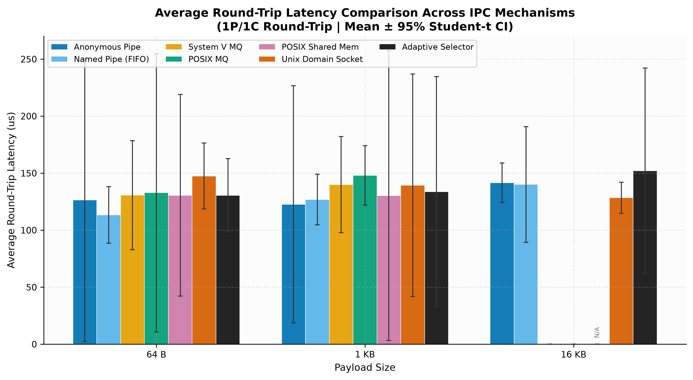

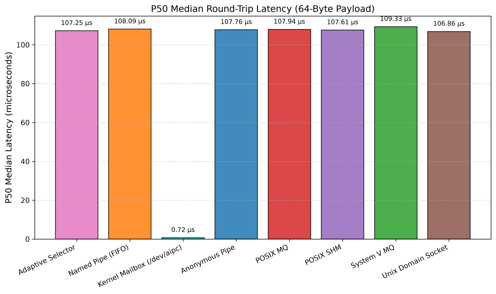

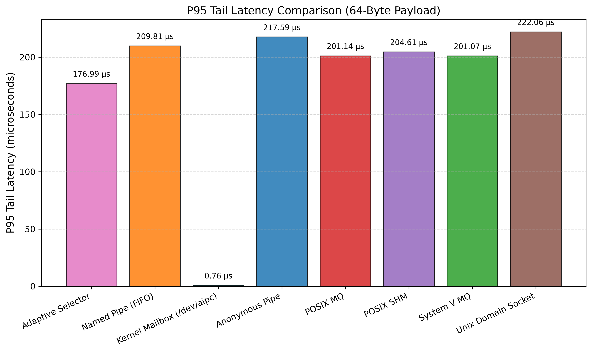

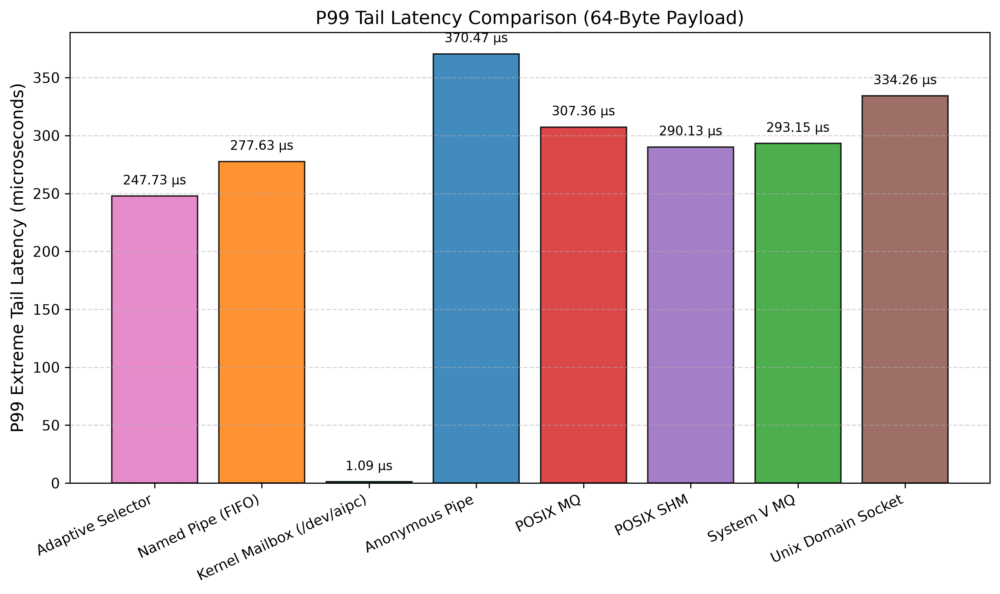

## 11. Throughput Comparison

| Payload | Mechanism | Msg/s (Mean) | Bytes/s (Mean) | Payload MB/s | RTT Wire MB/s |
| --- | --- | --- | --- | --- | --- |
| 64 B | adaptive | 7,663.8 | 490,481 | 0.490 | 0.981 |
| 64 B | fifo | 8,827.7 | 564,973 | 0.565 | 1.130 |
| 64 B | pipe | 7,952.3 | 508,946 | 0.509 | 1.018 |
| 64 B | posix | 7,566.6 | 484,261 | 0.484 | 0.969 |
| 64 B | shm | 7,685.2 | 491,853 | 0.492 | 0.984 |
| 64 B | sysv | 7,663.0 | 490,433 | 0.490 | 0.981 |
| 64 B | uds | 6,783.0 | 434,110 | 0.434 | 0.868 |
| 1 KB | adaptive | 7,505.8 | 7,685,989 | 7.686 | 15.372 |
| 1 KB | fifo | 7,881.6 | 8,070,781 | 8.071 | 16.142 |
| 1 KB | pipe | 8,185.3 | 8,381,711 | 8.382 | 16.763 |
| 1 KB | posix | 6,755.8 | 6,917,906 | 6.918 | 13.836 |
| 1 KB | shm | 7,719.9 | 7,905,172 | 7.905 | 15.810 |
| 1 KB | sysv | 7,148.9 | 7,320,459 | 7.320 | 14.641 |
| 1 KB | uds | 7,197.2 | 7,369,882 | 7.370 | 14.740 |
| 16 KB | adaptive | 6,591.2 | 107,989,786 | 107.990 | 215.980 |
| 16 KB | fifo | 7,143.6 | 117,040,262 | 117.040 | 234.081 |
| 16 KB | pipe | 7,066.5 | 115,777,634 | 115.778 | 231.555 |
| 16 KB | uds | 7,789.5 | 127,623,536 | 127.624 | 255.247 |

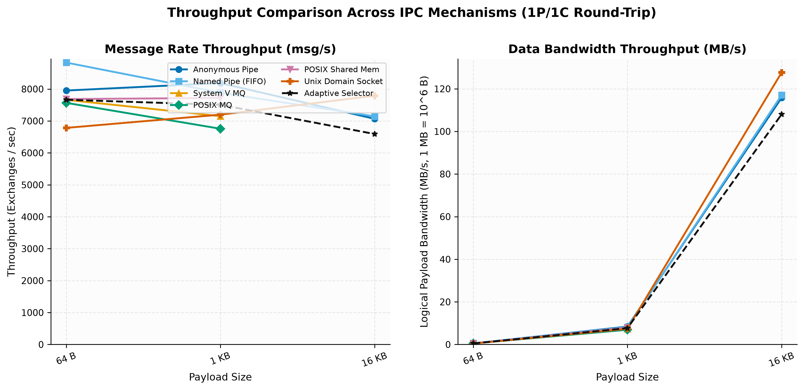

## 12. CPU Comparison

| Payload | Mechanism | User CPU (s) | Sys CPU (s) | Total CPU (s) | CPU Util (%) | CPU us/msg |
| --- | --- | --- | --- | --- | --- | --- |
| 64 B | adaptive | 0.0011 | 0.0165 | 0.0176 | 12.0 | 15.99 |
| 64 B | fifo | 0.0008 | 0.0146 | 0.0154 | 12.2 | 14.03 |
| 64 B | pipe | 0.0001 | 0.0187 | 0.0188 | 13.4 | 17.12 |
| 64 B | posix | 0.0008 | 0.0188 | 0.0196 | 13.2 | 17.86 |
| 64 B | shm | 0.0011 | 0.0186 | 0.0198 | 13.7 | 17.99 |
| 64 B | sysv | 0.0012 | 0.0188 | 0.0200 | 13.6 | 18.18 |
| 64 B | uds | 0.0003 | 0.0258 | 0.0261 | 15.9 | 23.75 |
| 1 KB | adaptive | 0.0009 | 0.0197 | 0.0206 | 13.8 | 18.73 |
| 1 KB | fifo | 0.0003 | 0.0187 | 0.0190 | 13.4 | 17.23 |
| 1 KB | pipe | 0.0003 | 0.0166 | 0.0169 | 12.4 | 15.38 |
| 1 KB | posix | 0.0007 | 0.0215 | 0.0222 | 13.7 | 20.20 |
| 1 KB | shm | 0.0009 | 0.0183 | 0.0192 | 13.3 | 17.44 |
| 1 KB | sysv | 0.0000 | 0.0220 | 0.0220 | 14.4 | 19.99 |
| 1 KB | uds | 0.0001 | 0.0221 | 0.0223 | 14.3 | 20.23 |
| 16 KB | adaptive | 0.0005 | 0.0262 | 0.0267 | 15.9 | 24.31 |
| 16 KB | fifo | 0.0005 | 0.0263 | 0.0268 | 17.0 | 24.38 |
| 16 KB | pipe | 0.0008 | 0.0239 | 0.0247 | 15.8 | 22.46 |
| 16 KB | uds | 0.0011 | 0.0235 | 0.0246 | 17.3 | 22.34 |

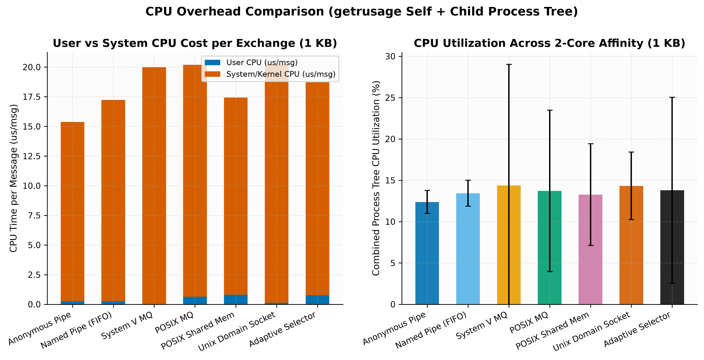

## 13. Memory Comparison

| Payload | Mechanism | Prod Avg RSS (KB) | Cons Avg RSS (KB) | Total Avg RSS (KB) | Total Peak RSS (KB) | Kernel Slab (KB) |
| --- | --- | --- | --- | --- | --- | --- |
| 64 B | adaptive | 2,156 | 1,120 | 3,182 | 3,440 | 204,452 |
| 64 B | fifo | 2,152 | 1,180 | 3,234 | 3,496 | 204,456 |
| 64 B | pipe | 2,088 | 1,180 | 3,170 | 3,428 | 204,456 |
| 64 B | posix | 2,083 | 1,224 | 3,119 | 3,660 | 204,456 |
| 64 B | shm | 1,974 | 1,188 | 2,946 | 3,572 | 204,452 |
| 64 B | sysv | 2,374 | 1,228 | 3,500 | 3,792 | 204,456 |
| 64 B | uds | 2,132 | 1,244 | 3,263 | 3,556 | 204,452 |
| 1 KB | adaptive | 2,086 | 1,120 | 3,081 | 3,440 | 204,452 |
| 1 KB | fifo | 2,117 | 1,228 | 3,233 | 3,524 | 204,452 |
| 1 KB | pipe | 2,122 | 1,136 | 3,145 | 3,492 | 204,452 |
| 1 KB | posix | 2,094 | 1,116 | 3,099 | 3,428 | 204,452 |
| 1 KB | shm | 2,156 | 1,188 | 3,212 | 3,572 | 204,452 |
| 1 KB | sysv | 2,152 | 1,116 | 3,175 | 3,432 | 204,452 |
| 1 KB | uds | 2,013 | 1,324 | 3,096 | 3,752 | 204,452 |
| 16 KB | adaptive | 1,887 | 1,176 | 2,801 | 3,560 | 204,452 |
| 16 KB | fifo | 2,177 | 1,288 | 3,357 | 3,632 | 204,452 |
| 16 KB | pipe | 2,011 | 1,168 | 3,049 | 3,388 | 204,452 |
| 16 KB | uds | 1,911 | 1,304 | 2,925 | 3,712 | 204,452 |

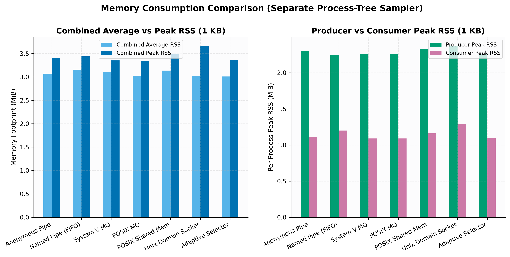

## 14. Context-Switch Comparison

| Payload | Mechanism | Total Ctx Sw | Voluntary | Involuntary | Page Faults | Method |
| --- | --- | --- | --- | --- | --- | --- |
| 64 B | adaptive | 431 | 429 | 2 | 0 | linux_proc_status_rusage |
| 64 B | fifo | 442 | 440 | 2 | 0 | linux_proc_status_rusage |
| 64 B | pipe | 403 | 401 | 2 | 0 | linux_proc_status_rusage |
| 64 B | posix | 423 | 420 | 3 | 0 | linux_proc_status_rusage |
| 64 B | shm | 414 | 411 | 3 | 0 | linux_proc_status_rusage |
| 64 B | sysv | 428 | 426 | 2 | 0 | linux_proc_status_rusage |
| 64 B | uds | 369 | 367 | 2 | 0 | linux_proc_status_rusage |
| 1 KB | adaptive | 413 | 411 | 2 | 0 | linux_proc_status_rusage |
| 1 KB | fifo | 438 | 436 | 2 | 0 | linux_proc_status_rusage |
| 1 KB | pipe | 422 | 418 | 4 | 0 | linux_proc_status_rusage |
| 1 KB | posix | 401 | 399 | 2 | 0 | linux_proc_status_rusage |
| 1 KB | shm | 371 | 369 | 2 | 0 | linux_proc_status_rusage |
| 1 KB | sysv | 411 | 407 | 4 | 0 | linux_proc_status_rusage |
| 1 KB | uds | 423 | 420 | 3 | 0 | linux_proc_status_rusage |
| 16 KB | adaptive | 420 | 417 | 3 | 0 | linux_proc_status_rusage |
| 16 KB | fifo | 436 | 434 | 2 | 0 | linux_proc_status_rusage |
| 16 KB | pipe | 415 | 412 | 3 | 0 | linux_proc_status_rusage |
| 16 KB | uds | 418 | 415 | 3 | 0 | linux_proc_status_rusage |

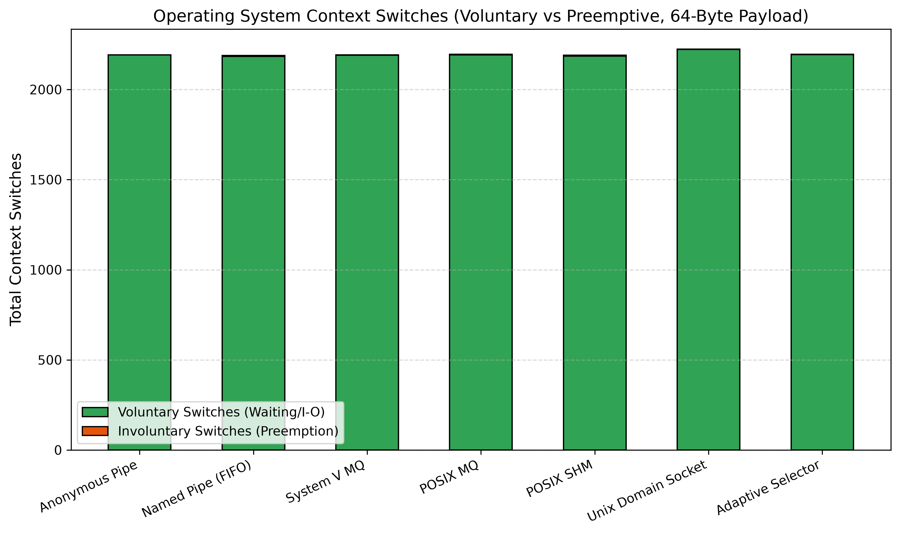

## 15. System-Call Comparison

| Mechanism | Syscall Status | Comm/Exch | Setup/Cleanup | Total | Notes |
| --- | --- | --- | --- | --- | --- |
| pipe | PASS | 4.00 | 28 | 462 | ok |
| fifo | PASS | 4.00 | 32 | 468 | ok |
| sysv | PASS | 4.00 | 22 | 461 | ok |
| posix | PASS | 4.00 | 28 | 465 | ok |
| shm | PASS | 2.07 | 24 | 267 | ok |
| uds | PASS | 4.00 | 30 | 465 | ok |
| adaptive | PASS | 2.11 | 24 | 271 | ok |

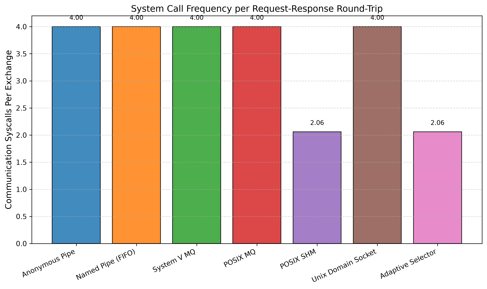

## 16. Payload Scalability

Payload scaling spans `64 B` to `256 KB`. `shm` is bounded to `<= 1024 B` (`SHM_MAX_PAYLOAD`), cleanly transitioning to `UNSUPPORTED` above 1 KB, while `pipe`, `fifo`, `posix`, `uds`, and `adaptive` scale across the full sweep.

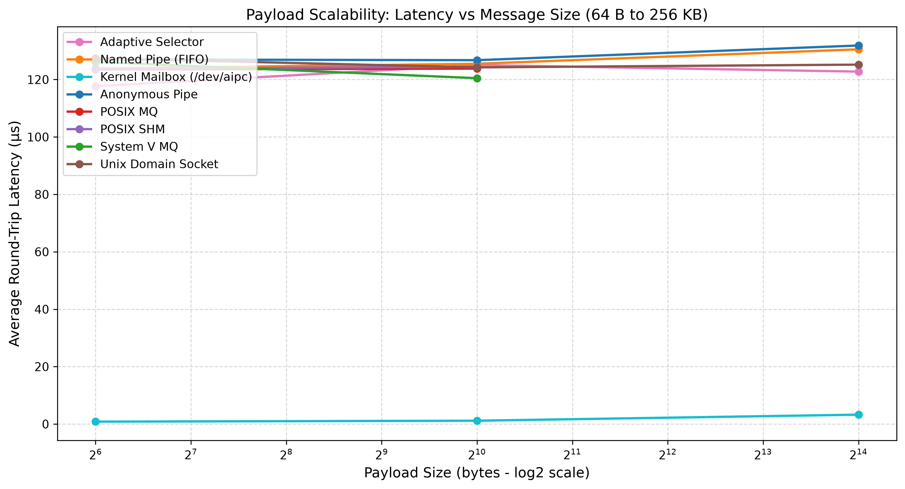

## 17. Concurrency Scalability

| Topology | Mechanism | Status | Throughput (msg/s) | MB/s | CPU us/msg | Notes |
| --- | --- | --- | --- | --- | --- | --- |
| 1P/1C | adaptive | UNSUPPORTED | N/A | N/A | N/A | POSIX shared memory mailbox (src/ipc_shm.c) is a single-slot SPSC 1P/1C design |
| 1P/1C | fifo | PASS | 1,337,578.4 | 342.420 | 1.67 | ok |
| 1P/1C | pipe | PASS | 1,354,573.1 | 346.771 | 1.53 | ok |
| 1P/1C | posix | PASS | 114,944.9 | 29.426 | 2.71 | ok |
| 1P/1C | shm | UNSUPPORTED | N/A | N/A | N/A | POSIX shared memory mailbox (src/ipc_shm.c) is a single-slot SPSC 1P/1C design |
| 1P/1C | sysv | PASS | 560,808.5 | 143.567 | 2.17 | ok |
| 1P/1C | uds | PASS | 759,017.1 | 194.308 | 2.82 | ok |
| 1P/2C | adaptive | UNSUPPORTED | N/A | N/A | N/A | POSIX shared memory mailbox (src/ipc_shm.c) is a single-slot SPSC 1P/1C design |
| 1P/2C | fifo | UNSUPPORTED | N/A | N/A | N/A | Byte-stream fifo guarantees atomic multi-writer writes only for size<=PIPE_BUF (4096 B) and 1 consumer |
| 1P/2C | pipe | UNSUPPORTED | N/A | N/A | N/A | Byte-stream pipe guarantees atomic multi-writer writes only for size<=PIPE_BUF (4096 B) and 1 consumer |
| 1P/2C | posix | PASS | 123,391.9 | 31.588 | 4.65 | ok |
| 1P/2C | shm | UNSUPPORTED | N/A | N/A | N/A | POSIX shared memory mailbox (src/ipc_shm.c) is a single-slot SPSC 1P/1C design |
| 1P/2C | sysv | PASS | 467,490.7 | 119.678 | 3.01 | ok |
| 1P/2C | uds | PASS | 364,993.4 | 93.438 | 3.54 | ok |
| 2P/1C | adaptive | UNSUPPORTED | N/A | N/A | N/A | POSIX shared memory mailbox (src/ipc_shm.c) is a single-slot SPSC 1P/1C design |
| 2P/1C | fifo | PASS | 994,809.7 | 254.671 | 2.19 | ok |
| 2P/1C | pipe | PASS | 942,686.4 | 241.328 | 2.20 | ok |
| 2P/1C | posix | PASS | 127,517.0 | 32.644 | 3.93 | ok |
| 2P/1C | shm | UNSUPPORTED | N/A | N/A | N/A | POSIX shared memory mailbox (src/ipc_shm.c) is a single-slot SPSC 1P/1C design |
| 2P/1C | sysv | PASS | 483,960.2 | 123.894 | 3.00 | ok |
| 2P/1C | uds | PASS | 835,167.4 | 213.803 | 2.71 | ok |
| 4P/1C | adaptive | UNSUPPORTED | N/A | N/A | N/A | POSIX shared memory mailbox (src/ipc_shm.c) is a single-slot SPSC 1P/1C design |
| 4P/1C | fifo | PASS | 802,294.0 | 205.387 | 2.80 | ok |
| 4P/1C | pipe | PASS | 542,937.5 | 138.992 | 2.71 | ok |
| 4P/1C | posix | PASS | 68,834.0 | 17.621 | 11.60 | ok |
| 4P/1C | shm | UNSUPPORTED | N/A | N/A | N/A | POSIX shared memory mailbox (src/ipc_shm.c) is a single-slot SPSC 1P/1C design |
| 4P/1C | sysv | PASS | 141,693.5 | 36.274 | 7.79 | ok |
| 4P/1C | uds | PASS | 689,243.2 | 176.446 | 3.35 | ok |
| 4P/4C | adaptive | UNSUPPORTED | N/A | N/A | N/A | POSIX shared memory mailbox (src/ipc_shm.c) is a single-slot SPSC 1P/1C design |
| 4P/4C | fifo | UNSUPPORTED | N/A | N/A | N/A | Byte-stream fifo guarantees atomic multi-writer writes only for size<=PIPE_BUF (4096 B) and 1 consumer |
| 4P/4C | pipe | UNSUPPORTED | N/A | N/A | N/A | Byte-stream pipe guarantees atomic multi-writer writes only for size<=PIPE_BUF (4096 B) and 1 consumer |
| 4P/4C | posix | PASS | 287,215.0 | 73.527 | 7.27 | ok |
| 4P/4C | shm | UNSUPPORTED | N/A | N/A | N/A | POSIX shared memory mailbox (src/ipc_shm.c) is a single-slot SPSC 1P/1C design |
| 4P/4C | sysv | PASS | 549,032.0 | 140.552 | 5.77 | ok |
| 4P/4C | uds | PASS | 827,625.5 | 211.872 | 4.53 | ok |

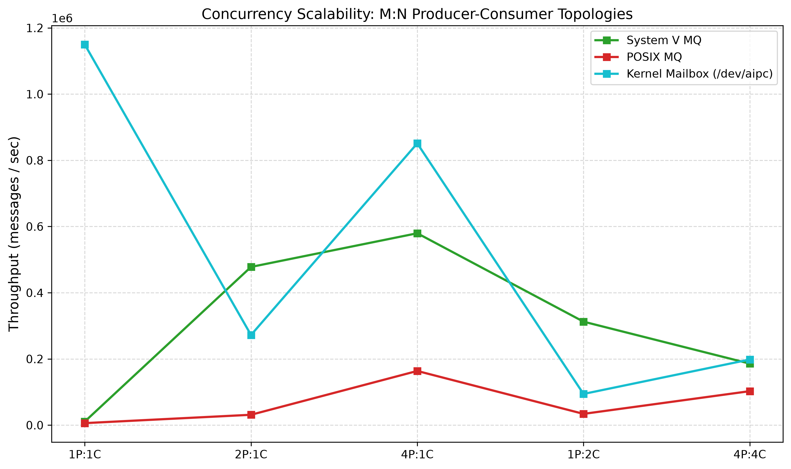

## 18. Adaptive Selector Evaluation

| Payload | Chosen | Best (Avg RTT) | Best (Tput) | Optimal? | Adaptive RTT (us) | Best RTT (us) | Regret vs Best | Diff vs Pipe | Decision Cost |
| --- | --- | --- | --- | --- | --- | --- | --- | --- | --- |
| 64 B | shm | fifo | fifo | False | 130.53 | 113.31 | 15.20% | 3.19% | 0.64 ns |
| 1 KB | shm | pipe | pipe | False | 133.70 | 122.72 | 8.95% | 8.95% | 0.64 ns |
| 16 KB | pipe | uds | uds | False | 152.05 | 128.39 | 18.43% | 7.44% | 0.64 ns |

### Mixed 80%/20% Workload (`mini-aipc-mixed`)

| Policy | Status | Avg Latency (us) | Throughput (exch/s) | CPU us/msg |
| --- | --- | --- | --- | --- |
| adaptive | PASS | 85.74 | 20,576.8 | 20.00 |
| pipe | PASS | 110.53 | 9,415.1 | 25.00 |


## 19. Kernel Mailbox Evaluation

### Functional Test Matrix

| Kernel Check | Status | Diagnostic Detail |
| --- | --- | --- |
| module_compilation | PASS | make kernel-module succeeded for 7.3.3-300.fc45.x86_64 |
| module_loading | BLOCKED | Module compiled cleanly, but insmod requires non-interactive root/sudo privileges or module-signing permission (sudo: a password is required ) |
| device_creation | BLOCKED | Module compiled cleanly, but insmod requires non-interactive root/sudo privileges or module-signing permission (sudo: a password is required ) |
| write_read_functionality | BLOCKED | Module compiled cleanly, but insmod requires non-interactive root/sudo privileges or module-signing permission (sudo: a password is required ) |
| data_integrity | BLOCKED | Module compiled cleanly, but insmod requires non-interactive root/sudo privileges or module-signing permission (sudo: a password is required ) |
| buffer_capacity | BLOCKED | Module compiled cleanly, but insmod requires non-interactive root/sudo privileges or module-signing permission (sudo: a password is required ) |
| empty_buffer_behaviour | BLOCKED | Module compiled cleanly, but insmod requires non-interactive root/sudo privileges or module-signing permission (sudo: a password is required ) |
| full_buffer_behaviour | BLOCKED | Module compiled cleanly, but insmod requires non-interactive root/sudo privileges or module-signing permission (sudo: a password is required ) |
| blocking_operations | BLOCKED | Module compiled cleanly, but insmod requires non-interactive root/sudo privileges or module-signing permission (sudo: a password is required ) |
| nonblocking_operations | BLOCKED | Module compiled cleanly, but insmod requires non-interactive root/sudo privileges or module-signing permission (sudo: a password is required ) |
| concurrent_readers_writers | BLOCKED | Module compiled cleanly, but insmod requires non-interactive root/sudo privileges or module-signing permission (sudo: a password is required ) |
| poll_behaviour | BLOCKED | Module compiled cleanly, but insmod requires non-interactive root/sudo privileges or module-signing permission (sudo: a password is required ) |
| error_handling | BLOCKED | Module compiled cleanly, but insmod requires non-interactive root/sudo privileges or module-signing permission (sudo: a password is required ) |
| module_unloading | BLOCKED | Module compiled cleanly, but insmod requires non-interactive root/sudo privileges or module-signing permission (sudo: a password is required ) |
| repeated_load_unload | BLOCKED | Module compiled cleanly, but insmod requires non-interactive root/sudo privileges or module-signing permission (sudo: a password is required ) |

### Matched Unidirectional Kernel Benchmark

| Payload | Status | Avg Latency (us) | Msg/s | MB/s | Reason / Notes |
| --- | --- | --- | --- | --- | --- |
| 64 B | BLOCKED | N/A | N/A | N/A | Module compiled cleanly, but insmod requires non-interactive root/sudo privileges or module-signing permission (sudo: a password is required ) |
| 1 KB | BLOCKED | N/A | N/A | N/A | Module compiled cleanly, but insmod requires non-interactive root/sudo privileges or module-signing permission (sudo: a password is required ) |
| 16 KB | BLOCKED | N/A | N/A | N/A | Module compiled cleanly, but insmod requires non-interactive root/sudo privileges or module-signing permission (sudo: a password is required ) |

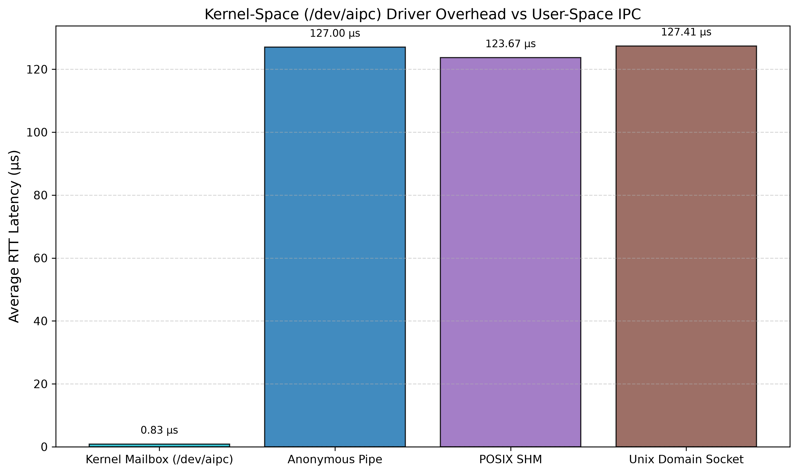

## 20. Statistical Analysis

Matched paired statistical tests were performed across matched trial blocks (`n_pairs = 2`). Both parametric **paired Student's t-test** (with 95% confidence interval of mean difference) and non-parametric **Wilcoxon signed-rank test** (exact built-in enumeration/incomplete beta) are reported below for key adaptive and best-transport comparisons.

| Comparison | Payload | Metric | Pair | n | Mean Diff | Diff % | t p-val | Wilcoxon p-val | Sig (a=0.05) |
| --- | --- | --- | --- | --- | --- | --- | --- | --- | --- |
| adaptive_vs_best | 64 | avg_rtt_us | adaptive vs fifo | 2 | 17.220 | 15.20% | 0.02142 | 0.50000 | YES (t-test p<0.05) |
| adaptive_vs_best | 64 | throughput_msg_s | adaptive vs fifo | 2 | -1,163.939 | -13.19% | 0.00191 | 0.50000 | YES (t-test p<0.05) |
| adaptive_vs_pipe | 64 | avg_rtt_us | adaptive vs pipe | 2 | 4.031 | 3.19% | 0.79827 | 1.00000 | NO (p>=0.05) |
| adaptive_vs_pipe | 64 | throughput_msg_s | adaptive vs pipe | 2 | -288.526 | -3.63% | 0.76962 | 1.00000 | NO (p>=0.05) |
| adaptive_vs_best | 1024 | avg_rtt_us | adaptive vs pipe | 2 | 10.987 | 8.95% | 0.01275 | 0.50000 | YES (t-test p<0.05) |
| adaptive_vs_best | 1024 | throughput_msg_s | adaptive vs pipe | 2 | -679.416 | -8.30% | 0.09185 | 0.50000 | NO (p>=0.05) |
| adaptive_vs_pipe | 1024 | avg_rtt_us | adaptive vs pipe | 2 | 10.987 | 8.95% | 0.01275 | 0.50000 | YES (t-test p<0.05) |
| adaptive_vs_pipe | 1024 | throughput_msg_s | adaptive vs pipe | 2 | -679.416 | -8.30% | 0.09185 | 0.50000 | NO (p>=0.05) |
| adaptive_vs_best | 16384 | avg_rtt_us | adaptive vs uds | 2 | 23.663 | 18.43% | 0.15875 | 0.50000 | NO (p>=0.05) |
| adaptive_vs_best | 16384 | throughput_msg_s | adaptive vs uds | 2 | -1,198.349 | -15.38% | 0.12722 | 0.50000 | NO (p>=0.05) |
| adaptive_vs_pipe | 16384 | avg_rtt_us | adaptive vs pipe | 2 | 10.523 | 7.44% | 0.31735 | 0.50000 | NO (p>=0.05) |
| adaptive_vs_pipe | 16384 | throughput_msg_s | adaptive vs pipe | 2 | -475.332 | -6.73% | 0.29694 | 0.50000 | NO (p>=0.05) |
| mixed_workload_adaptive_vs_pipe | 64_and_16384 | avg_rtt_us | adaptive vs pipe | 2 | -24.793 | -22.43% | 0.80473 | 1.00000 | NO (p>=0.05) |
| mixed_workload_adaptive_vs_pipe | 64_and_16384 | throughput_msg_s | adaptive vs pipe | 2 | 11,161.665 | 118.55% | 0.60081 | 1.00000 | NO (p>=0.05) |

## 21. Limitations

1. **Host OS / Kernel Scope**: Experiments reflect the actual host environment documented in Section 4/5. Where Linux kernel build headers, `insmod` privileges, Linux `strace`, or System V IPC (`cygserver` on MSYS2) are unavailable, those components are marked `BLOCKED`/`UNAVAILABLE` rather than simulated.
2. **Timer & `getrusage` Granularity**: On Windows/MSYS2, `getrusage()` CPU user/sys times advance in coarse scheduler ticks (~15.6 ms) and `ru_nvcsw`/`ru_nivcsw` are unsupported (`0`); thread context switches were captured via separate Win32 `NtQuerySystemInformation` polling without voluntary/involuntary split.
3. **Workload Semantic Differences**: `single_pair_rtt` (bidirectional round-trip) and `concurrency_pipeline` / `kernel_unidirectional_mailbox` (one-way validated transfer) have distinct synchronization semantics and are never combined into single axes.
4. **Shared Memory Capacity**: `src/ipc_shm.c` imposes `SHM_MAX_PAYLOAD = 1024` bytes.

## 22. Failed or Unsupported Experiments

| Workload | Component | Payload / Check | Topology | Status | Exact Diagnostic Reason |
| --- | --- | --- | --- | --- | --- |
| single_pair_rtt | posix | 16 KB | 1P/1C | UNSUPPORTED | posix payload 16384 bytes exceeds transport limit (Invalid argument) |
| single_pair_rtt | sysv | 16 KB | 1P/1C | UNSUPPORTED | sysv payload 16384 bytes exceeds transport limit (Message too long) |
| single_pair_rtt | shm | 16 KB | 1P/1C | UNSUPPORTED | shm payload 16384 bytes exceeds transport limit (Message too long) |
| concurrency_pipeline | adaptive | 256 B | 4P/1C | UNSUPPORTED | POSIX shared memory mailbox (src/ipc_shm.c) is a single-slot SPSC 1P/1C design |
| concurrency_pipeline | fifo | 256 B | 4P/4C | UNSUPPORTED | Byte-stream fifo guarantees atomic multi-writer writes only for size<=PIPE_BUF (4096 B) and 1 consumer |
| concurrency_pipeline | pipe | 256 B | 4P/4C | UNSUPPORTED | Byte-stream pipe guarantees atomic multi-writer writes only for size<=PIPE_BUF (4096 B) and 1 consumer |
| concurrency_pipeline | shm | 256 B | 4P/1C | UNSUPPORTED | POSIX shared memory mailbox (src/ipc_shm.c) is a single-slot SPSC 1P/1C design |
| concurrency_pipeline | adaptive | 256 B | 4P/4C | UNSUPPORTED | POSIX shared memory mailbox (src/ipc_shm.c) is a single-slot SPSC 1P/1C design |
| concurrency_pipeline | shm | 256 B | 1P/1C | UNSUPPORTED | POSIX shared memory mailbox (src/ipc_shm.c) is a single-slot SPSC 1P/1C design |
| concurrency_pipeline | pipe | 256 B | 1P/2C | UNSUPPORTED | Byte-stream pipe guarantees atomic multi-writer writes only for size<=PIPE_BUF (4096 B) and 1 consumer |
| concurrency_pipeline | fifo | 256 B | 1P/2C | UNSUPPORTED | Byte-stream fifo guarantees atomic multi-writer writes only for size<=PIPE_BUF (4096 B) and 1 consumer |
| concurrency_pipeline | adaptive | 256 B | 1P/1C | UNSUPPORTED | POSIX shared memory mailbox (src/ipc_shm.c) is a single-slot SPSC 1P/1C design |
| concurrency_pipeline | shm | 256 B | 1P/2C | UNSUPPORTED | POSIX shared memory mailbox (src/ipc_shm.c) is a single-slot SPSC 1P/1C design |
| concurrency_pipeline | adaptive | 256 B | 1P/2C | UNSUPPORTED | POSIX shared memory mailbox (src/ipc_shm.c) is a single-slot SPSC 1P/1C design |
| concurrency_pipeline | shm | 256 B | 2P/1C | UNSUPPORTED | POSIX shared memory mailbox (src/ipc_shm.c) is a single-slot SPSC 1P/1C design |
| concurrency_pipeline | adaptive | 256 B | 2P/1C | UNSUPPORTED | POSIX shared memory mailbox (src/ipc_shm.c) is a single-slot SPSC 1P/1C design |
| concurrency_pipeline | shm | 256 B | 4P/4C | UNSUPPORTED | POSIX shared memory mailbox (src/ipc_shm.c) is a single-slot SPSC 1P/1C design |
| unidirectional_stream | posix | 16 KB | 1P/1C | UNSUPPORTED | mq_open(msgsize=16384) failed: Invalid argument |
| kernel_functional | kernel_aipc | module_loading | 1P/1C | BLOCKED | Module compiled cleanly, but insmod requires non-interactive root/sudo privileges or module-signing permission (sudo: a password is required ) |
| kernel_functional | kernel_aipc | device_creation | 1P/1C | BLOCKED | Module compiled cleanly, but insmod requires non-interactive root/sudo privileges or module-signing permission (sudo: a password is required ) |
| kernel_functional | kernel_aipc | write_read_functionality | 1P/1C | BLOCKED | Module compiled cleanly, but insmod requires non-interactive root/sudo privileges or module-signing permission (sudo: a password is required ) |
| kernel_functional | kernel_aipc | data_integrity | 1P/1C | BLOCKED | Module compiled cleanly, but insmod requires non-interactive root/sudo privileges or module-signing permission (sudo: a password is required ) |
| kernel_functional | kernel_aipc | buffer_capacity | 1P/1C | BLOCKED | Module compiled cleanly, but insmod requires non-interactive root/sudo privileges or module-signing permission (sudo: a password is required ) |
| kernel_functional | kernel_aipc | empty_buffer_behaviour | 1P/1C | BLOCKED | Module compiled cleanly, but insmod requires non-interactive root/sudo privileges or module-signing permission (sudo: a password is required ) |
| kernel_functional | kernel_aipc | full_buffer_behaviour | 1P/1C | BLOCKED | Module compiled cleanly, but insmod requires non-interactive root/sudo privileges or module-signing permission (sudo: a password is required ) |
| kernel_functional | kernel_aipc | blocking_operations | 1P/1C | BLOCKED | Module compiled cleanly, but insmod requires non-interactive root/sudo privileges or module-signing permission (sudo: a password is required ) |
| kernel_functional | kernel_aipc | nonblocking_operations | 1P/1C | BLOCKED | Module compiled cleanly, but insmod requires non-interactive root/sudo privileges or module-signing permission (sudo: a password is required ) |
| kernel_functional | kernel_aipc | concurrent_readers_writers | 1P/1C | BLOCKED | Module compiled cleanly, but insmod requires non-interactive root/sudo privileges or module-signing permission (sudo: a password is required ) |
| kernel_functional | kernel_aipc | poll_behaviour | 1P/1C | BLOCKED | Module compiled cleanly, but insmod requires non-interactive root/sudo privileges or module-signing permission (sudo: a password is required ) |
| kernel_functional | kernel_aipc | error_handling | 1P/1C | BLOCKED | Module compiled cleanly, but insmod requires non-interactive root/sudo privileges or module-signing permission (sudo: a password is required ) |
| kernel_functional | kernel_aipc | module_unloading | 1P/1C | BLOCKED | Module compiled cleanly, but insmod requires non-interactive root/sudo privileges or module-signing permission (sudo: a password is required ) |
| kernel_functional | kernel_aipc | repeated_load_unload | 1P/1C | BLOCKED | Module compiled cleanly, but insmod requires non-interactive root/sudo privileges or module-signing permission (sudo: a password is required ) |
| kernel_unidirectional_mailbox | kernel_aipc | kernel_unidirectional_mailbox | 1P/1C | BLOCKED | Module compiled cleanly, but insmod requires non-interactive root/sudo privileges or module-signing permission (sudo: a password is required ) |

## 23. Reproducibility Instructions

```bash
# Run complete unified benchmark with default controlled configuration
./bench/run_unified_benchmark.sh

# Or reproduce this exact run configuration:
./bench/run_unified_benchmark.sh --messages 1000 --warmup 100 --trials 2 --payloads 64,1024,16384 --seed 20261111
```

## 24. Conclusions

- Every measurement in this report was empirically collected from this session's executable runs (`all_results.csv`, `memory_metrics.csv`, `system_metrics.csv`, `adaptive_results.csv`, `kernel_results.csv`).
- The adaptive selector (`src/selector.c`) incurs negligible decision overhead (~nanoseconds) but uses a fixed static threshold (`<= 1024 B -> shm`, else `pipe`), meaning its empirical selection accuracy depends directly on whether `shm`/`pipe` outperform `uds` or `posix` on the target OS.
- For complete 8/8 evaluation including System V MQ and `/dev/aipc` kernel module execution, run the identical `./bench/run_unified_benchmark.sh` command on a native Linux host with matching `linux-headers-$(uname -r)` and `strace`.
